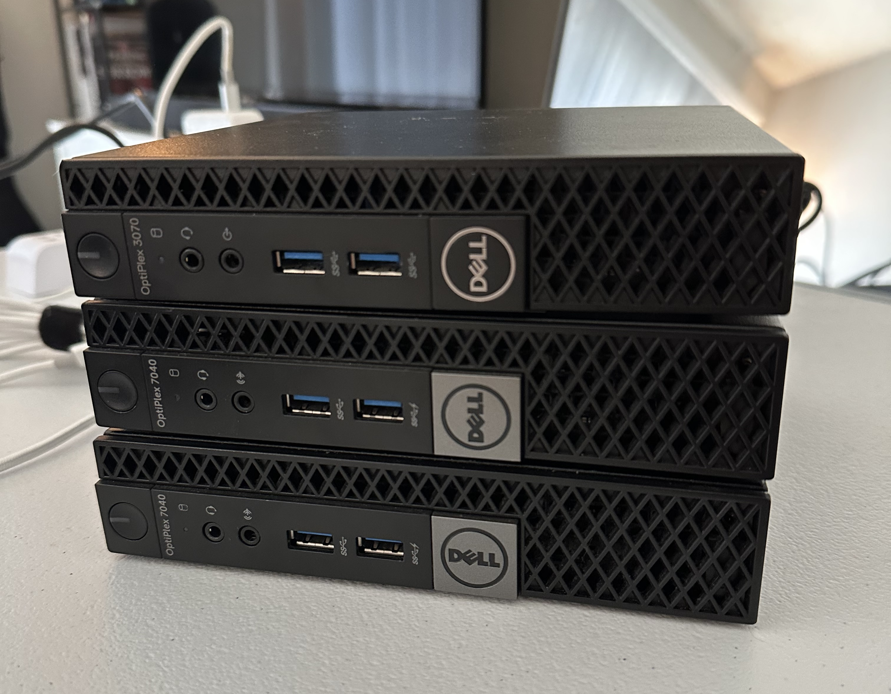
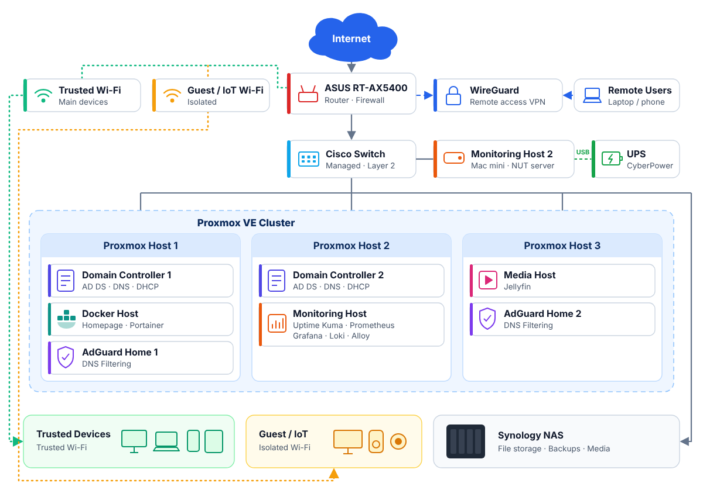
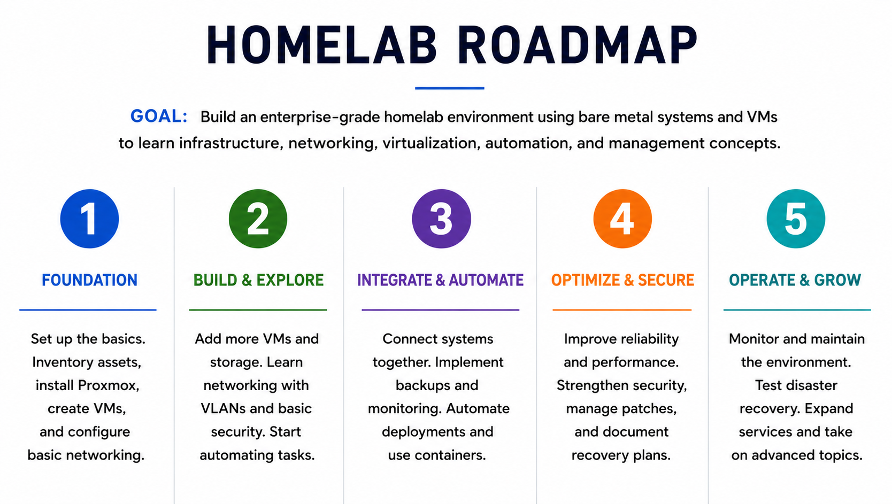

# EC-Builds | Enterprise Homelab

I'm Emmanuel Casillas, a systems administrator with eight years in enterprise IT, focused on Windows and Linux infrastructure, identity, and security. This lab is where I build, test, and document the kinds of systems I've supported at work, running on a three-node Proxmox cluster with managed switching and dedicated storage.

Each project is built, tested against failure where it matters, and documented: deployments, validation, upgrades, and lessons learned.

[LinkedIn](https://www.linkedin.com/in/casillasemmanuel) · [emmanuelcasillas.com](https://emmanuelcasillas.com) · [ec-builds.com](https://ec-builds.com)

## Highlights

- **Redundant Active Directory, DNS, and DHCP.** Two domain controllers on separate Proxmox hosts, with DHCP failover and redundant DNS forwarding, validated by taking each server offline in turn. ➡️ [Active Directory Lab](projects/active-directory-lab/)
- **Proxmox cluster operations.** A three-node cluster maintained with node-by-node upgrades, VM migration, workload evacuation, and a documented hardware node replacement. ➡️ [Virtualization Lab](projects/virtualization-lab/)
- **Monitoring and observability.** Prometheus, Grafana, Loki, and Uptime Kuma covering Proxmox hosts, Linux VMs, network devices, and service availability. ➡️ [Infrastructure Monitoring](projects/infrastructure-monitoring/)
- **Microsoft Intune and Entra ID.** Device enrollment, compliance policies with noncompliance testing and remediation, application deployment, and Windows Update management. ➡️ [Microsoft Intune Lab](projects/microsoft-intune/)
- **Documented like production.** Standards for naming, sanitization, and documentation, plus architecture decision records and lessons-learned logs. ➡️ [Standards](docs/standards/)

## Navigation

| README Section | Description |
|---|---|
| [Highlights](#highlights) | The strongest work in the lab, with links |
| [Equipment](#equipment) | Physical compute, networking, and storage hardware |
| [Current Infrastructure](#current-infrastructure) | Current and planned infrastructure components |
| [Architecture Overview](#architecture-overview) | Logical topology and infrastructure domains |
| [Project Portfolio](#project-portfolio) | Hands-on infrastructure projects and their status |
| [Roadmap](#roadmap) | Planned infrastructure projects and future lab development |
| [Approach](#approach) | Build approach and documentation workflow |
| [Technology Stack](#technology-stack) | Technologies and platforms used throughout the lab |
| [Core Documents](#core-documents) | Architecture, standards, references, and supporting documentation |

## Equipment

The homelab is built on repurposed hardware, managed networking equipment, and dedicated storage platforms. Take a look at the equipment inventory below for more info. My focus is on compact hardware where possible. Space is hard to come by in LA. 

  

➡️ **[See Equipment Inventory](./docs/equipment-inventory.md)**

## Current Infrastructure

| Category | Current | Planned |
|----------|---------|---------|
| Router / Firewall | ASUS RT-AX5400 | OPNsense Firewall |
| Switching | Cisco Catalyst 3560CG | VLAN Segmentation |
| Storage | Synology DS718+ | — |
| Virtualization | Three-Node Proxmox VE Cluster | Continue expanding virtualized services |
| Identity | Windows Server Active Directory | Additional identity services and hybrid integration |
| Containers | Docker Self-Hosted Services Platform | Continue expanding containerized services |
| Monitoring | Prometheus, Grafana, Loki, Grafana Alloy, Uptime Kuma; alerts to Discord from Uptime Kuma, NUT, Proxmox and the Synology | Alertmanager alerting, additional exporters and dashboards |
| Power | CyberPower UPS, NUT server on a standalone Mac mini, Proxmox and NAS clients | Full outage test |
| Networking | Managed Switching, Redundant Windows DHCP, Active Directory-integrated DNS, AdGuard DNS Filtering, DNS-over-HTTPS, WireGuard | VLAN Segmentation, Inter-VLAN Firewall Policies |
| Documentation | GitHub + Markdown | Continue expanding standards, references, and runbooks |

## Architecture Overview

A three-node Proxmox VE cluster and Synology NAS on a managed Cisco switch, hosting Active Directory, network services, Docker workloads, and a full monitoring stack, all on a UPS that shuts the lab down cleanly during an outage and brings it back afterwards. Next up: an OPNsense firewall, VLAN segmentation, a reverse proxy, IDS/IPS, and proper backups with tested restores. There's still a lot to do.

### Core network services

- **Routing & firewall** — ASUS RT-AX5400 (stateful firewall, NAT)
- **Switching** — Cisco Catalyst 3560CG managed switch
- **DHCP** — redundant Windows Server failover pair
- **DNS** — Active Directory-integrated, forwarding to redundant AdGuard Home instances for filtering and DNS-over-HTTPS
- **Remote access** — WireGuard VPN
- **Wireless isolation** — guest and IoT devices separated from the trusted network

### Hosted services

- **Containers & monitoring** — a Docker host for self-hosted apps and a dedicated monitoring host
- **Storage** — Synology NAS for centralized file storage and Active Backup for Business
- **Media services** — Jellyfin on a dedicated Debian VM, where this lab started
- **Power protection** — a CyberPower UPS with a NUT server on a standalone Mac mini. The Proxmox nodes and the NAS shut down automatically during an outage, and the UPS power-cycles its outlets so everything restarts.

## Project Portfolio

### Project Status Legend

| Status | Meaning |
|--------|---------|
| 🟢 **Operational** | Deployed, documented, and working as intended |
| 🟡 **In Progress** | Currently being built, configured, or tested |
| ⚪ **Planned** | Defined and included in the project roadmap |

| Project | Focus Area | Status |
|----------|------------|:------:|
| [Active Directory Lab](projects/active-directory-lab/) | Windows Server, AD DS, DNS, DHCP (Group Policy planned) | 🟢 |
| [Backup & Disaster Recovery](projects/backup-disaster-recovery/) | Backup strategy, restore testing, DR runbooks | 🟡 |
| [Containerization-Lab](projects/containerization-lab/) | Containerized self-hosted applications, Docker | 🟢 |
| [Infrastructure Automation](projects/infrastructure-automation/) | Terraform, Ansible, IaC, configuration management | 🟡 |
| [Infrastructure Monitoring](projects/infrastructure-monitoring/) | Prometheus, Grafana, alerting, observability | 🟢 |
| [Media Services Platform](projects/media-services-platform/) | Linux administration, storage, service deployment | 🟢 |
| [Microsoft 365 & Entra ID Lab](projects/microsoft-365-entra-id/) | Microsoft 365, Entra ID, hybrid identity | 🟡 |
| [Microsoft Intune Lab](projects/microsoft-intune/) | Intune, MDM, compliance, app deployment, Windows Update | 🟢 |
| [Network Infrastructure](projects/network-infrastructure/) | Routing, switching, DHCP, DNS, and network services | 🟢 |
| [Network Security](projects/network-security/) | Firewall, DNS security, VPN (segmentation planned) | 🟡 |
| [Virtualization Lab](projects/virtualization-lab/) | Proxmox, VM lifecycle, lab foundation | 🟢 |
| [Security Operations](projects/security-operations/) | SIEM, detection engineering, incident response | ⚪ |
| [Web Platform & Secure Delivery](projects/web-platform/) | Astro, Cloudflare Workers, CI/CD, web security, DNS | 🟢 |

Take a look at all the projects here:

➡️ **[Browse All Projects](./projects/README.md)**

## Roadmap

Roadmaps are great! I refer back to this when I find myself lost and wondering what the next step is. This roadmap outlines the planned evolution of the homelab, highlighting current priorities and future infrastructure projects.

➡️ **[See Roadmap Doc](docs/roadmap.md)**

## Approach

This lab is built on repurposed and affordable hardware to practice enterprise IT the way it's run at work: plan it, build it, document it, and keep it maintained.

I use AI to help draft and review documentation, speed up research, and pressure-test design decisions. The builds, configurations, and troubleshooting are my own.

## Technology Stack

Technologies used in the lab, organized by infrastructure layer. 

➡️ **[See Tool Catalog](docs/tool-catalog.md)**

## Core Documents

| Document | Description |
|----------|-------------|
| [`docs/homelab-decisions.md`](docs/homelab-decisions.md) | Architecture decisions and reasoning |
| [`docs/homelab-direction.md`](docs/homelab-direction.md) | Strategic direction, priorities, and long-term goals |
| [`docs/reference/`](docs/reference/) | Quick reference guides and cheat sheets |
| [`docs/standards/`](docs/standards/) | Baseline configurations, naming conventions, and documentation standards |
| [`docs/tool-catalog.md`](docs/tool-catalog.md) | Quick reference of technologies used throughout the homelab |

## EC-Builds

This repo is part of the **EC-Builds** project, where I document technical projects, infrastructure builds, and lessons learned while continuing to develop skills in enterprise IT and systems administration.

## Connect

