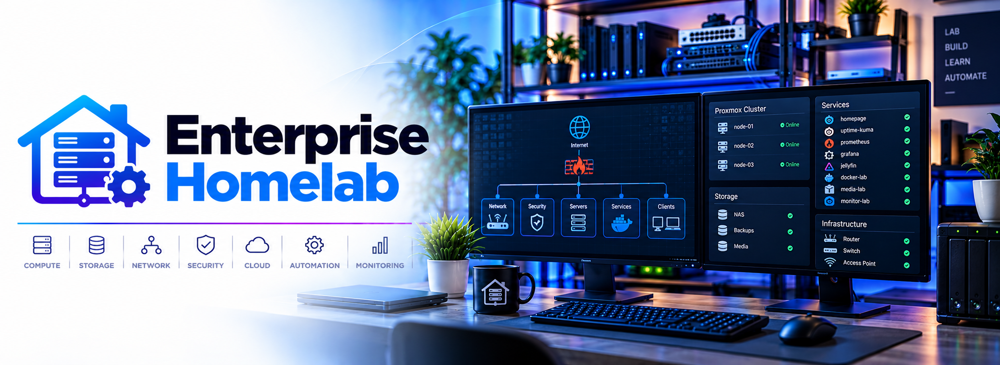
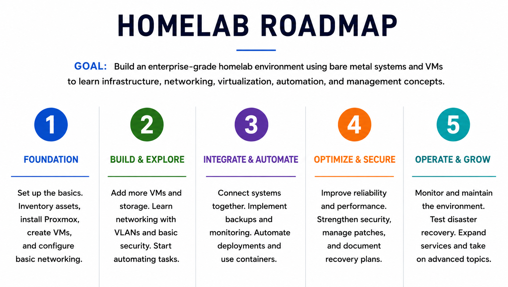
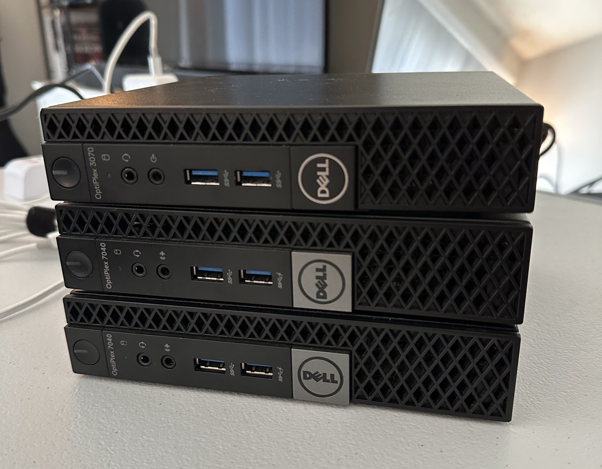
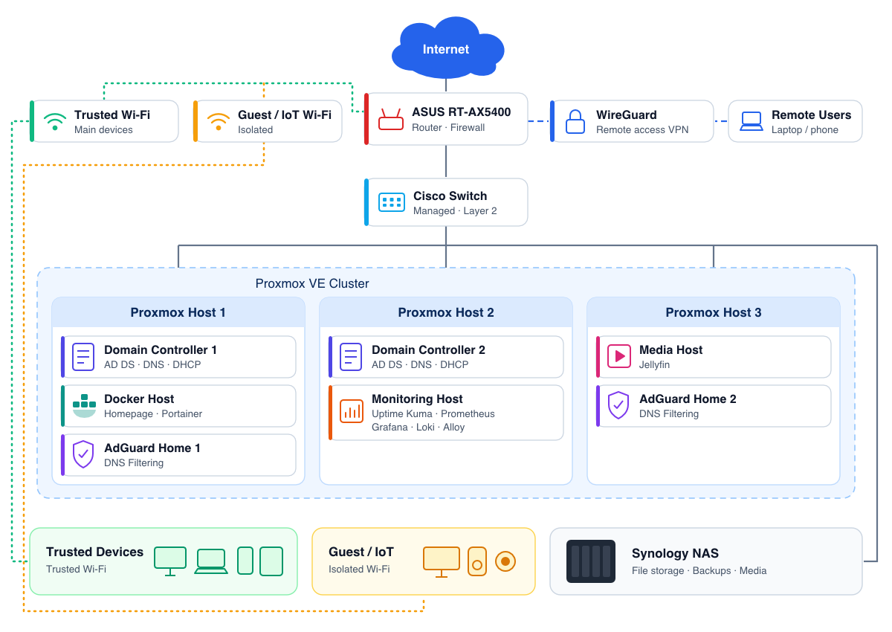

# EC-Builds | Enterprise Homelab

Welcome to my Homelab!

This repository showcases my enterprise-focused homelab, where I build and document hands-on projects in systems administration, networking, Microsoft infrastructure and identity, Linux, automation, virtualization, and cloud technologies. 

Have a look around. I'm regularly updating projects as I build out this repo. If you find this information useful, consider following along. 

## Navigation

| README Section | Description |
|---|---|
| [Roadmap](#roadmap) | Planned infrastructure projects and future lab development |
| [Equipment](#equipment) | Physical compute, networking, and storage hardware |
| [Current Infrastructure](#current-infrastructure) | Current and planned infrastructure components |
| [Architecture Overview](#architecture-overview) | Logical topology and infrastructure domains |
| [Project Portfolio](#project-portfolio) | Hands-on infrastructure projects and their status |
| [Approach](#approach) | Build approach and documentation workflow |
| [Technology Stack](#technology-stack) | Technologies and platforms used throughout the lab |
| [Core Documents](#core-documents) | Architecture, standards, references, and supporting documentation |

## Roadmap

Roadmaps are great! I refer back to this when I find myself lost and wondering what the next step is. This roadmap outlines the planned evolution of the homelab, highlighting current priorities and future infrastructure projects.

➡️ **[See Roadmap Doc](docs/roadmap.md)**

## Equipment

The homelab is built on repurposed hardware, managed networking equipment, and dedicated storage platforms. Take a look at the equipment inventory below for more info. My focus is on compact hardware where possible. Space is hard to come by in LA. 

  

➡️ **[See Equipment Inventory](./docs/equipment-inventory.md)**

## Current Infrastructure

| Category | Current | Planned |
|----------|---------|---------|
| Router / Firewall | ASUS RT-AX5400 | OPNsense Firewall |
| Switching | Cisco Catalyst 3560CG | VLAN Segmentation |
| Storage | Synology DS718+ | — |
| Virtualization | Three-Node Proxmox VE Cluster | Continue expanding virtualized services |
| Identity | Windows Server Active Directory | Additional identity services and hybrid integration |
| Containers | Docker Self-Hosted Services Platform | Continue expanding containerized services |
| Monitoring | Prometheus, Grafana, Loki, Alertmanager, Grafana Alloy, Uptime Kuma | Additional exporters, dashboards, and alerting |
| Networking | Managed Switching, Redundant Windows DHCP, Active Directory-integrated DNS, AdGuard DNS Filtering, DNS-over-HTTPS, WireGuard | VLAN Segmentation, Inter-VLAN Firewall Policies |
| Documentation | GitHub + Markdown | Continue expanding standards, references, and runbooks |

## Architecture Overview

A three-node Proxmox VE cluster and Synology NAS on a managed Cisco switch, hosting Active Directory, network services, Docker workloads, and a full monitoring stack. Next up: an OPNsense firewall, VLAN segmentation, a reverse proxy, IDS/IPS, and proper backups. There's still a lot to do.

### Core network services:

- **Routing & firewall** — ASUS RT-AX5400 (stateful firewall, NAT)
- **Switching** — Cisco Catalyst 3560CG managed switch
- **DHCP** — redundant Windows Server failover pair
- **DNS** — Active Directory-integrated, forwarding to redundant AdGuard Home instances for filtering and DNS-over-HTTPS
- **Remote access** — WireGuard VPN
- **Wireless isolation** — guest and IoT devices separated from the trusted network

### Hosted services:

- **Containers & monitoring** — Multiple Docker host VM's running self-hosted apps and the monitoring stack
- **Storage** — Synology NAS for centralized file storage and Active Backup for Business
- **Media services** — A dedicated Debian VM and how this lab started

<b>View by infrastructure domain</b>

The same environment, viewed by function:

| Domain | Scope | Status |
|--------|-------|--------|
| Network Infrastructure | Routing, switching, DHCP, DNS, DNS filtering | 🟢 |
| Network Security | Firewall, WireGuard, DNS security, wireless isolation | 🟢 |
| Virtualization | Proxmox cluster, VM lifecycle, storage, virtual networking | 🟢 |
| Identity & Access | Active Directory, Group Policy | 🟢 |
| Infrastructure Monitoring | Availability, metrics, logs, dashboards, alerting | 🟢 |
| Containerized Services | Docker Compose, app hosting | 🟢 |
| Media Services | Media apps, Linux admin, NAS integration | 🟢 |
| Security Operations | Detection, security monitoring, incident response | ⚪ |
| Automation & DevOps | Infrastructure as code, configuration management | ⚪ |

## Project Portfolio

### Project Status Legend

| Status | Meaning |
|--------|---------|
| 🟢 **Operational** | Deployed, documented, and working as intended |
| 🟡 **In Progress** | Currently being built, configured, or tested |
| ⚪ **Planned** | Defined and included in the project roadmap |

> [!NOTE]
> Projects are documented independently and may progress at different rates depending on current learning objectives and infrastructure priorities.

| Project | Focus Area | Status |
|----------|------------|--------|
| [Active Directory Lab](projects/active-directory-lab/) | Windows Server, AD DS, Group Policy | 🟢 Operational |
| [Backup & Disaster Recovery](projects/backup-disaster-recovery/) | Backup strategy, restore testing, DR runbooks | ⚪ Planned |
| [Containerization-Lab](projects/containerization-lab/) | Containerized self-hosted applications, Docker | 🟢 Operational |
| [Infrastructure Automation](projects/infrastructure-automation/) | Terraform, Ansible, IaC, configuration management | ⚪ Planned |
| [Infrastructure Monitoring](projects/infrastructure-monitoring/) | Prometheus, Grafana, alerting, observability | 🟢 Operational |
| [Media Services Platform](projects/media-services-platform/) | Linux administration, storage, service deployment | 🟢 Operational |
| [Microsoft 365 & Entra ID Lab](projects/microsoft-365-entra-id/) | Microsoft 365, Entra ID, hybrid identity | ⚪ Planned |
| [Microsoft Intune Lab](projects/microsoft-intune/) | Intune, Autopilot, MDM, compliance, app deployment | 🟡 In Progress |
| [Network Infrastructure](projects/network-infrastructure/) | Routing, switching, DHCP, DNS, and network services | 🟢 Operational |
| [Network Security](projects/network-security/) | Firewall, DNS security, VPN, network segmentation | 🟢 Operational |
| [Virtualization Lab](projects/virtualization-lab/) | Proxmox, VM lifecycle, lab foundation | 🟢 Operational |
| [Security Operations](projects/security-operations/) | SIEM, detection engineering, incident response | ⚪ Planned |
| [Web Platform & Secure Delivery](projects/web-platform/) | Astro, Cloudflare Workers, CI/CD, web security, DNS | 🟢 Operational |

The homelab is organized into independent project areas. Each project contains its own documentation, architecture, objectives, and lessons learned.

➡️ **[Browse All Projects](./projects/README.md)**

## Approach

This lab is built on repurposed and affordable hardware to practice enterprise IT the way it's run at work: plan it, build it, document it, and keep it maintained.

I use AI to help draft and review documentation, speed up research, and pressure-test design decisions. The builds, configurations, and troubleshooting are my own.

## Technology Stack

Technologies used in the lab, organized by infrastructure layer. 

➡️ **[See Tool Catalog](docs/tool-catalog.md)**

## Core Documents

| Document | Description |
|----------|-------------|
| [`docs/homelab-decisions.md`](docs/homelab-decisions.md) | Architecture decisions and reasoning |
| [`docs/homelab-direction.md`](docs/homelab-direction.md) | Strategic direction, priorities, and long-term goals |
| [`docs/reference/`](docs/reference/) | Quick reference guides and cheat sheets |
| [`docs/standards/`](docs/standards/) | Baseline configurations, naming conventions, and documentation standards |
| [`docs/tool-catalog.md`](docs/tool-catalog.md) | Quick reference of technologies used throughout the homelab |

## EC-Builds

This repo is part of the **EC-Builds** project, where I document technical projects, infrastructure builds, and lessons learned while continuing to develop skills in enterprise IT and systems administration.

## Connect

