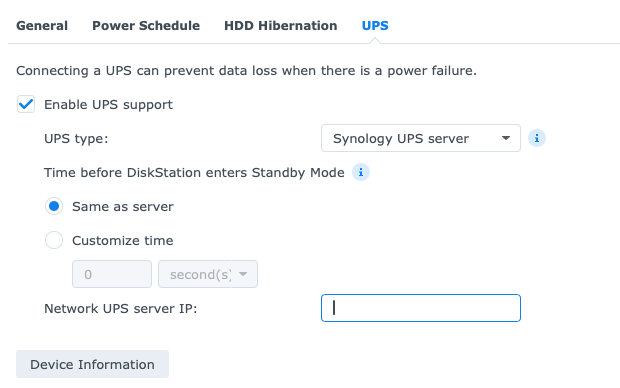
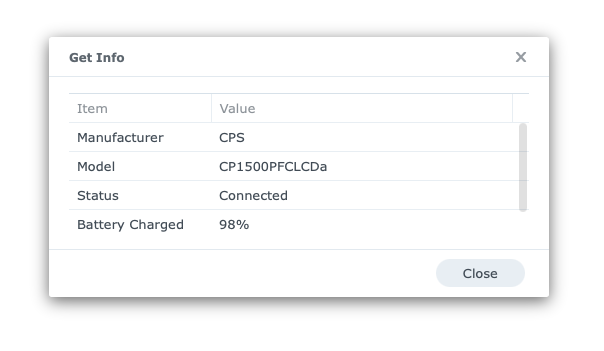

# NUT Client Setup

Reference for connecting machines to the NUT server so they shut down cleanly during a power outage. Clients only watch the server: they shut down when the server forces a shutdown or the UPS reports low battery, and they run no timers of their own.

Server: [NUT Server Installation](./nut-server-installation.md). Shutdown sequence and tests: [NUT Shutdown Sequence and Testing](./nut-shutdown-and-testing.md).

## Overview

| Client | Type | Login | Method |
|---|---|---|---|
| `prox-lab-01`, `prox-lab-02`, `prox-lab-03` | Proxmox VE (Debian) | `upsmon_remote` (`secondary`) | `nut-client` package |
| `nas-lab` | Synology DSM | `monuser` (fixed by DSM) | DSM UPS settings |

Before adding a client:

- Its address is allowed by the server's firewall (see [Restrict Network Access](./nut-server-installation.md#7-restrict-network-access)).
- Use the server's **IP address**, not its hostname. During an outage the domain controllers, which provide DNS, may already be shutting down.

## Debian and Proxmox

Run as root on each node. Do one node first and check it before the others.

```bash
# 1. Install the client
apt update && apt install -y nut-client

# 2. Client mode
sed -i 's/^MODE=.*/MODE=netclient/' /etc/nut/nut.conf
grep ^MODE /etc/nut/nut.conf

# 3. Watch the server's UPS (prompts for upsmon_remote's password)
NUT_SERVER=<nut-server-ip>          # REPLACE
read -rsp "upsmon_remote password: " PW; echo
echo "MONITOR ups@$NUT_SERVER 1 upsmon_remote $PW secondary" >> /etc/nut/upsmon.conf
unset PW
grep -nE '^(MONITOR|SHUTDOWNCMD)' /etc/nut/upsmon.conf

# 4. Permissions (the file now holds a password)
chown root:nut /etc/nut/upsmon.conf
chmod 640 /etc/nut/upsmon.conf

# 5. Start and check
systemctl enable nut-monitor
systemctl restart nut-monitor
sleep 3
systemctl is-active nut-monitor
upsc ups@$NUT_SERVER ups.status 2>/dev/null
journalctl -u nut-monitor -n 5 --no-pager
```

Expected:

- The `grep` shows one `SHUTDOWNCMD` line (Debian's default, `/sbin/shutdown -h +0`) and the new `MONITOR` line.
- `nut-monitor` is `active`.
- `upsc` prints `OL`, or `OL CHRG` while the battery recharges.
- The journal shows `UPS: ups@<nut-server-ip> (secondary) (power value 1)` and no `Connection refused` or `access denied`.

`upsnotify` lines about libsystemd and the watchdog are harmless.

On a Proxmox node, shutting the host down also shuts down its VMs, so VMs need no NUT client. VMs that should come back after an outage need `onboot: 1`:

```bash
grep -H onboot /etc/pve/qemu-server/*.conf
```

## Synology DSM

1. Open **Control Panel → Hardware & Power → UPS**.
2. Tick **Enable UPS support**.
3. Set **UPS type** to **Synology UPS server**.
4. Set **Time before DiskStation enters Standby Mode** to **Same as server**, so the NAS waits for the server instead of running its own timer.
5. Set **Network UPS server IP** to the NUT server's address.
6. Click **Apply**.



*DSM UPS settings for a NUT client. The server IP field is shown empty here; it holds the NUT server's address.*

Click **Device Information** to confirm the NAS can read the UPS:



*Device Information showing the UPS model and a connected status.*

Also check **Control Panel → Hardware & Power → General → Restart automatically when power supply issue is fixed**, so the NAS powers back on after an outage.

DSM always connects to a UPS named `ups` with its fixed `monuser` login, which is why the server uses those names.

## Verify on the Server

```bash
upsc -c ups@localhost 2>/dev/null
```

Lists every connected client, for example:

```text
<nas-ip>
<prox-lab-01-ip>
<prox-lab-02-ip>
<prox-lab-03-ip>
127.0.0.1
```

`127.0.0.1` is the server's own `upsmon`.

## Client Behavior

| Situation | What the client does |
|---|---|
| UPS on line, server reachable | Nothing |
| Loses contact with the server while the UPS is on line | Logs `Communications with UPS ... lost`, keeps running |
| Server sets forced shutdown (FSD) | Shuts down |
| UPS reports low battery | Shuts down |
| Loses contact while the UPS was last seen on battery | Treats it as low battery and shuts down |

## Adding a Client

1. Add the client's address to the server firewall and restart `nut-firewall.service`.
2. Configure it as above.
3. Check it appears in `upsc -c ups@localhost` on the server.

## Troubleshooting

| Symptom | Check |
|---|---|
| `Connection refused` | The server isn't listening on the network, or the IP is wrong. On the server, `ss -tlnp \| grep 3493` should show `0.0.0.0:3493` |
| Connection hangs, then times out | The client's address isn't allowed by the server firewall: `nft list table inet nut_filter` on the server |
| `access denied` or login failure | The password doesn't match `upsmon_remote` in the server's `upsd.users` |
| `upsc` works but the client isn't listed on the server | `nut-monitor` isn't running on the client: `systemctl status nut-monitor` |
| DSM shows the UPS as disconnected | Server IP in DSM, the NAS address in the server firewall, and `monuser` in `upsd.users` |

## Security

- `upsmon.conf` on each client holds the `upsmon_remote` password: keep it `root:nut`, mode `640`.
- The password is entered at a prompt so it stays out of shell history, and is kept in a password manager.
- NUT traffic isn't encrypted; the server firewall limits which hosts can connect.
