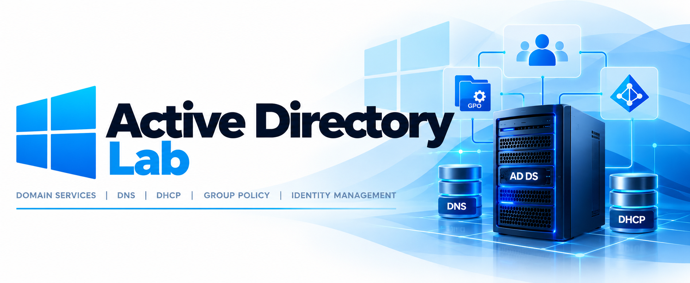
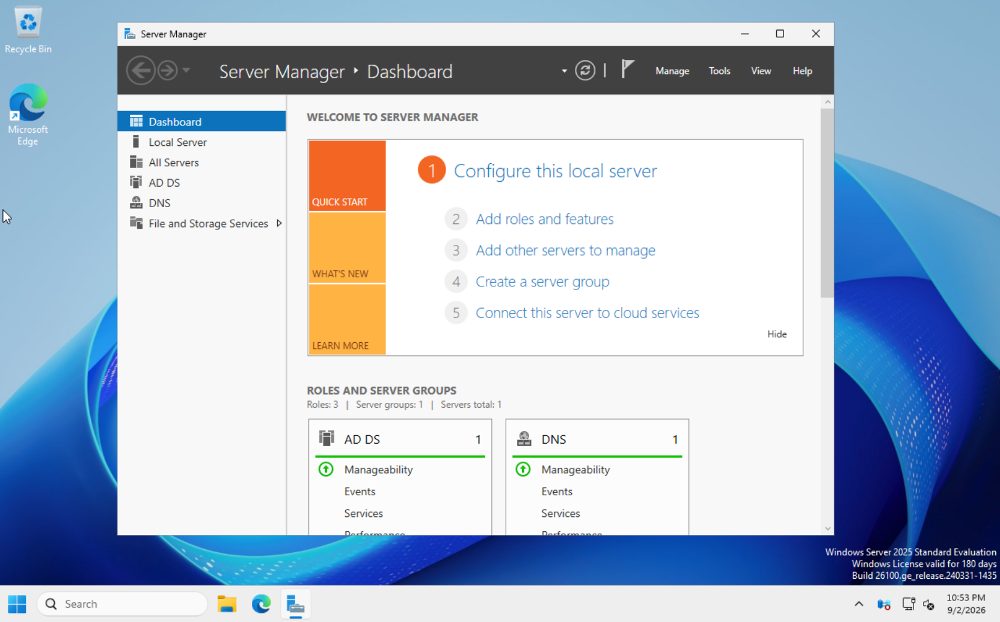

# 🏢 Active Directory Lab

**Status: 🟢 Operational**



## Overview

This lab built a redundant Windows Server Active Directory environment on the Proxmox cluster. Two domain controllers on separate Proxmox hosts provide Active Directory Domain Services, AD-integrated DNS, and Windows DHCP failover for the network.

The environment is the on-premises identity foundation for the Microsoft Entra ID and Intune labs.

<p align="left">
  
</p>

*Windows Server 2025 domain controller with Active Directory Domain Services deployed.*

> [!NOTE]
> Hostnames, IP addresses, and domain names in this lab's documentation have been sanitized for public release.

## Architecture

```text
              lab.example.com
                     │
      ┌──────────────┴──────────────┐
      │                             │
  prox-lab-01                   prox-lab-02
  └── dc-lab-01                 └── dc-lab-02
      AD DS · DNS · DHCP · GC       AD DS · DNS · DHCP · GC
      │                             │
      ├──── AD / DNS replication ───┤
      └──── DHCP failover (50/50) ──┘
                     │
                     ▼
     adguard-lab-01 / adguard-lab-02
       (filtering, DoH upstream)
                     │
                     ▼
            Public DNS resolvers
```

Both domain controllers are writable, replicate with each other, and serve clients at the same time. Losing either domain controller or either Proxmox host was tested and did not interrupt directory, DNS, or DHCP service.

Design decisions are recorded in [Domain Controller Architecture](./domain-controller-architecture.md).

## Domain Controllers

| Server | Proxmox Host | Roles | Status |
|---|---|---|---|
| `dc-lab-01` | `prox-lab-01` | AD DS, DNS, DHCP, Global Catalog | 🟢 Operational |
| `dc-lab-02` | `prox-lab-02` | AD DS, DNS, DHCP, Global Catalog | 🟢 Operational |

## Objectives

- Deploy a multi-domain-controller Active Directory environment across separate Proxmox hosts
- Deploy redundant AD-integrated DNS and Windows DHCP failover
- Design an OU structure modeling a real business
- Implement users, groups, and role-based access using AGDLP
- Implement Group Policy for security baselines and configuration management
- Manage users, groups, and computers at scale with PowerShell
- Deploy and manage domain-joined Windows clients
- Implement service account management, security, and auditing controls
- Develop and test backup and recovery procedures
- Plan internal PKI with Active Directory Certificate Services
- Extend on-premises identity into Microsoft Entra ID

## Technologies

- Proxmox VE
- Windows Server 2025 (Desktop Experience)
- Active Directory Domain Services
- Active Directory-integrated DNS
- Windows Server DHCP with failover
- AdGuard Home (external DNS forwarding)
- PowerShell

## Progress

```text
Domain Controller Deployment   ██████████  Complete
AD Replication                 ██████████  Complete
AD-Integrated DNS              ██████████  Complete
DHCP Failover                  ██████████  Complete
Failure Testing                ██████████  Complete
OU Design                      ░░░░░░░░░░  Next
Users / Groups / Access        ░░░░░░░░░░  Planned
Group Policy                   ░░░░░░░░░░  Planned
Client Management              ░░░░░░░░░░  Planned
AD Security / Auditing         ░░░░░░░░░░  Planned
Backup / Recovery              ░░░░░░░░░░  Planned
AD CS / Internal PKI           ░░░░░░░░░░  Planned
Hybrid Identity                ░░░░░░░░░░  Future
```

## Completed Work

- **Domain controllers:** `dc-lab-01` and `dc-lab-02` were cloned from the generalized Windows Server template, placed on separate Proxmox hosts, and promoted as domain controllers with DNS and Global Catalog.
- **Replication:** Bidirectional replication of all naming contexts, including `DomainDnsZones` and `ForestDnsZones`, was validated.
- **DNS:** AD-integrated zones, LDAP and Kerberos SRV records, secure dynamic updates, manual A/PTR records, and redundant AdGuard forwarders were configured and validated.
- **DHCP:** Both servers were authorized in Active Directory, the LAN scope was configured, 50/50 load-balanced failover was established, and clients were migrated off the previous DHCP service.
- **Failure testing:** Each domain controller and each AdGuard instance was taken offline in turn. DNS and DHCP service continued, and normal operation resumed after restoration.

## Next Steps

- [ ] Design the organizational unit structure
- [ ] Create users, groups, and administrative structure
- [ ] Implement AGDLP-based access assignment
- [ ] Join and organize Windows client systems
- [ ] Configure and validate Group Policy
- [ ] Automate user and group administration with PowerShell

## Planned

- [ ] Service account management
- [ ] Active Directory security and auditing controls
- [ ] PowerShell identity and group membership audit reports
- [ ] Active Directory Sites and Services documentation
- [ ] Backup and recovery procedures, with a tested restore
- [ ] [AD CS deployment](./TODO-ad-cs-deployment-plan.md) on a dedicated CA server
- [ ] [PKI implementation](./TODO-pki-implementation-plan.md): issuance, trust distribution, renewal, and revocation
- [ ] Hybrid identity with Microsoft Entra ID

AD CS will issue certificates; it will not act as a reverse proxy. Nginx Proxy Manager remains part of the [Containerization Lab](../containerization-lab/).

## Documentation

| Document | Contents |
|---|---|
| [Domain Controller Architecture](./domain-controller-architecture.md) | Design decisions, VM configuration, failure domains, and known limitations |
| [Domain Controller Deployment](./domain-controller-deployment.md) | Forest creation on `dc-lab-01` and `dc-lab-02` as an additional domain controller |
| [Active Directory DNS](./active-directory-DNS.md) | AD-integrated zones, resolution path, record management, and DNS testing |
| [Active Directory DHCP](./active-directory-DHCP.md) | Scope, failover configuration, cutover, and failover testing |
| [AD CS Deployment Plan](./TODO-ad-cs-deployment-plan.md) | Planned certificate authority deployment |
| [PKI Implementation Plan](./TODO-pki-implementation-plan.md) | Planned certificate lifecycle management |

Documents for OU design, users and groups, Group Policy, client management, service accounts, security, and backup will be added as each capability is deployed and validated.

## Future Integration

```text
Active Directory
      │
      │ Entra Connect
      ▼
Microsoft Entra ID
      │
      ├── Microsoft 365
      └── Microsoft Intune
```

Hybrid identity will extend the identities and groups built here into Microsoft Entra ID, Conditional Access, and Intune, rather than treating the on-premises and cloud labs as unrelated environments.

## Outcome

The lab produced a working two-domain-controller Active Directory environment with redundant directory, DNS, and DHCP services across separate Proxmox hosts. Failure testing confirmed that clients keep authentication, name resolution, and addressing when either domain controller is offline. Work now moves from infrastructure deployment to identity administration, starting with OU design.

## Related Documentation

- [Virtualization Lab](../virtualization-lab/): Proxmox platform hosting the domain controllers
- [Network Infrastructure](../network-infrastructure/): switching, AdGuard Home, and supporting network services
- [Microsoft 365 & Entra ID](../microsoft-365-entra-id/): future hybrid identity
- [Microsoft Intune Lab](../microsoft-intune/): endpoint management
- [Security Operations Lab](../security-operations/): future collection of AD security events
- [Windows VM Templates](../../docs/reference/proxmox/proxmox-windows-vm-template.md)
- [Windows Server DNS Validation](../../docs/reference/windows/windows-server-DNS-validation.md)
- [Additional Domain Controller Validation](../../docs/reference/windows/windows-additional-domain-controller-validation.md)
- [Windows Server DHCP Deployment and Failover](../../docs/reference/windows/windows-server-DHCP-deployment-and-failover.md)
