# 🖥️ Domain Controller Deployment

**Status: 🟢 Operational**

<p align="left">
  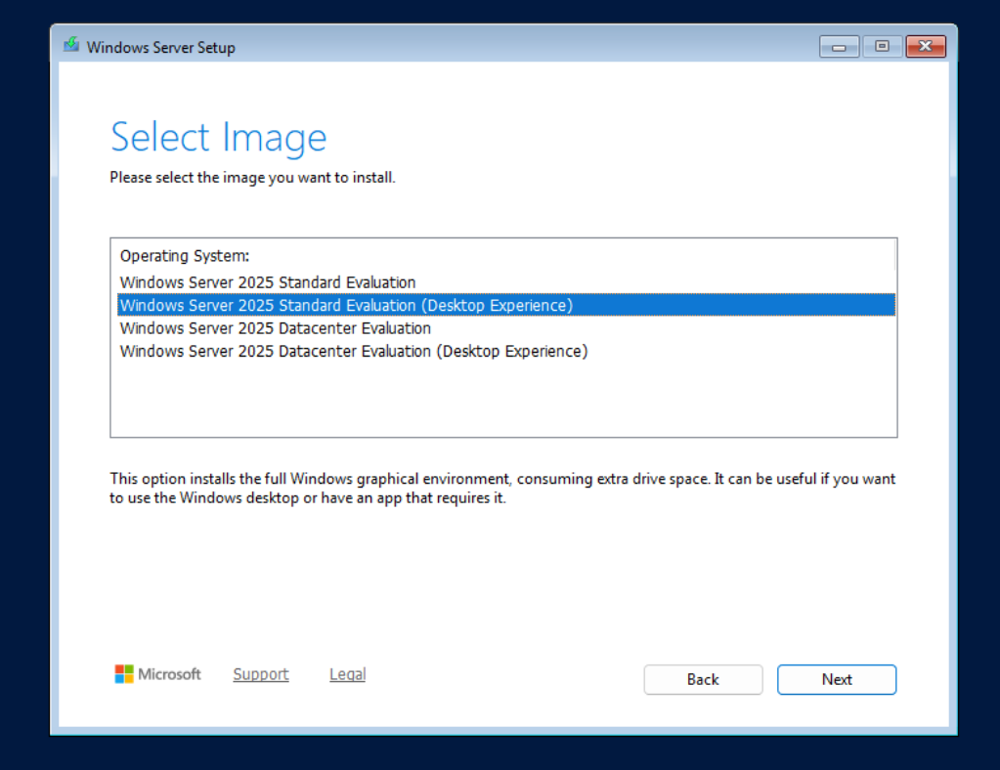
</p>

*Windows Server 2025 Standard Evaluation (Desktop Experience)*

## Overview

This document records the deployment of both Active Directory domain controllers. `dc-lab-01` created the forest and domain, and `dc-lab-02` was then added as a second writable domain controller that replicates with it.

Step-by-step procedures are in the [Domain Controller Promotion](../../docs/reference/windows/windows-server-domain-controller-promotion.md) reference. Design decisions are in [Domain Controller Architecture](./domain-controller-architecture.md).

> [!NOTE]
> Hostnames, IP addresses, and domain names have been sanitized for public release.

## Deployment Sequence

```text
win-server-2025-template (sysprepped, no roles)
        │
        ├──────────────────────────────┐
        ▼                              ▼
   dc-lab-01                       dc-lab-02
   prox-lab-01                     prox-lab-02
        │                              │
   Hostname + static IP            Hostname + static IP
        │                              │
   Network validation              DNS → dc-lab-01
        │                              │
   AD DS + DNS installed           AD DS + DNS installed
        │                              │
   New forest created ───────────► Added to existing domain
        │                              │  (replicated from dc-lab-01)
   Validated                       Validated
```

Both domain controllers were cloned from the same generalized Windows Server template and use identical VM specifications. `dc-lab-02` was built after `dc-lab-01` was operational and validated, because an additional domain controller needs an existing domain to replicate from.

## Part 1: `dc-lab-01` and Forest Creation

### Build

| Setting | Configuration |
|---|---|
| VM / hostname | `dc-lab-01` |
| Proxmox host | `prox-lab-01` |
| Source template | `win-server-2025-template` |
| Operating system | Windows Server 2025 Standard Evaluation (Desktop Experience) |
| vCPU / memory / disk | 2 / 2 GB / 64 GB |
| IPv4 address | `10.0.0.10` (static) |
| Initial DNS server | `10.0.0.1` (existing network DNS) |
| Roles | AD DS, DNS |

The VM was cloned from the template, given its permanent hostname, and restarted before any roles were installed. A static IPv4 address was then configured. DNS initially pointed at the existing network DNS server, because the server was not yet providing DNS itself.

### Network Validation

Connectivity was validated before Active Directory was installed, so that network problems could be separated from problems introduced later by AD DS or DNS.

| Test | Result |
|---|---|
| Local TCP/IP (`127.0.0.1`) | ✅ |
| Default gateway | ✅ |
| External IPv4 routing | ✅ |
| External DNS resolution | ✅ |
| Outbound HTTPS (port 443) | ✅ |

### Role Installation

Active Directory Domain Services and DNS Server were installed through **Server Manager → Add Roles and Features**, along with the management tools Windows selected automatically: Group Policy Management, the AD DS tools, the Active Directory PowerShell module, and the DNS Server tools.

<p align="left">
  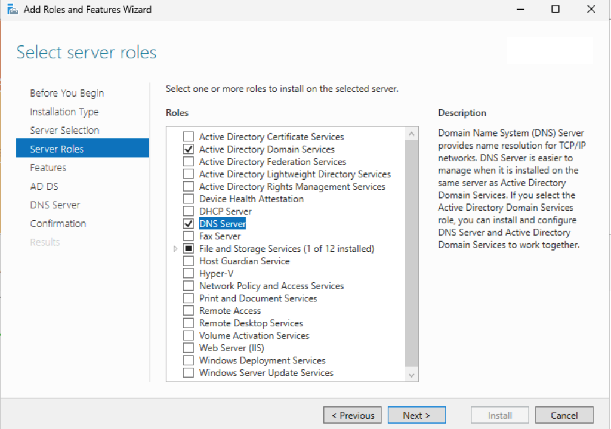
</p>

*Active Directory Domain Services and DNS Server selected.*

DHCP Server was intentionally left out at this stage. It was added after both domain controllers were operational. See [Active Directory DHCP](./active-directory-DHCP.md).

<p align="left">
  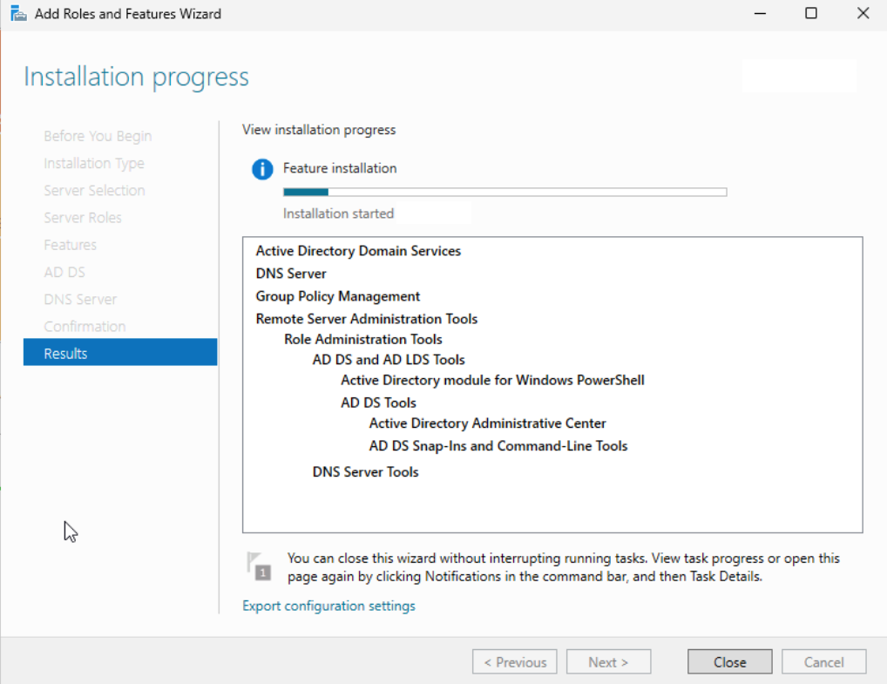
</p>

*Role installation in progress.*

<p align="left">
  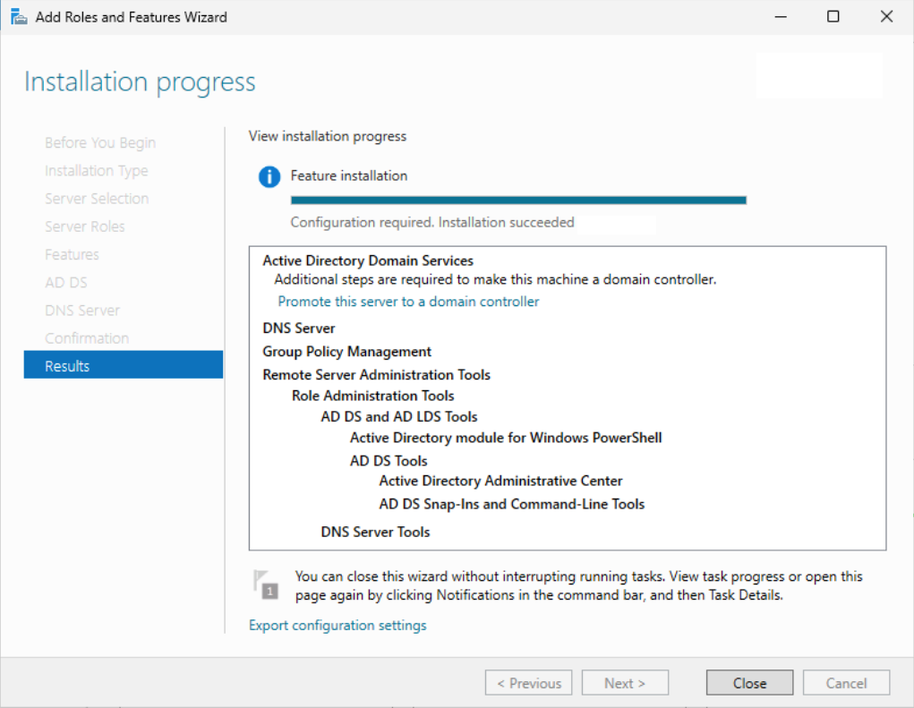
</p>

*Installation complete; Server Manager reported that promotion was required.*

### Forest Creation

The server was promoted from the Server Manager notification using **Add a new forest**.

<p align="left">
  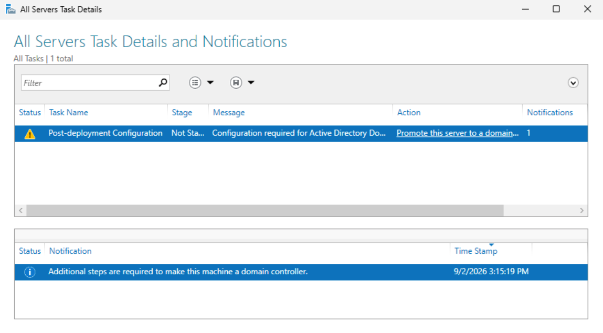
</p>

*Post-deployment notification to promote the server.*

<p align="left">
  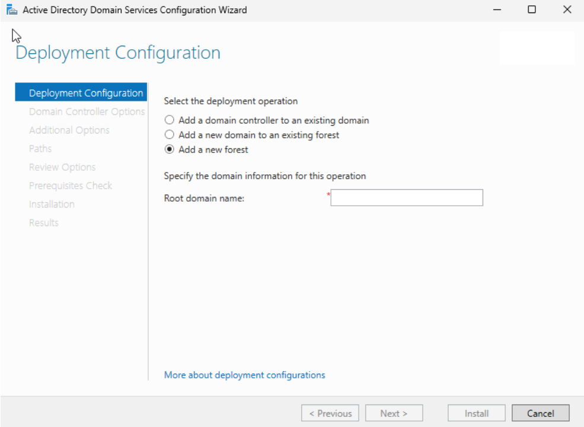
</p>

*New forest for the lab environment.*

| Setting | Configuration |
|---|---|
| Deployment operation | Add a new forest |
| Root domain | `lab.example.com` |
| NetBIOS domain | `LAB` |
| Forest / domain functional level | Windows Server 2025 |
| DNS Server | Enabled |
| Global Catalog | Enabled |
| RODC | Disabled |
| DNS delegation | Not created |
| Database, logs, SYSVOL | Defaults (`C:\Windows\NTDS`, `C:\Windows\SYSVOL`) |

<p align="left">
  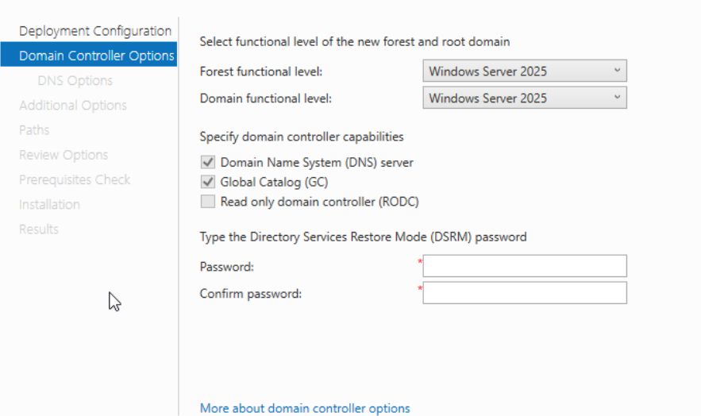
</p>

*Functional levels set to Windows Server 2025, with DNS and Global Catalog enabled.*

A Directory Services Restore Mode (DSRM) password was set during this step and is stored securely outside the repository.

<p align="left">
  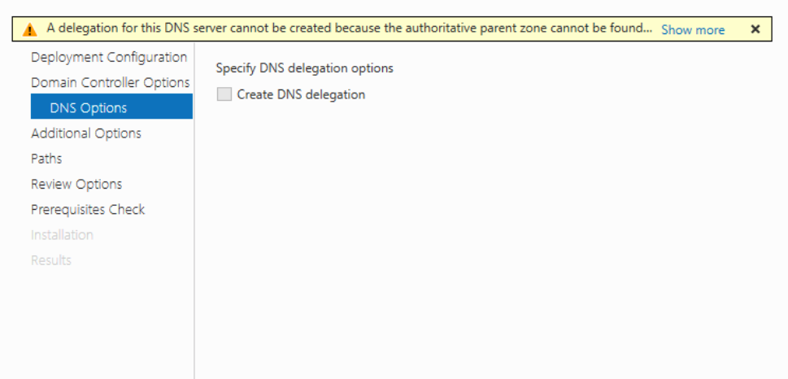
</p>

*No DNS delegation was created.*

The wizard could not create a DNS delegation because there is no authoritative parent zone. This was expected: the domain controllers manage the internal namespace themselves, so no delegation is needed.

<p align="left">
  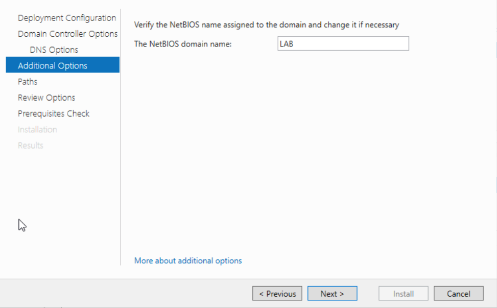
</p>

*NetBIOS domain name.*

Domain accounts can sign in as `LAB\username` or `username@lab.example.com`.

<p align="left">
  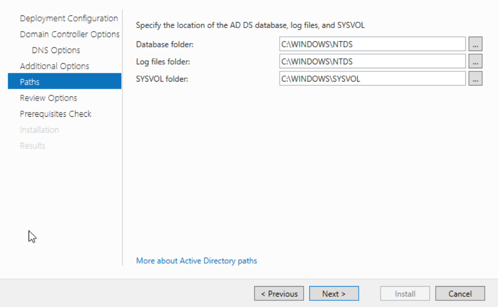
</p>

*Default database, log, and SYSVOL locations.*

<p align="left">
  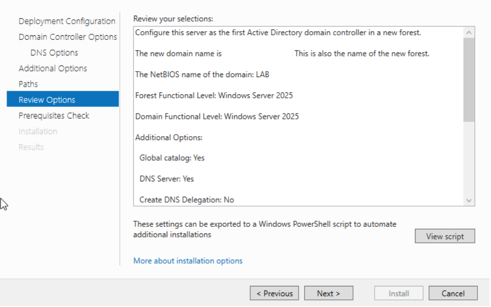
</p>

*Configuration review before the prerequisite check.*

### Prerequisite Check

<p align="left">
  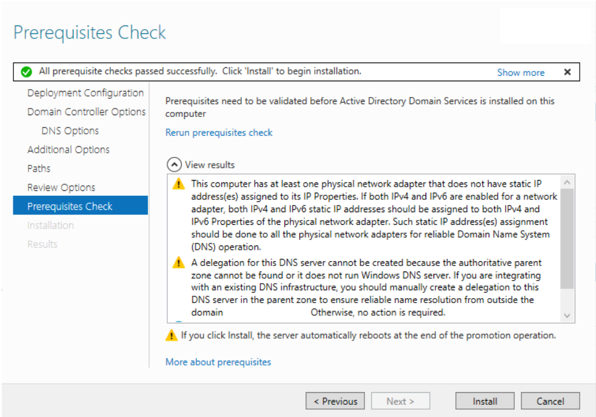
</p>

*All prerequisite checks passed.*

All checks passed, with two expected warnings:

| Warning | Reason it was accepted |
|---|---|
| IPv6 enabled without a static IPv6 address | The server had a static IPv4 address; IPv6 was left enabled |
| DNS delegation could not be created | No parent zone exists for the internal namespace |

### Result

The server restarted and came up as the first domain controller in the new forest, holding all five FSMO roles.

<p align="left">
  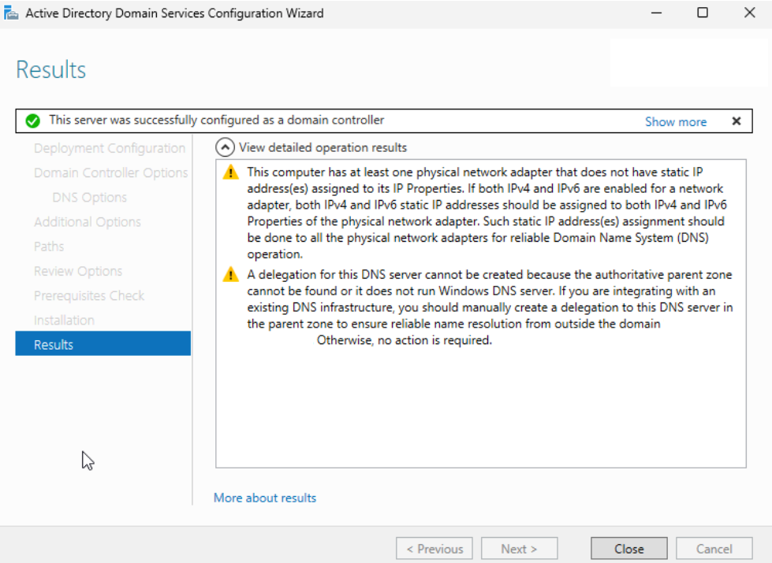
</p>

*Promotion completed successfully.*

```text
lab.example.com
└── dc-lab-01
    ├── Active Directory Domain Services
    ├── DNS Server
    ├── Global Catalog
    └── FSMO roles (all five)
```

### Post-Promotion Validation

| Check | Result |
|---|---|
| AD DS and DNS roles installed | ✅ |
| Domain and forest returned by `Get-ADDomain` / `Get-ADForest` | ✅ |
| Domain controller discovered by `Get-ADDomainController` | ✅ |
| DNS Server service running | ✅ |
| `lab.example.com` and `_msdcs.lab.example.com` zones present | ✅ |
| `dc-lab-01.lab.example.com` resolves to `10.0.0.10` | ✅ |
| LDAP SRV record returns `dc-lab-01` | ✅ |

## Part 2: `dc-lab-02` as an Additional Domain Controller

### Build

`dc-lab-02` was cloned from the same `win-server-2025-template` and placed on `prox-lab-02`. Because the template was sysprepped and contains no server roles, the clone started as a clean Windows Server installation with its own identity.

| Setting | Configuration |
|---|---|
| VM / hostname | `dc-lab-02` |
| Proxmox host | `prox-lab-02` |
| Source template | `win-server-2025-template` |
| VM specifications | Same as `dc-lab-01` |
| IPv4 address | `10.0.0.11` (static) |
| Initial DNS server | `10.0.0.10` (`dc-lab-01`) |
| Roles | AD DS, DNS |

The hostname and static address were configured the same way as on `dc-lab-01`. DNS pointed at `dc-lab-01` so the new server could locate the domain through its SRV records.

### Promotion

AD DS and DNS Server were installed through **Add Roles and Features**, and the server was promoted with **Add a domain controller to an existing domain**.

| Setting | Configuration |
|---|---|
| Deployment operation | Add a domain controller to an existing domain |
| Domain | `lab.example.com` |
| DNS Server | Enabled |
| Global Catalog | Enabled |
| RODC | Disabled |
| Replicate from | `dc-lab-01` (selected explicitly) |
| Database, logs, SYSVOL | Defaults |

The source was named explicitly rather than left on "Any domain controller", so the initial replication path is documented.

The directory partitions, SYSVOL, and AD-integrated DNS zones replicated from `dc-lab-01` during promotion. No zones or objects were created manually on `dc-lab-02`.

### Result

```text
lab.example.com
├── dc-lab-01   AD DS · DNS · GC · FSMO roles
└── dc-lab-02   AD DS · DNS · GC
        ▲
        └── Multi-master replication ──► dc-lab-01
```

After promotion, both domain controllers were writable and replicated changes in both directions. Active Directory is multi-master, so either domain controller can authenticate clients and accept changes while the other is offline. All five FSMO roles remained on `dc-lab-01`, which `netdom query fsmo` confirmed from both servers.

After promotion, each domain controller's DNS client was set to use its partner as preferred and its own DNS service as alternate, as described in [Domain Controller Architecture](./domain-controller-architecture.md).

### Validation

| Check | Result |
|---|---|
| `repadmin /replsummary` with no failures | ✅ |
| Inbound and outbound replication with `dc-lab-01` | ✅ |
| Domain, Configuration, Schema, `DomainDnsZones`, `ForestDnsZones` replicated | ✅ |
| SYSVOL and NETLOGON shared | ✅ |
| AD-integrated zones present on `dc-lab-02` | ✅ |
| LDAP and Kerberos SRV records list both domain controllers | ✅ |
| `dcdiag` and `dcdiag /test:dns` passed | ✅ |

Commands are in the [Additional Domain Controller Validation](../../docs/reference/windows/windows-additional-domain-controller-validation.md) reference.

## Outcome

Both domain controllers were deployed from the same template onto separate Proxmox hosts. `dc-lab-01` created the `lab.example.com` forest, and `dc-lab-02` joined as a second writable domain controller, replicating from `dc-lab-01` and validated in both directions. This foundation was then extended with DHCP failover and redundant DNS forwarding.

## Related Documentation

- [Active Directory Lab](./README.md)
- [Domain Controller Architecture](./domain-controller-architecture.md)
- [Active Directory DNS](./active-directory-DNS.md)
- [Active Directory DHCP](./active-directory-DHCP.md)
- [Domain Controller Promotion](../../docs/reference/windows/windows-server-domain-controller-promotion.md)
- [Additional Domain Controller Validation](../../docs/reference/windows/windows-additional-domain-controller-validation.md)
- [Windows VM Templates](../../docs/reference/proxmox/proxmox-windows-vm-template.md)
