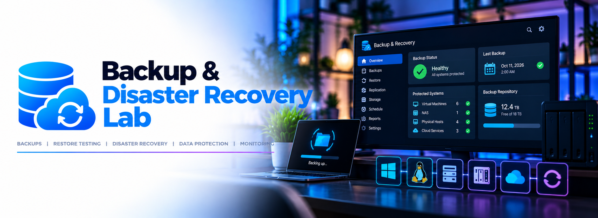

# 💾 Backup & Disaster Recovery

**Status: 🟡 In Progress**

## Overview

A backup that hasn't been restored isn't a backup. Right now the lab has storage, not a real backup
strategy, and this project fixes that by covering three things:

- **Backups:** 3-2-1 protection using hardware I already have, with copies on a dedicated backup server,
  the NAS and offsite.
- **Power protection:** a UPS-driven shutdown that stops everything cleanly during an outage and brings it
  back on its own.
- **Recovery:** runbooks for the failures that matter most, each tested and timed against a recovery target.

Nothing counts as done until it's been proven by a real restore or a real test.

## Plan

| Copy | Method | Destination |
|---|---|---|
| VM backups (primary) | Proxmox Backup Server, nightly incremental | Backup server — ZFS `pbs` dataset |
| VM backups (secondary) | Proxmox scheduled backups (vzdump), weekly | Synology NAS |
| NAS data | Hyper Backup → rsync, with ZFS snapshots | Backup server — ZFS `nas` dataset |
| Offsite | Hyper Backup (encrypted) → Cloud Sync upload | Microsoft OneDrive |
| Service configs | Git (sanitized) | GitHub |
| Network devices | Exported running configs | Synology NAS |

Only the critical VMs go offsite: domain controllers, Docker host, monitoring host, and AdGuard. Media can be rebuilt, so it stays local. No point filling up OneDrive with it.

## Backup Server

I'm bringing an old desktop back to life as a dedicated backup server. It'll run Proxmox Backup Server on bare metal, with the drives in a ZFS pool split into two datasets:

| Dataset | Purpose |
|---|---|
| `pbs` | Proxmox Backup Server datastore for VM backups |
| `nas` | Hyper Backup target for the Synology, with daily ZFS snapshots |

The snapshots matter. If the NAS ever got compromised, it could delete its own backups, but it can't touch snapshots taken on the backup server.

I'll probably set it to wake up for the nightly backup window and shut down after. An old desktop running 24/7 just to sit idle isn't worth the power bill.

## Offsite

Hyper Backup doesn't support OneDrive directly, so offsite takes two steps. Hyper Backup writes an encrypted, versioned backup to a local staging folder, then Cloud Sync uploads that folder to OneDrive one way. Hyper Backup handles the actual backup work, and OneDrive is just where it ends up. I already have 1TB there, so it costs nothing extra.

## Power Protection

One CyberPower UPS covers the lab. NUT on `monitor-lab-02` shares its status over the network, so the
Proxmox nodes and the NAS shut down in order and come back on their own when power returns.

- Plan: [UPS Power Protection Plan](./TODO-ups-power-protection-plan.md)
- Server setup: [NUT Server Installation](../../docs/reference/nut/nut-server-installation.md)
- Lessons from the build: [Lessons Learned](./lessons-learned.md)

## Disaster Recovery Runbooks

Each likely failure gets a runbook, and each runbook gets tested. The [DR Overview](./dr-overview.md) sets recovery targets, the order systems come back in, and how to get in when the usual path is down. Results go in the [DR Test Log](./dr-test-log.md).

| Runbook | Scenario |
|---|---|
| [Power Outage](./runbooks/TODO-power-outage.md) | Utility power lost |
| [Proxmox Node Failure](./runbooks/TODO-node-failure.md) | One node down for good |
| [Domain Controller Recovery](./runbooks/TODO-domain-controller-recovery.md) | One or both DCs lost |
| [NAS Recovery](./runbooks/TODO-nas-recovery.md) | Drive failure or NAS loss |
| [Point-in-Time Restore](./runbooks/TODO-point-in-time-restore.md) | Bad change, corruption or ransomware |
| [Full Rebuild](./runbooks/TODO-full-rebuild.md) | Site loss, rebuild from offsite |

## Verification

Nothing gets marked 🟢 Operational until it's been restored:

- [ ] Restore a VM from PBS and confirm it boots and services run
- [ ] Restore a single file from inside a VM using PBS file restore
- [ ] Restore a VM from the weekly NAS backup
- [ ] Restore files from the NAS backup on the backup server
- [ ] Roll back a ZFS snapshot of the `nas` dataset
- [ ] Download the offsite backup from OneDrive and restore a VM from it
- [ ] Rebuild a Docker service from its Git config
- [ ] Pull wall power and confirm systems shut down in order and come back on their own
- [ ] Log restore times and anything that went wrong

## Tasks

- [ ] Repurpose the desktop as a Proxmox Backup Server with a ZFS pool
- [ ] Create `pbs` and `nas` datasets with quotas
- [ ] Schedule nightly PBS backups, verify jobs, and pruning
- [ ] Add a Synology NFS share as Proxmox storage for weekly backups
- [ ] Set up Hyper Backup from the NAS to the backup server (rsync)
- [ ] Schedule ZFS snapshots on the `nas` dataset
- [ ] Set up Hyper Backup to a local staging folder for offsite
- [ ] Set up Cloud Sync to upload the staging folder to OneDrive (one way, no deletions)
- [ ] Export Cisco and ASUS configs
- [ ] Add the backup server to [Infrastructure Monitoring](../infrastructure-monitoring/) and alert on failed jobs
- [ ] Test each DR runbook and record the results in the DR Test Log, starting with the power outage
- [ ] Set up UPS power protection with NUT: see [UPS Power Protection Plan](./TODO-ups-power-protection-plan.md)

## Future

- Native cloud target (e.g. Backblaze B2) if OneDrive space gets tight
