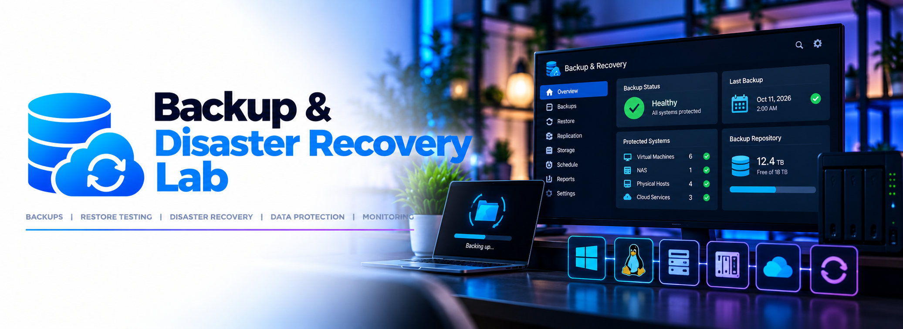

# 💾 Backup & Disaster Recovery

**Status: ⚪ Planned**

A backup that hasn't been restored isn't a backup. This project sets up 3-2-1 protection for the lab using tools already in place, then verifies it works with restore tests.

## Plan

| Layer | Method | Destination |
|---|---|---|
| Proxmox VMs (incl. Docker volumes) | Proxmox scheduled backups (vzdump) | Synology NAS |
| Offsite copy | Hyper Backup (encrypted) → Cloud Sync upload | Microsoft OneDrive |
| Service configs | Git (sanitized) | GitHub |
| Network devices | Exported running configs | Synology NAS |

Only critical VMs go offsite: domain controllers, Docker host, monitoring host, and AdGuard. Media is rebuildable and stays local.

## Verification

Every layer will be tested before this project is marked operational:

- [ ] Restore a VM from the NAS to a new VM ID, boot it, and confirm services run
- [ ] Download the offsite backup from OneDrive and restore a VM from it
- [ ] Restore a single file from the offsite backup
- [ ] Rebuild a Docker service from its Git config
- [ ] Record restore times and any issues in the results log

## Tasks

- [ ] Add Synology NFS share as Proxmox backup storage
- [ ] Schedule nightly VM backups with retention
- [ ] Configure Hyper Backup to a local staging folder
- [ ] Configure Cloud Sync to upload the staging folder to OneDrive (one-way, no deletions)
- [ ] Export Cisco and ASUS configs
- [ ] Alert on backup failures via [Infrastructure Monitoring](../infrastructure-monitoring/)
- [ ] Write a short recovery runbook

## Future

- Proxmox Backup Server for incremental, deduplicated backups
- Native cloud target (e.g. Backblaze B2) if OneDrive space becomes a constraint
