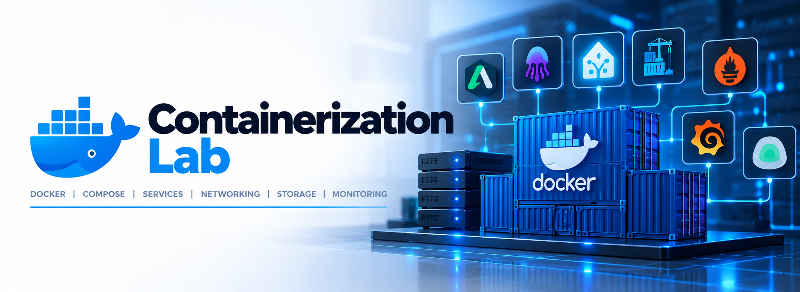

# 🐳 Docker & Self-Hosted Services

**Status: 🟢 Operational**

## Overview

Self-hosted services running on three Debian Docker hosts, deployed from version-controlled Docker Compose files and managed centrally with Portainer Community Edition. The lab covers container operations, service networking, monitoring, persistent storage, backups and multi-host Docker administration.

Each host has one role and runs on its own Proxmox node, so applications, monitoring and media can fail and be maintained independently:

| Host | Node | Role | Current Workloads |
|---|---|---|---|
| `docker-lab-01` | `prox-lab-01` | General applications and Docker management | Portainer CE, Homepage |
| `monitor-lab-01` | `prox-lab-02` | Monitoring and observability | Uptime Kuma, Prometheus, Grafana, Loki, Grafana Alloy, SNMP Exporter, rsyslog, Portainer Agent (Alertmanager in progress) |
| `media-lab-01` | `prox-lab-03` | Media services | Jellyfin, Portainer Agent |

The full layout, deployment model and design decisions are in [Architecture](./architecture.md).

## Services

### General Applications

| Docker Host | Category | Service | Status |
|---|---|---|---|
| `docker-lab-01` | Management | Portainer CE | 🟢 Deployed |
| `docker-lab-01` | Dashboard | Homepage | 🟢 Deployed |
| `docker-lab-01` | Reverse Proxy | Nginx Proxy Manager | ⚪ Planned |
| `docker-lab-01` | Password Management | Bitwarden Lite | ⚪ Planned |

### Monitoring and Observability

Uptime Kuma was deployed on its own on `monitor-lab-01`. The rest of the stack was tested on a temporary host first, then moved to `monitor-lab-01`. Alertmanager has a placeholder configuration there and isn't deployed yet.

| Docker Host | Category | Service | Status |
|---|---|---|---|
| `monitor-lab-01` | Availability Monitoring | Uptime Kuma | 🟢 Deployed |
| `monitor-lab-01` | Metrics | Prometheus | 🟢 Deployed |
| `monitor-lab-01` | Visualization | Grafana | 🟢 Deployed |
| `monitor-lab-01` | Logging | Loki | 🟢 Deployed |
| `monitor-lab-01` | Log Collection | Grafana Alloy | 🟢 Deployed |
| `monitor-lab-01` | Alerting | Alertmanager | 🟡 In Progress |

How the monitoring stack is used is documented in the [Infrastructure Monitoring](../infrastructure-monitoring/README.md) project.

### Media Services

| Docker Host | Category | Service | Deployment | Status |
|---|---|---|---|---|
| `media-lab-01` | Media Server | Jellyfin | Docker Compose | 🟢 Deployed |

Jellyfin was moved from a host-based install to Docker Compose so it's easier to recreate, migrate and back up. Its data lives in bind mounts and its media library on the NAS.

## Management and Configuration

Portainer CE Server on `docker-lab-01` manages all three hosts: the local engine directly, and the other two through Portainer Agent on TCP 9001. Compose files remain the source of truth, so services can be recreated, migrated and backed up without Portainer. See [Portainer CE Deployment](./portainer.md).

Example Compose files, including Portainer Server and Agent, are under [`configs/docker`](../../configs/docker/). On each host, persistent data is kept outside the container in bind mounts or Docker volumes.

## What's Next

### Docker Services

- [x] Deploy Portainer CE
- [x] Deploy Portainer Agent across remote Docker hosts
- [x] Deploy Homepage
- [ ] Deploy Nginx Proxy Manager
- [ ] Deploy Bitwarden Lite

### Monitoring and Observability

- [x] Deploy Uptime Kuma to dedicated monitoring host
- [x] Deploy and test Prometheus
- [x] Deploy and test Grafana
- [x] Deploy and test Loki
- [ ] Deploy and test Alertmanager
- [x] Deploy and test Grafana Alloy
- [x] Deploy validated monitoring stack to permanent Docker environment
- [x] Deploy Node Exporter
- [ ] Deploy cAdvisor
- [x] Deploy SNMP Exporter
- [ ] Deploy Blackbox Exporter
- [ ] Create baseline dashboards
- [ ] Expand infrastructure monitoring targets

### Media Services

- [x] Create dedicated media services VM
- [x] Migrate Jellyfin to the Proxmox environment
- [x] Convert Jellyfin from host-based deployment to Docker
- [x] Deploy Jellyfin using Docker Compose
- [x] Configure persistent application data using bind mounts
- [x] Integrate network-mounted media storage

### Networking

- [ ] Deploy Nginx Proxy Manager
- [ ] Configure internal DNS for service hostnames
- [ ] Configure reverse proxy hosts
- [ ] Configure and validate HTTPS/TLS
- [ ] Create required custom Docker networks
- [ ] Document service exposure strategy

### Operations

- [ ] Standardize Compose and `.env` templates
- [ ] Configure Docker volume and bind-mount backups
- [ ] Define monitoring data retention
- [ ] Document upgrade and disaster recovery procedures

## Security Notes

- Secrets are never committed; `.env` files are excluded by `.gitignore`, and public examples contain no credentials.
- Portainer, its Agents and the Docker socket are treated as privileged; they're reachable only from trusted networks or the VPN, never the internet.
- Persistent data is kept outside container filesystems.
- The reverse proxy will start internal-only, with no port forwarding from the internet.

## Reference Documentation

General Docker documentation lives in `docs/reference/` to avoid duplicating it per project:

| Document | Purpose |
|---|---|
| [docker-installation.md](../../docs/reference/docker/docker-installation.md) | Docker Engine and Compose installation |
| [docker-container-deployment.md](../../docs/reference/docker/docker-container-deployment.md) | Standard container deployment process |
| [docker-concepts.md](../../docs/reference/docker/docker-concepts.md) | Core Docker concepts and architecture |
| [docker-command-reference.md](../../docs/reference/docker/docker-command-reference.md) | Administration and troubleshooting commands |
