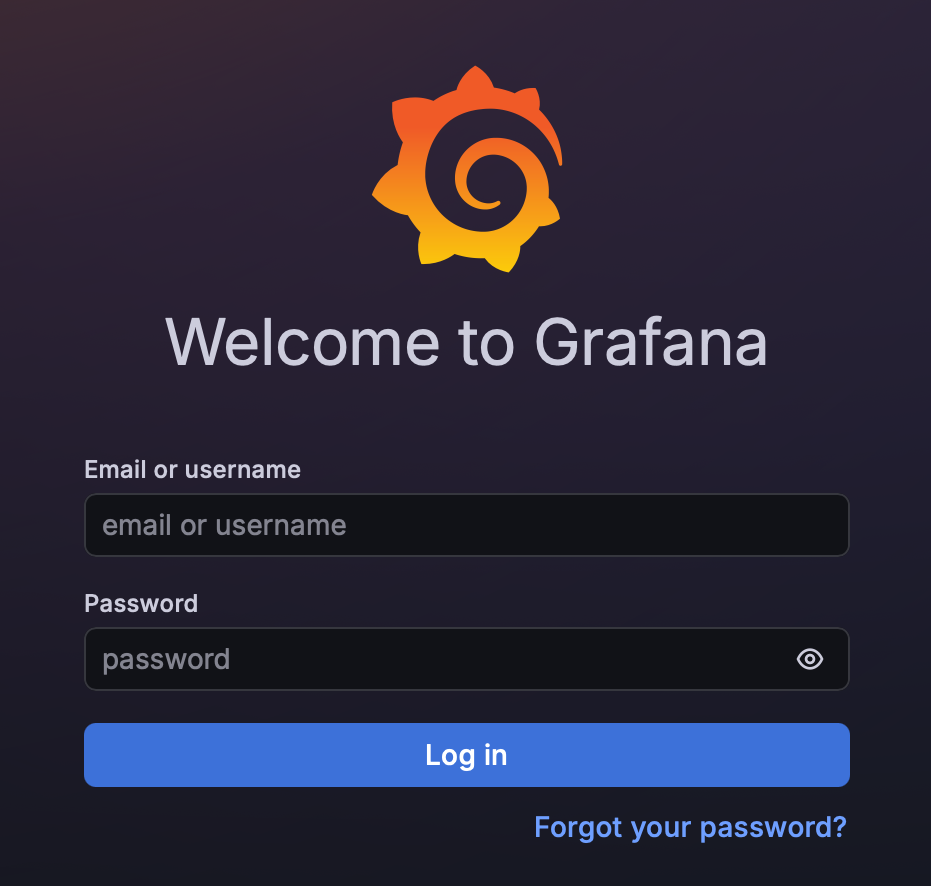
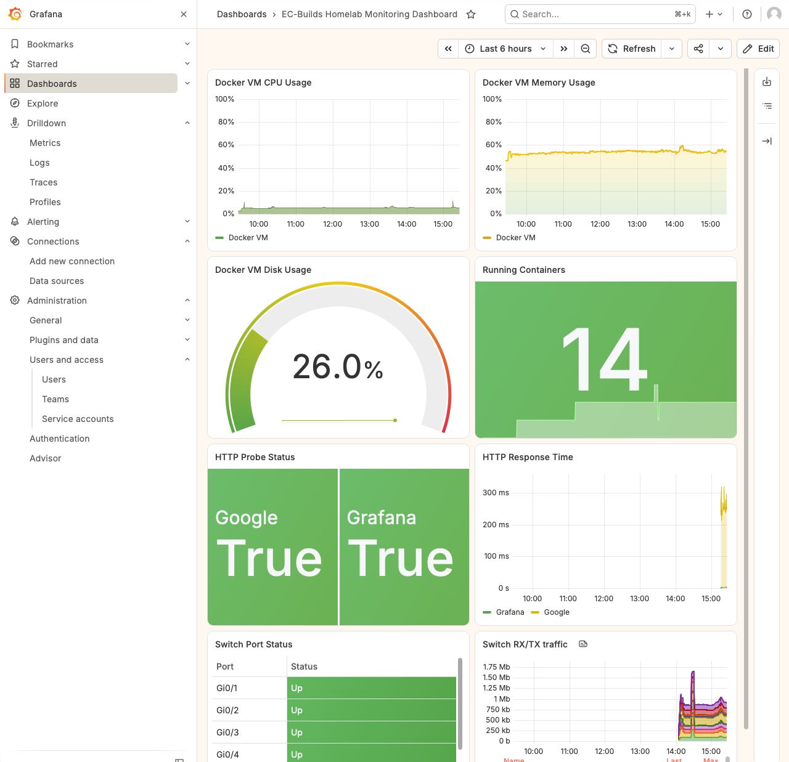

# Grafana Monitoring



Grafana is the dashboard and investigation interface for the homelab's monitoring. It runs as a Docker service on `monitor-lab-01` and reads metrics from **Prometheus** and logs from **Loki**.

This page covers Grafana's role and its two dashboards. Collection pipelines, queries, alerting and troubleshooting are documented in the [Infrastructure Monitoring](../infrastructure-monitoring/README.md) project.

## Dashboards

| Dashboard | Shows | Data Source |
|---|---|---|
| **Metrics Overview** | Infrastructure health, performance, availability and network data | Prometheus |
| **Logs Overview** | Log activity, severity, sources and event investigation | Loki |

Metrics and logs have separate dashboards so each stays focused. During troubleshooting, Metrics Overview shows *what is happening* and Logs Overview shows *what happened around it* for the same time window.

### Metrics Overview

Current panels:

- Docker host CPU, memory and disk use
- Running container count
- HTTP endpoint status and response time
- Network interface status and RX/TX traffic



*Grafana Metrics Overview showing host resource use, container status, endpoint availability, response times and network data.*

Metrics come from Node Exporter (Linux hosts), cAdvisor (containers), SNMP Exporter (network devices) and Blackbox Exporter (endpoints), all scraped by Prometheus. See [Metric Monitoring](../infrastructure-monitoring/metric-monitoring.md).

### Logs Overview

The Logs Overview shows:

- Overall log activity and volume over time
- Errors, critical events and warnings
- Events by source
- Recent errors and warnings
- Live and recent logs

Filtering by source switches between the whole environment and a single system. Collection through rsyslog and Grafana Alloy, severity handling, LogQL and retention are covered in [Log Monitoring](../infrastructure-monitoring/log-monitoring.md).

## Role in the Monitoring Stack

Grafana only queries and displays data; Prometheus and Loki collect and store it. The monitoring containers share a dedicated Docker network and reach each other by container name. Uptime Kuma runs alongside as independent availability monitoring, and Alertmanager handles Prometheus alerts.

```text
Hosts / Containers / Network / Apps
           │
     ┌─────┴─────┐
     ▼           ▼
 Exporters   Collection / Processing
     │           │
     ▼           ▼
Prometheus      Loki
     └─────┬─────┘
           ▼
        Grafana
     ┌─────┴─────┐
     ▼           ▼
 Metrics       Logs
 Overview      Overview
```

## Security

Credentials, authentication details and notification secrets are supplied at deployment and never stored in the repository. Grafana is internal only and talks to the other monitoring services over the monitoring Docker network.
