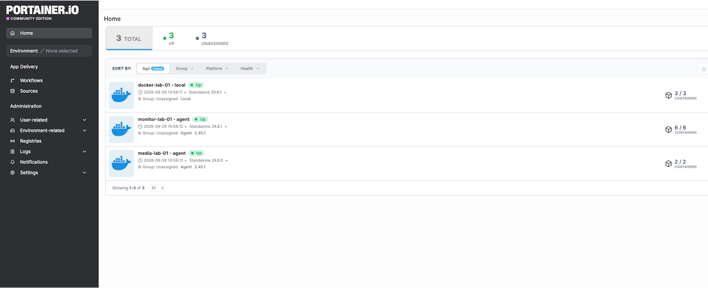
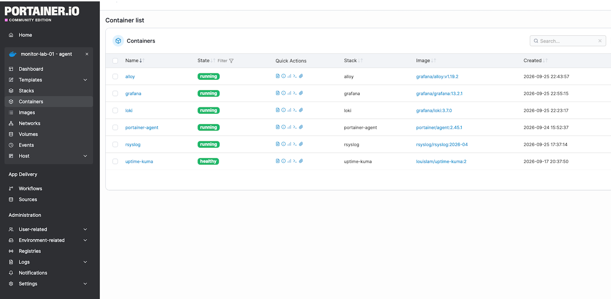

# Portainer CE Deployment

**Status: 🟢 Operational**



## Overview

Portainer Community Edition (CE) is the homelab's Docker management interface. One Portainer Server manages all three Docker hosts in the Proxmox cluster, and it's used for:

- Container status and health at a glance
- Logs and console access
- Image, network and storage inspection
- Routine container administration across hosts

Portainer adds a central view; it doesn't replace the existing tools:

```text
Docker Compose = Service configuration and deployment
Docker CLI     = Direct administration and troubleshooting
Portainer CE   = Centralized management and visibility
```

## Architecture

| Docker VM | Portainer Role | Connection | Workload |
|---|---|---|---|
| `docker-lab-01` | Portainer CE Server | Local (Docker socket) | General applications |
| `monitor-lab-01` | Portainer Agent | TCP 9001 | Monitoring |
| `media-lab-01` | Portainer Agent | TCP 9001 | Media services |

```text
                    Portainer CE
                    docker-lab-01 ──► local Docker Engine (docker.sock)
                         │
               ┌─────────┴─────────┐
           TCP 9001            TCP 9001
               ▼                   ▼
        monitor-lab-01       media-lab-01
        Portainer Agent      Portainer Agent
               │                   │
               ▼                   ▼
         Docker Engine         Docker Engine
```

The three VMs and their Proxmox placement are shown in [Architecture](./architecture.md). Portainer manages Docker inside the VMs; the VMs themselves are managed in Proxmox.

## Deployment

**Server.** Portainer CE Server runs as a container on `docker-lab-01` and manages the local Docker Engine through the Docker socket. Its data is stored outside the container, so the container can be recreated without losing configuration.

**Agents.** Portainer Agent runs on `monitor-lab-01` and `media-lab-01`, giving one management view while the workloads stay on separate VMs.

## Configuration Model



Docker Compose is the source of truth for Portainer and the other important services. Example Compose files for the Server and the Agent are in the repository:

```text
/configs/docker
├── portainer/
│   └── docker-compose.yaml
└── portainer-agent/
    └── docker-compose.yaml
```

```text
Repository Configuration ──► Docker Compose ──► Docker Engine ──┬──► Docker CLI
                                                                └──► Portainer CE
```

Compose defines images, ports, networks, storage, environment and restart behavior. Portainer sits on top as a management and visibility layer, so no important configuration exists only inside Portainer.

## Security

Portainer is part of the privileged management plane:

- Reachable only from trusted networks or over the VPN, never exposed to the internet.
- TCP 9001 is treated as a privileged Agent management port.
- Docker socket access is limited to components that need to administer Docker. Socket access is effectively root on the host, so the Server and Agents are treated as privileged.
- Credentials and secrets are kept out of the public repository.
- Portainer data is stored apart from the container, and Compose configuration apart from the Portainer database.

## Failure Behavior

Containers don't depend on Portainer. If the Portainer Server goes down, containers on all three hosts keep running. If one Agent loses contact, only central management of that host is affected. A Portainer outage never becomes an application outage.

## Design Decisions

- **One Server for all hosts**, not a separate management interface on each.
- **Workloads stay separated** across VMs; Portainer centralizes management without merging them.
- **Compose as the source of truth**, so deployments stay reproducible and recoverable without Portainer.
- **The CLI stays in use** for troubleshooting, scripting, detailed inspection and automation.

## Current Deployment State

| Capability | Status |
|---|---|
| Portainer CE Server | 🟢 Operational |
| `docker-lab-01` local environment | 🟢 Connected |
| `monitor-lab-01` Agent | 🟢 Connected |
| `media-lab-01` Agent | 🟢 Connected |
| Centralized three-host management | 🟢 Operational |
| Compose-based service management | 🟢 Operational |
| Portainer Server Compose example | 🟢 Documented in `/configs` |
| Portainer Agent Compose example | 🟢 Documented in `/configs` |
