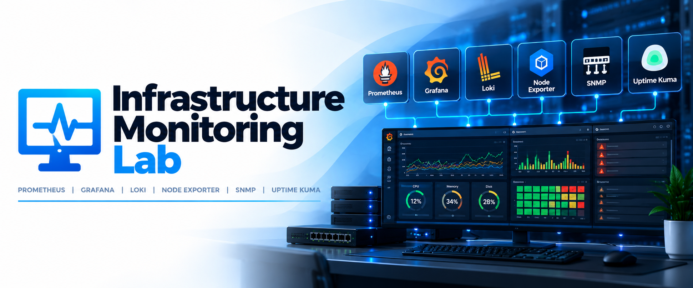
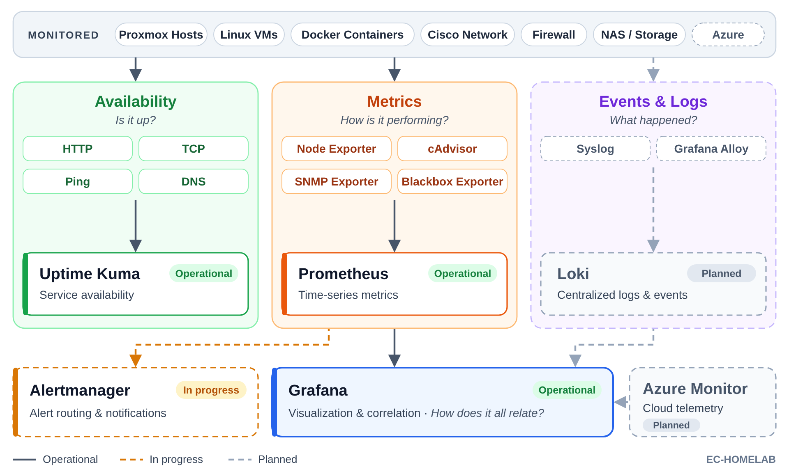

# 📊 Infrastructure Monitoring

**Status: 🟢 Operational**



## Overview

Monitoring for the Enterprise Homelab covers three questions:

> **Availability** → Is it working?  
> **Metrics** → How is it performing?  
> **Logs** → What happened?

Uptime Kuma answers the first, Prometheus and its exporters the second, and rsyslog, Grafana Alloy and Loki the third. Grafana displays metrics and logs side by side for investigation.

## Monitoring Architecture



*Figure 1. High-level monitoring and observability architecture.*

| Capability | Components | Purpose |
|---|---|---|
| **Availability** | Uptime Kuma | Reachability checks, synthetic checks, outage detection and notifications |
| **Metrics** | Prometheus, Node Exporter, cAdvisor, SNMP Exporter, Blackbox Exporter | Health, performance, utilization and endpoint data |
| **Logs** | rsyslog, Grafana Alloy, Loki | Collecting, storing and querying infrastructure and application events |
| **Visualization** | Grafana | Dashboards for metrics and logs |
| **Alerting** | Uptime Kuma, Prometheus, Alertmanager | Notifications for conditions that need attention |

Component placement, data flows and failure domains are in [`architecture.md`](./architecture.md).

```text
Infrastructure
      │
      ├──► Availability ──► Uptime Kuma
      │
      ├──► Metrics ───────► Exporters ──► Prometheus ──┐
      │                                                ├──► Grafana
      └──► Logs ──────────► rsyslog ──► Alloy ──► Loki ┘
```

## Objectives

- Detect infrastructure and service outages
- Monitor infrastructure health and performance
- Collect metrics from hosts, containers, endpoints and network devices
- Centralize infrastructure and application logs
- Monitor network devices through SNMP
- Build dashboards for day-to-day checks and troubleshooting
- Correlate metrics and logs during troubleshooting
- Send notifications for conditions that need action

## Monitoring Stack

**Legend:** 🟢 Operational · 🟡 In Progress · ⚪ Planned

| Component | Capability | Purpose | Status |
|---|---|---|:---:|
| Uptime Kuma | Availability | Availability and synthetic monitoring | 🟢 |
| Uptime Kuma (secondary) | Availability | Independent checks from outside the Proxmox cluster | ⚪ |
| Prometheus | Metrics | Metrics collection and time-series storage | 🟢 |
| Node Exporter | Metrics | Linux host metrics | 🟢 |
| cAdvisor | Metrics | Container metrics | 🟡 |
| SNMP Exporter | Metrics | Network device metrics | 🟢 |
| Blackbox Exporter | Metrics / Availability | Endpoint probing | 🟡 |
| rsyslog | Logs | Central syslog collection | 🟢 |
| Grafana Alloy | Logs | Log collection and processing | 🟢 |
| Loki | Logs | Log storage and querying | 🟢 |
| Grafana | Visualization | Metrics and log visualization | 🟢 |
| Discord Webhooks | Notifications | Alerts from Uptime Kuma, NUT, Proxmox and the Synology, one webhook per source | 🟢 |
| Alertmanager | Alerting | Metrics alert routing and management | 🟡 |
| ntfy / Webhooks | Notifications | Alertmanager notification delivery | ⚪ |
| Azure Monitor | Cloud | Azure monitoring and telemetry | ⚪ |

## Monitoring Areas

### Availability

Uptime Kuma checks network dependencies, infrastructure, platform services and applications. Checks are grouped by dependency layer, so an application outage can be told apart from a wider infrastructure failure.

Details: [`availability-monitoring.md`](./availability-monitoring.md), covering dependency-based monitoring, LAN and internet checks, DNS, infrastructure and service checks, applications, notifications and troubleshooting.

### Metrics

Prometheus scrapes an exporter matched to each type of system:

```text
Linux Hosts ───────► Node Exporter ────┐
Containers ────────► cAdvisor ─────────┤
Network Devices ───► SNMP Exporter ────┼──► Prometheus ───► Grafana
Endpoints ──────────► Blackbox Exporter ┘
```

Details: [`metric-monitoring.md`](./metric-monitoring.md), covering host, container, network and endpoint metrics, Prometheus collection, the Grafana Metrics Overview and metrics alerting.

### Logs

```text
Infrastructure Devices ──► rsyslog ──► Persistent Logs ──► Grafana Alloy ──► Loki ──► Grafana
```

rsyslog receives syslog, Alloy processes and forwards it, Loki stores and queries it, and Grafana displays it.

Details: [`log-monitoring.md`](./log-monitoring.md), covering centralized syslog, collection and processing, source and severity labels, Loki and LogQL, the Grafana Logs Overview and troubleshooting.

## Troubleshooting Model

During an incident the three signals are checked in order:

```text
Alert ──► Availability: is it reachable? ──► Metrics: what changed? ──► Logs: what happened around it?
```

| Signal | Source | Example |
|---|---|---|
| Service becomes unreachable | Availability | Uptime Kuma detects the outage |
| Resource or network behavior changes | Metrics | Prometheus records the change |
| System logs an event | Logs | The event appears in Loki |
| Investigation | Visualization | Grafana shows metrics and logs for the same window |

Lining the signals up doesn't prove the root cause, but it narrows where to look.

## Alerting

Uptime Kuma, NUT, Proxmox and the Synology send notifications to Discord today, each through its own webhook. Prometheus alert rules and Alertmanager will add metrics-based alerts once baselines and thresholds are set. Details: [`alerting.md`](./alerting.md), with the Synology setup in [`synology-notifications.md`](./synology-notifications.md).

## Current State

```text
Availability   🟢
Metrics        🟢
Logs           🟢
Visualization  🟢
Alerting       🟡
Cloud          ⚪
```

Current work: wider coverage, better dashboards and baselines, and useful alert rules.

## Next Steps

- 🟡 Complete Alertmanager routing and notification delivery
- 🟡 Expand metrics coverage across infrastructure
- 🟡 Refine the Grafana Metrics Overview
- 🟡 Set alert thresholds from observed baselines
- ⚪ Expand application and infrastructure log coverage
- ⚪ Define and validate retention policies
- ⚪ Integrate Azure monitoring
- ⚪ Reduce shared dependencies between monitoring components
- ⚪ Deploy a secondary Uptime Kuma on `monitor-lab-02` with its own notification channel

## Repository Structure

```text
infrastructure-monitoring/
├── diagrams/
├── README.md
├── alerting.md
├── architecture.md
├── availability-monitoring.md
├── lessons-learned.md
├── log-monitoring.md
├── metric-monitoring.md
├── monitoring-strategy.md
└── synology-notifications.md
```
