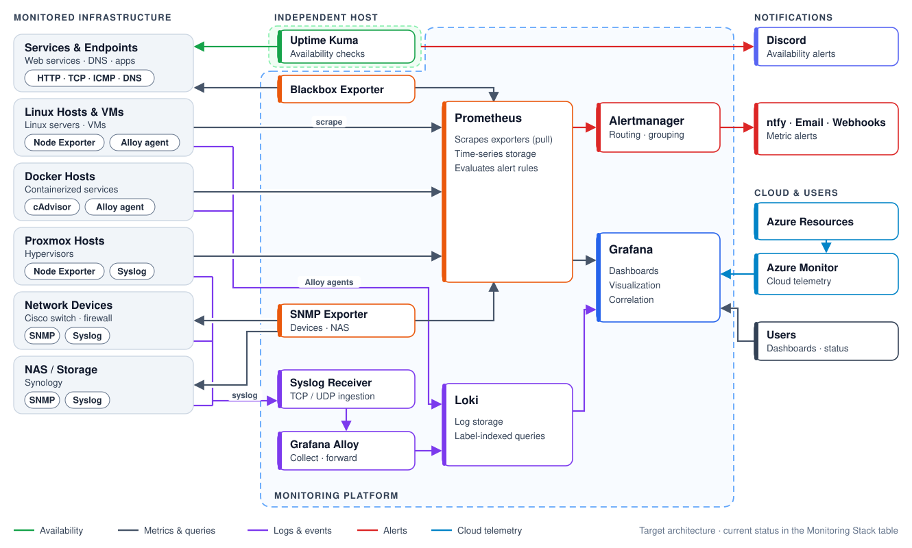

# Monitoring Architecture

Where each monitoring component runs, how data flows between them, how alerts are delivered, and what breaks when a component fails.

**Legend:** 🟢 Operational · 🟡 In Progress · ⚪ Planned

## Architecture Overview



*Figure 1. Target monitoring architecture showing availability, metrics, logs, visualization, cloud telemetry and alerting flows.*

```text
Availability ──► Uptime Kuma

Metrics ───────► Exporters ──► Prometheus ──┐
                                            ├──► Grafana
Logs ──────────► rsyslog / Alloy ──► Loki ──┘

Alerting ──────► Uptime Kuma / Prometheus / Alertmanager
```

## Component Placement

| Component | Runs On | Deployment | Status |
|---|---|---|:---:|
| Uptime Kuma | Docker Monitoring Host | Docker container | 🟢 |
| Prometheus | Docker Monitoring Host | Docker container | 🟢 |
| Grafana | Docker Monitoring Host | Docker container | 🟢 |
| Alertmanager | Docker Monitoring Host | Docker container | 🟡 |
| SNMP Exporter | Docker Monitoring Host | Docker container | 🟢 |
| Blackbox Exporter | Docker Monitoring Host | Docker container | 🟡 |
| Node Exporter | Monitored Linux hosts and VMs | Agent / container | 🟢 |
| cAdvisor | Docker hosts | Docker container | 🟡 |
| Loki | Docker Monitoring Host | Docker container | 🟢 |
| Grafana Alloy | Linux / Docker hosts that need it | Agent / container | 🟢 |
| rsyslog | Docker Monitoring Host | Docker container | 🟢 |
| Azure Monitor | Azure | Cloud service / Grafana data source | ⚪ |

The core services share one Docker Monitoring Host. That's simpler to run but makes the host a single failure domain; moving critical availability monitoring off it is a planned improvement.

## Data Flow

### Availability 🟢

Uptime Kuma checks infrastructure and services directly over HTTP, TCP, ICMP and DNS, separate from the Prometheus pipeline. Blackbox Exporter also probes endpoints, but its results become Prometheus metrics:

```text
Uptime Kuma       → Current availability and notifications
Blackbox Exporter → Probe metrics, trends and metric-based alerting
```

Monitor organization is in [Availability Monitoring](./availability-monitoring.md).

### Metrics 🟢

Prometheus pulls metrics from exporters:

```text
Linux Hosts ───────► Node Exporter ────┐
Docker Hosts ──────► cAdvisor ─────────┤
Network Devices ───► SNMP Exporter ────┼──► Prometheus ───► Grafana
Endpoints ─────────► Blackbox Exporter ┘
```

Node Exporter and cAdvisor run on the monitored systems. SNMP Exporter and Blackbox Exporter sit in between: Prometheus queries the exporter, and the exporter queries the target. Details are in [Metric Monitoring](./metric-monitoring.md).

### Logs 🟢

Logs reach Loki two ways:

```text
Linux / Docker / Applications ──► Grafana Alloy ─────────┐
                                                          ▼
                                                         Loki ──► Grafana
                                                          ▲
Infrastructure / Network ──► rsyslog ──► Log Files ──► Alloy
```

Systems that can run an agent send logs through Alloy directly. Devices that only support syslog forward to the central rsyslog collector, which normalizes and writes events to files before Alloy ships them to Loki. Those files separate ingestion from processing and keep a local copy independent of Loki.

Labels, queries, dashboards and validation are in [Log Monitoring](./log-monitoring.md).

### Visualization 🟢

Grafana queries each data source directly and stores none of the data itself:

```text
Prometheus ────── Metrics 🟢 ──┐
Loki ──────────── Logs 🟢 ─────┼──► Grafana
Azure Monitor ─── Cloud ⚪ ─────┘
```

### Cloud Monitoring ⚪

Azure telemetry is planned to come from Azure Monitor straight into Grafana, not through the on-premises Prometheus or Loki pipelines.

## Alerting

Availability and metrics alerts use separate paths:

```text
Availability Alerting 🟢          Metrics Alerting 🟡

      Uptime Kuma                     Prometheus
           │                         Alert Rules
           ▼                              ▼
    Discord Webhook                 Alertmanager
           │                              ├──► ntfy       ⚪
           ▼                              ├──► Email      ⚪
        Discord                           └──► Webhooks   ⚪
```

Uptime Kuma sends availability and recovery notifications through a Discord webhook. Prometheus evaluates metrics rules, and Alertmanager handles routing, grouping, silencing and delivery. Grafana alerting may be added later for conditions based on data outside Prometheus. See [Alerting](./alerting.md).

## Ports & Protocols

Default or currently defined ports; addressing is omitted.

| Source | Destination | Port / Protocol | Purpose |
|---|---|---|---|
| Prometheus | Node Exporter | `9100/TCP` | Host metrics |
| Prometheus | cAdvisor | `8080/TCP` | Container metrics |
| Prometheus | SNMP Exporter | `9116/TCP` | SNMP exporter queries |
| SNMP Exporter | Network devices | `161/UDP` | SNMP polling |
| Prometheus | Blackbox Exporter | `9115/TCP` | Endpoint probe metrics |
| Prometheus | Alertmanager | `9093/TCP` | Alert delivery |
| Grafana | Prometheus | `9090/TCP` | Metrics queries |
| Grafana | Loki | `3100/TCP` | Log queries |
| Alloy | Loki | `3100/TCP` | Log ingestion |
| Infrastructure sources | rsyslog | `514/TCP` or `514/UDP` | Syslog forwarding |
| Users | Grafana | `3000/TCP` | Dashboard access |
| Users | Uptime Kuma | `3001/TCP` | Availability monitoring interface |
| Uptime Kuma | Discord | `443/TCP` | Availability notifications |
| Grafana | Azure Monitor | `443/TCP` | Cloud telemetry queries ⚪ |

Syslog sources use TCP when they support it, UDP otherwise. Plain syslog has no encryption or sender authentication, so it's limited to trusted internal infrastructure.

## Failure Domains

| Failure | Impact | Still Working |
|---|---|---|
| Prometheus unavailable | Metrics collection and Prometheus alert evaluation stop | Uptime Kuma and logging pipeline |
| Alertmanager unavailable | Alerts may be evaluated but aren't delivered | Metrics collection, Uptime Kuma, logs |
| Loki unavailable | Log ingestion into Loki stops | rsyslog file collection, metrics, Uptime Kuma |
| Alloy unavailable | Log forwarding to Loki stops for affected sources | rsyslog file collection |
| rsyslog unavailable | Central syslog ingestion stops | Direct Alloy collection, metrics, Uptime Kuma |
| Grafana unavailable | Dashboards and investigation unavailable | Data collection and alerting |
| Uptime Kuma unavailable | Availability checks and Discord notifications stop | Metrics and logging pipelines |
| Internet unavailable | External targets and remote notifications may fail | Local collection and dashboards |
| Docker Monitoring Host unavailable | Most centralized monitoring stops | Agents and exporters may keep running locally, but collection and alerting are largely down |

### Shared Monitoring Host

The Docker Monitoring Host is the largest single failure domain. It runs Uptime Kuma, Prometheus, Grafana, Alertmanager, rsyslog, Alloy, Loki and the exporter services. Uptime Kuma doesn't depend on Prometheus, but because they share a host, one host failure takes out both monitoring paths. The planned fix is to move Uptime Kuma to a separate host or device, optionally with an external heartbeat check.

## Persistence

Metrics are stored in Prometheus's time-series database. Syslog is written to files by rsyslog before Alloy sends it to Loki, so an Alloy or Loki outage doesn't stop rsyslog from receiving and saving events. Recovery for other sources depends on the collector. Backup, retention and recovery policies are documented separately.

## Documentation Boundaries

This project documents the monitoring system as a whole. How each container is deployed (Uptime Kuma, Prometheus, Grafana, rsyslog, Alloy, Loki) is documented in the [Docker lab](../containerization-lab/README.md).
