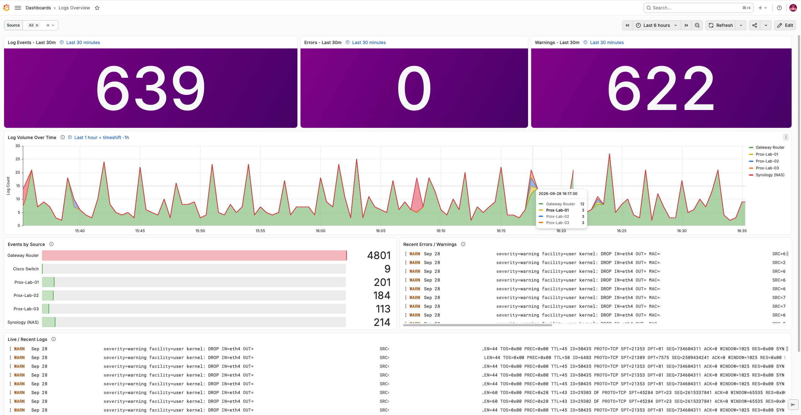

# Log Monitoring

How the homelab's logs are collected, labeled, stored, queried and displayed with rsyslog, Grafana Alloy, Loki and Grafana.



| Component | Role |
|---|---|
| rsyslog | Receives syslog, preserves severity and facility, writes one file per source under `/opt/docker/rsyslog/logs/` |
| Grafana Alloy | Tails the active files, adds source and severity labels, forwards to Loki |
| Loki | Stores logs, indexes a small set of labels, answers LogQL queries |
| Grafana | Dashboards, filtering by source and severity, investigation |

The result is one place to see events from every system instead of logging into each one.

## Architecture

```text
Infrastructure Devices
├── Hypervisors
├── Network Devices
├── Storage Systems
├── Firewalls / Routers
└── Other Syslog-Capable Devices
        │ syslog
        ▼
     rsyslog
        │ persistent log files
        ▼
  Grafana Alloy
        │ labeled log streams
        ▼
       Loki
        │
        ▼
     Grafana ──► Dashboards / Investigation
```

Collection, storage and display are separate components, so each can be maintained on its own.

## Collection with rsyslog

Systems that support syslog forwarding send authentication activity, service starts and stops, configuration changes, scheduled jobs, firewall events, warnings, errors and network device events to the central rsyslog collector. It accepts messages from approved devices and writes each source to its own file on the Docker host:

```text
/opt/docker/rsyslog/logs/
├── firewall.log
├── hypervisor01.log
├── hypervisor02.log
├── network-switch.log
└── storage.log
```

Per-source files make it obvious where an event came from and give Alloy a consistent source name. (Real source names are environment-specific.) The container deployment is in the Docker lab's [rsyslog](../containerization-lab/rsyslog.md) doc, and rotation and retention are in `docs/reference/logs/`.

### Severity Preservation

rsyslog keeps the native syslog severity and facility on every line:

```text
<timestamp> <source> severity=<severity> facility=<facility> <application>: <message>
```

```text
Sep 28 14:30:00 10.0.0.20 severity=warning facility=daemon service: Example warning event
```

| Level | Severity | Meaning |
|---:|---|---|
| 0 | `emerg` | System unusable |
| 1 | `alert` | Immediate action required |
| 2 | `crit` | Critical condition |
| 3 | `err` | Error condition |
| 4 | `warning` | Warning condition |
| 5 | `notice` | Normal but significant condition |
| 6 | `info` | Informational event |
| 7 | `debug` | Debugging information |

Recording severity at collection means nothing downstream has to guess it from words like `error` or `failed`.

## Processing with Grafana Alloy

```text
Log Files ──► File Discovery ──► File Tail ──► Source Labeling ──► Severity Parsing ──► Loki
```

**Source.** Alloy takes the source name from the filename: `/var/log/rsyslog/hypervisor01.log` (the directory as mounted inside the Alloy container) becomes `source="hypervisor01"`. Logs can then be filtered by system without putting addresses in queries.

**Severity.** Alloy parses the `severity=` and `facility=` fields. Severity becomes a Loki label (`severity="warning"`); facility is parsed but not indexed unless there's a reason to, which keeps the label set small.

## Storage with Loki

Each stream has three labels:

```text
job="rsyslog"
source="<source>"
severity="<severity>"
```

Labels are kept low-cardinality. IP addresses, usernames, process IDs, MAC addresses, ports, session IDs and message text stay in the log body, where they can still be searched, instead of becoming labels. That keeps the number of Loki streams under control.

## Queries

```logql
# All centralized logs
{job="rsyslog"}

# One source
{job="rsyslog", source="hypervisor01"}

# Warnings
{job="rsyslog", severity="warning"}

# Errors and worse
{job="rsyslog", severity=~"emerg|alert|crit|err"}

# Warnings and errors
{job="rsyslog", severity=~"emerg|alert|crit|err|warning"}
```

### Why Structured Severity

A keyword search such as `{job="rsyslog"} |~ "(?i)error|failed|failure"` matches normal messages that happen to contain the word "error." Filtering on `severity="err"` uses the level the source system assigned, which makes dashboard counts and future alerts more reliable.

| Dashboard Category | Severities |
|---|---|
| Errors | `emerg`, `alert`, `crit`, `err` |
| Warnings | `warning` |
| Normal / Context | `notice`, `info`, `debug` |

Informational events are kept because they explain errors (a login, a config change or a restart just before the failure), but they aren't counted as problems.

## Grafana Logs Overview

The dashboard answers: how much is being logged, which systems are producing warnings or errors, which sources are busiest, whether volume has changed, and what happened around an incident.

```text
┌────────────────┬────────────────┬────────────────┐
│ Log Events     │ Errors         │ Warnings       │
│ Last 5m        │ Last 5m        │ Last 5m        │
└────────────────┴────────────────┴────────────────┘
┌──────────────────────────────────────────────────┐
│              Log Volume Over Time                │
└──────────────────────────────────────────────────┘
┌───────────────────────┬──────────────────────────┐
│ Events by Source      │ Recent Errors / Warnings │
└───────────────────────┴──────────────────────────┘
┌──────────────────────────────────────────────────┐
│                Live / Recent Logs                │
└──────────────────────────────────────────────────┘
```

### Panel Queries

```logql
# Log Events — last 5 minutes
sum(count_over_time({job="rsyslog", source=~"$source"}[5m]))

# Errors — last 5 minutes
sum(count_over_time({job="rsyslog", source=~"$source", severity=~"emerg|alert|crit|err"}[5m]))

# Warnings — last 5 minutes
sum(count_over_time({job="rsyslog", source=~"$source", severity="warning"}[5m]))

# Log Volume Over Time
sum by (source) (count_over_time({job="rsyslog", source=~"$source"}[$__auto]))

# Events by Source
sum by (source) (count_over_time({job="rsyslog", source=~"$source"}[$__range]))

# Recent Errors / Warnings
{job="rsyslog", source=~"$source", severity=~"emerg|alert|crit|err|warning"}

# Live / Recent Logs
{job="rsyslog", source=~"$source"}
```

### Source Filter

A `source` variable (All, firewall, hypervisor01, hypervisor02, network-switch, storage, …) switches between the whole environment and one system. It's populated from Loki, so new sources appear without editing panels.

### Device-Specific Dashboards

The Logs Overview stays source-neutral. Device-specific views such as firewall drops and denies, interface changes, VPN events, storage failures, hypervisor events, failed logins and admin access belong in their own dashboards (for example, Network / Firewall Logs and Authentication / Security Logs). That way one device's numbers aren't mistaken for the whole environment's.

## Validation

Send test events from a Linux host:

```bash
logger -p local0.warning "TEST WARNING - monitoring validation"
logger -p local0.err "TEST ERROR - monitoring validation"
logger -p local0.crit "TEST CRITICAL - monitoring validation"
```

They should arrive with severities `warning`, `err` and `crit`, and be checked at every stage: source → rsyslog file → Alloy → Loki → Grafana. That confirms transport and processing, not just that the source sent something.

## Historical Logs

Parsing and label changes apply only to new logs. Changing rsyslog templates or Alloy rules, or adding Loki labels, doesn't rewrite existing entries, so older events may lack newer labels or show an unknown severity. That's expected.

## Rotation and Retention

Active files in `/opt/docker/rsyslog/logs/` are rotated separately from the ingestion pipeline, so the directory holds both active and rotated files:

```text
/opt/docker/rsyslog/logs/
├── firewall.log
├── firewall.log-YYYY-MM-DD
├── firewall.log-YYYY-MM-DD.gz
├── hypervisor01.log
├── hypervisor01.log-YYYY-MM-DD
└── hypervisor01.log-YYYY-MM-DD.gz
```

Alloy tails only active `*.log` files; rotated files are kept per the host's rotation policy and aren't treated as new sources. Rotation configuration and procedures are in `docs/reference/logs/`.

## Design Principles

- Centralize infrastructure logs, with collection, processing, storage and display kept separate.
- Keep the source's own severity and normalize metadata before storage.
- Keep Loki labels low-cardinality.
- Don't derive severity from keywords when structured data exists.
- Keep informational events for context.
- Keep the overview dashboard source-neutral; put device detail in dedicated dashboards.
- Test the whole path with controlled events.
