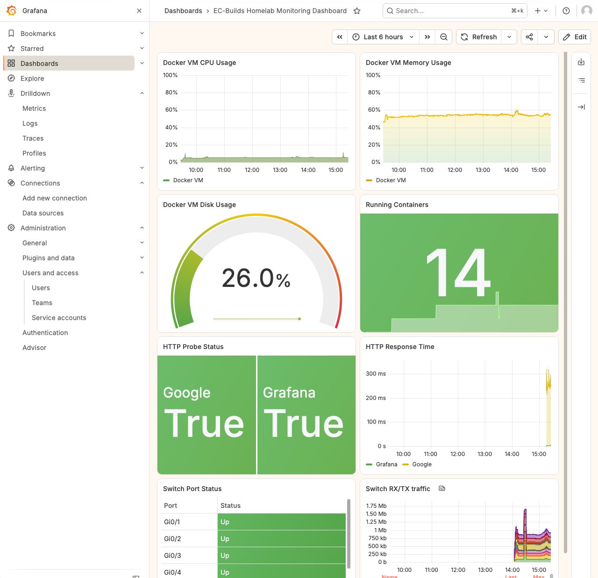

# Metric Monitoring

**Status: 🟡 In Progress**

How the homelab collects, stores and displays infrastructure metrics with Prometheus and Grafana, and how that coverage is being expanded.

Centralized logging is complete. The next stage is wider metrics coverage and a dedicated **Metrics Overview** dashboard in Grafana.

## What Metrics Should Answer

- Are monitored systems reachable and reporting?
- Are hosts running short on CPU or memory?
- Is storage approaching capacity?
- Are containers using unusual amounts of resources?
- Are network interfaces up, and how much traffic are they carrying?
- Are monitored endpoints responding?
- Has system behavior changed over time?

Metrics show what is happening; [logs](./log-monitoring.md) show the events around it.

## Architecture

Prometheus collects and stores metrics, and Grafana displays them.

```text
                         MONITORED SYSTEMS
                  Hosts / Containers / Network / Apps
                               │
          ┌────────────────────┼────────────────────┐
          ▼                    ▼                    ▼
        Hosts              Containers            Network
          │                    │                    │
          ▼                    ▼                    ▼
    Node Exporter           cAdvisor          SNMP Exporter
          │                    │                    │
          └────────────────────┼────────────────────┘
                               ▼
                           Prometheus
                               │
                               ▼
                            Grafana
                               │
                               ▼
                       Metrics Overview
```

| Component | Role | Status |
|---|---|:---:|
| **Prometheus** | Metrics collection, storage and queries | 🟢 |
| **Grafana** | Metrics visualization | 🟢 |
| **Node Exporter** | Linux host metrics | 🟢 |
| **cAdvisor** | Docker container metrics | 🟡 |
| **SNMP Exporter** | Network device metrics | 🟢 |
| **Blackbox Exporter** | Endpoint probing | 🟡 |
| **Alertmanager** | Metrics alert routing | 🟡 |

Container deployment and configuration for each component are documented in the Docker lab.

## Coverage

| Source | Collected by | Example systems | Target metrics |
|---|---|---|---|
| Linux hosts | Node Exporter | `prox-lab-01`–`03`, `docker-lab-01`, `monitor-lab-01` | CPU, memory, filesystem use, disk activity, load, network traffic and errors, uptime |
| Docker hosts | cAdvisor | `docker-lab-01`, `monitor-lab-01` | Running containers, CPU, memory and network use per container, lifecycle events |
| Network devices | SNMP Exporter | `switch-lab-01`, `router-lab-01`, `firewall-lab-01` | Interface state, traffic, errors, discards, uptime, other device-specific data |
| Endpoints | Blackbox Exporter | Selected services | Availability, HTTP response time, probe duration and success |

Available SNMP metrics depend on each device. Blackbox probes test whether a service can actually be reached, not just whether its host is healthy.

## Prometheus

Prometheus discovers configured targets, scrapes them, stores the time series, answers PromQL queries, evaluates alert rules and feeds Grafana.

```text
Monitored System ──► Exporter / Metrics Endpoint ──► Prometheus ──► Grafana
```

Targets, scrape intervals, metric selection and retention will be documented as coverage expands.

## Grafana Metrics Overview

The Metrics Overview is a dashboard separate from the Logs Overview. Its panels currently cover:

- Docker host CPU, memory and disk use
- Running container count
- HTTP endpoint status and response time
- Network interface status and RX/TX traffic



The planned layout starts with environment-wide health and drills down from there:

```text
Metrics Overview
├── Environment Health
├── Host Resources (CPU, Memory, Disk)
├── Container Health
├── Endpoint Availability
├── Network Interfaces
└── Network Traffic
```

Dashboard rules:

- Start with the environment-wide view.
- Show metrics that help troubleshooting, not everything Prometheus collects.
- Keep units and naming consistent.
- Move device- or application-specific detail into separate dashboards (host, Docker, network) as they're needed.

## Alerting

Metrics alerts come after baselines. Prometheus evaluates the rules and Alertmanager routes the notifications. Likely alerts: host or exporter down, sustained resource exhaustion, low disk space, endpoint failure and interface failure. Thresholds will be set after normal behavior has been observed. See [Alerting](./alerting.md).

## Validation

Each integration is checked end to end:

```text
Monitored System ──► Exporter ──► Prometheus Target ──► PromQL Query ──► Grafana Panel
```

1. The exporter or metrics endpoint responds.
2. Prometheus scrapes the target successfully.
3. The expected metrics are present.
4. PromQL returns the expected data.
5. Grafana displays it correctly.

A running exporter alone doesn't prove the path works.

## Implementation Steps

1. **Inventory.** List the systems that should report metrics and pick the collection method for each: Node Exporter for Linux hosts, Node Exporter plus cAdvisor for Docker hosts, SNMP Exporter for network devices, Blackbox Exporter for web endpoints.
2. **Collection.** Deploy or confirm the exporters and check that each system exposes its metrics.
3. **Prometheus.** Add the scrape targets and confirm target health, expected metrics, consistent low-cardinality labels and sensible scrape intervals.
4. **Grafana.** Build the Metrics Overview, starting with environment-wide panels.
5. **Baselines.** Observe normal behavior to find typical utilization, capacity trends and failure conditions.
6. **Alerting.** Write Prometheus alert rules and Alertmanager routes from those baselines.
7. **Documentation.** Record monitored systems, metric sources, Prometheus targets, key PromQL queries, dashboard layout, alert rules, validation and troubleshooting.

This document will become the operational reference for metrics once these steps are done.
