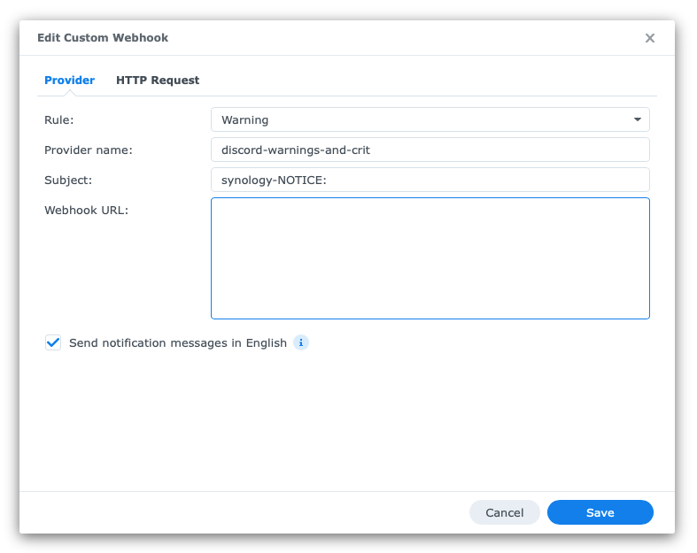
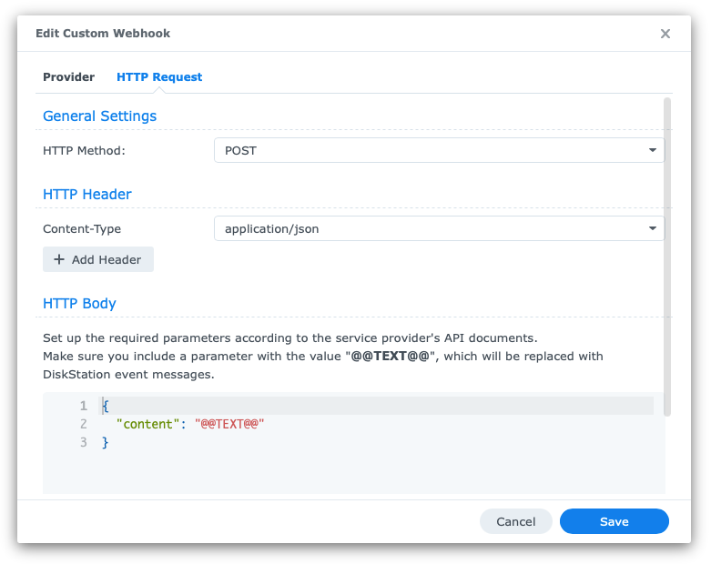
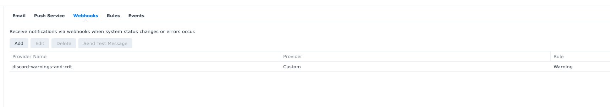

# Synology Notifications

**Status: 🟢 Operational**

The Synology NAS (`nas-lab`) sends warning and critical events to the Discord alerts channel through a DSM webhook. These cover what availability monitoring can't see from outside: drive health, storage capacity and failed backup tasks.

## Architecture

```text
DSM event (warning or critical)
   │
   ▼
Warning notification rule ──► Custom webhook ──► Discord alerts channel
```

The webhook uses its own Discord webhook named for Synology, so messages show their source next to Uptime Kuma, NUT and Proxmox alerts.

## Webhook

**Control Panel → Notification → Webhooks → Add**, provider **Custom**:

| Setting | Value |
|---|---|
| Provider name | `discord-warnings-and-crit` |
| Rule | Warning |
| Subject | `synology-NOTICE:` |
| Webhook URL | The Synology Discord webhook URL |
| Send notification messages in English | On |
| HTTP method | `POST` |
| Header | `Content-Type: application/json` |



*Provider tab: rule, name and subject. The webhook URL is shown empty here; it holds the Discord webhook URL.*

Body:

```json
{
  "content": "@@TEXT@@"
}
```

DSM replaces `@@TEXT@@` with the event message. The default body DSM suggests uses a `text` field, which is what Slack and Synology Chat expect; Discord needs `content`, and rejects a message without it.



*HTTP Request tab with the Discord `content` body.*

## Rule

The webhook uses the built-in **Warning** rule. That rule covers warning **and** critical events, so one webhook is enough:

- Drive health, such as bad sectors or abnormal drive status
- Low volume space and shared-folder quota warnings
- Failed backup or restore tasks
- System events, such as unexpected power events

Adding a second webhook on the **Critical** rule would send every critical event twice.

The NAS is also a NUT client of the UPS (see [NUT Client Setup](../../docs/reference/nut/nut-client-setup.md)), so DSM may report UPS events that overlap with the NUT server's own alerts. A custom rule can turn those off if they add noise.

## Validation

- **Send Test Message** from the webhook arrived in the Discord alerts channel.



*One custom webhook on the Warning rule.*

- The Discord webhook URL is kept out of the repository.

## Related

- [Alerting](./alerting.md): every alert source in the lab and where it goes
