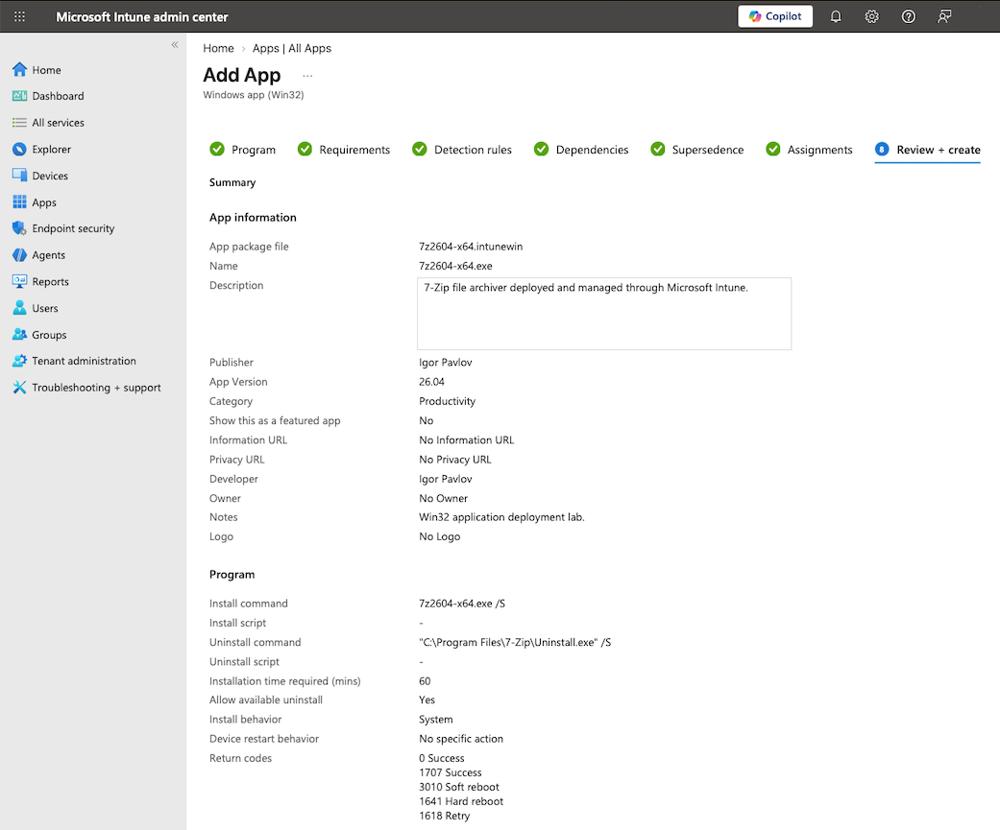
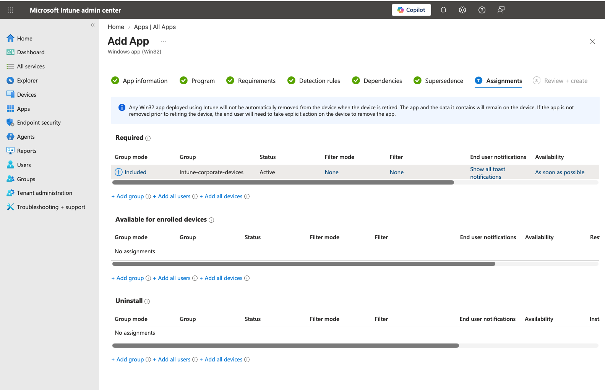
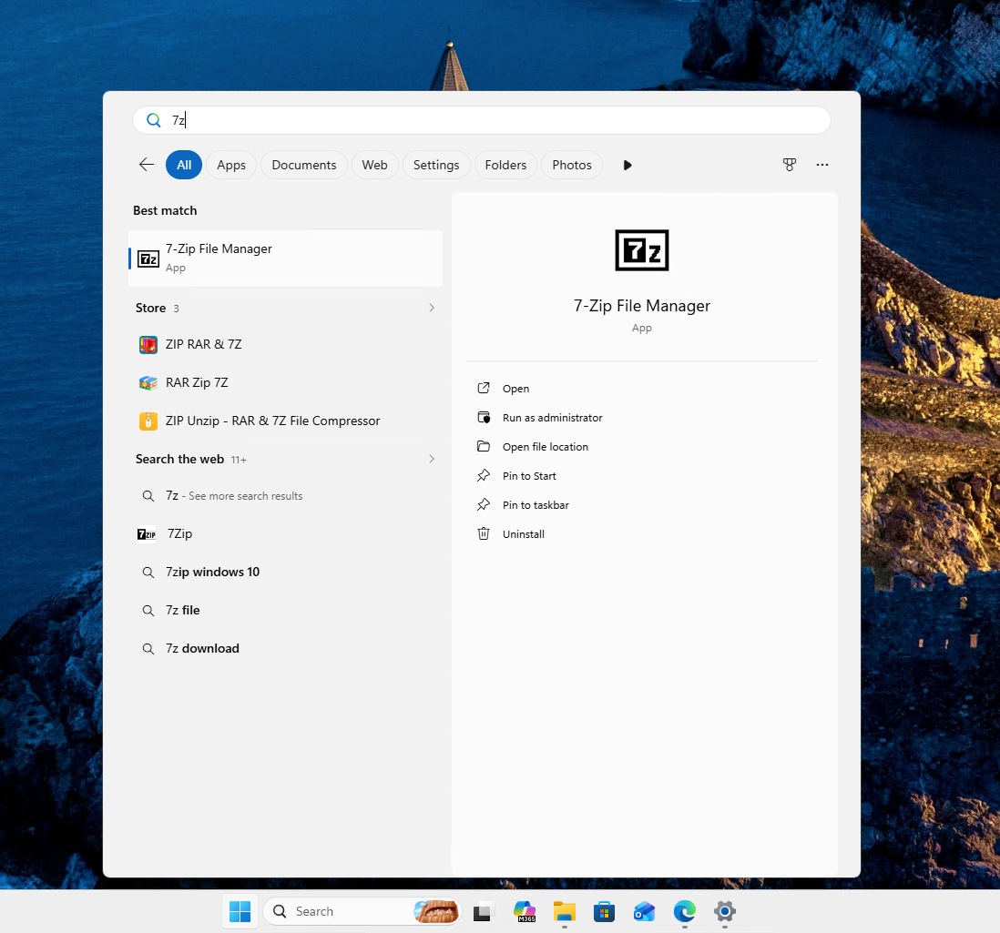
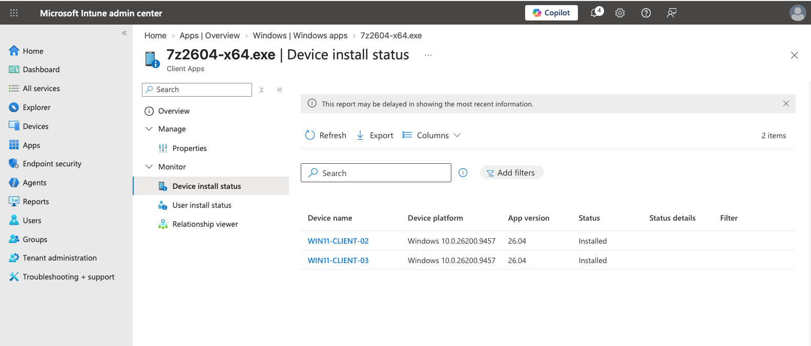
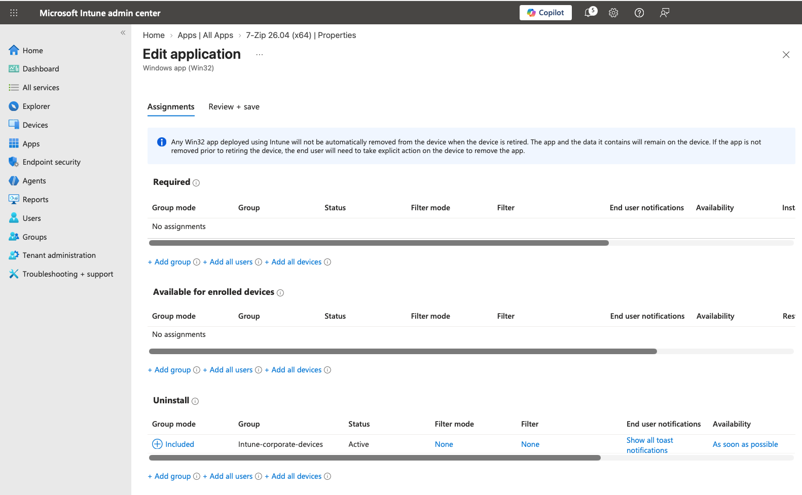
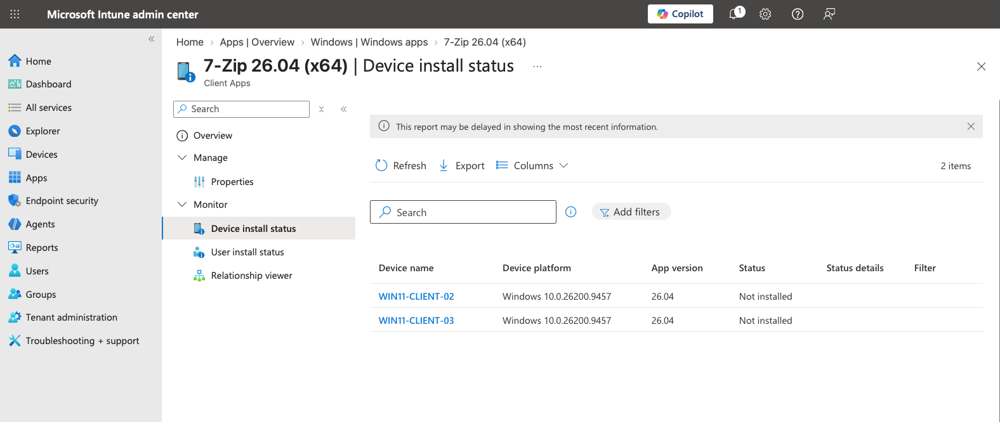

# Application Deployment

**Status: 🟢 Operational**

This document covers Windows application deployment through Microsoft Intune.

The lab uses **7-Zip 26.04 (x64)** to validate the complete Win32 application lifecycle from packaging and Required deployment through detection, reporting, and managed removal.

## Deployment Workflow

```text
Download Application Installer
        ↓
Package Installer as .intunewin
        ↓
Add Windows Win32 App to Intune
        ↓
Configure Application
├── Install / Uninstall Commands
├── System Installation Context
├── Windows Requirements
└── Detection Rule
        ↓
Assign as Required
        ↓
Intune-corporate-devices
        ↓
Managed Endpoint Checks In
        ↓
Intune Management Extension
        ↓
Silent Application Installation
        ↓
Detection Rule Evaluation
        ↓
Intune Reports Installed
        ↓
Change Assignment to Uninstall
        ↓
Managed Application Removal
        ↓
Intune Reports Not Installed
```

## 1. Application Packaging

**Application:** 7-Zip 26.04 (x64)  
**Deployment Type:** Windows Win32 app  
**Installer:** `7z2604-x64.exe`  
**Package Format:** `.intunewin`

The 7-Zip executable installer was packaged using the **Microsoft Win32 Content Prep Tool** before being uploaded to Intune.

Packaging the application as a Win32 app allowed Intune to manage the complete deployment lifecycle, including installation commands, requirements, detection, assignment, and reporting.

## 2. Intune Application Configuration

The Win32 application was configured for silent, machine-wide installation.

| Setting | Configuration |
|---|---|
| Version | 26.04 |
| Architecture | x64 |
| Minimum OS | Windows 11 21H2 |
| Install behavior | System |
| Install command | `7z2604-x64.exe /S` |
| Uninstall command | `"C:\Program Files\7-Zip\Uninstall.exe" /S` |
| Restart behavior | No specific action |

Using the **System** installation context allows Intune to install the application without depending on the signed-in user's local administrative privileges.



## 3. Detection Rule

A file-based detection rule was configured so Intune could determine whether the application was present after deployment.

The rule checks the expected 7-Zip installation location under:

```text
C:\Program Files\7-Zip
```

Detection is an important part of Win32 application management because a successful installer exit alone does not establish the application's managed state. Intune evaluates the configured detection rule to determine whether the application is installed.

## 4. Assignment

The application was assigned as **Required** to:

```text
Intune-corporate-devices
```

A Required assignment was selected to test centrally enforced application deployment rather than optional user installation through Company Portal.

Both corporate Windows test endpoints were therefore expected to receive 7-Zip automatically when they checked in with Intune.



## 5. Endpoint Deployment

`WIN11-CLIENT-02` was online during deployment testing.

After the Intune assignment was processed, 7-Zip installed silently on the managed endpoint without requiring the user to manually download or launch the installer.

The installed application was then verified directly from Windows.



## 6. Offline Device Test

`WIN11-CLIENT-03` was powered off when the Required application assignment was created.

This provided an additional deployment scenario:

```text
Required Application Assigned
        ↓
WIN11-CLIENT-03 Offline
        ↓
No Installation While Offline
        ↓
Device Powered On
        ↓
Device Reconnects to Intune
        ↓
Policy / Application Assignment Processed
        ↓
7-Zip Installed
        ↓
Intune Reports Installed
```

After `WIN11-CLIENT-03` was powered on and reconnected, it synchronized with Intune and subsequently installed the assigned application.

This validated that a Required application assignment did not depend on the endpoint being online when the assignment was originally created. The device processed the outstanding deployment after returning online and checking in with Intune.

## 7. Deployment Reporting

Intune subsequently reported the application as **Installed** on both managed endpoints:

| Device | Application Version | Result |
|---|---:|---|
| `WIN11-CLIENT-02` | 26.04 | Installed |
| `WIN11-CLIENT-03` | 26.04 | Installed |

This provided management-plane confirmation in addition to the endpoint-side verification.



## 8. Managed Uninstall

After successful installation and reporting were validated, the application lifecycle was tested in the opposite direction.

The `Intune-corporate-devices` group was removed from the **Required** assignment and assigned to **Uninstall** instead.

This changed the desired application state for the managed endpoints from installed to not installed.



After the endpoints synchronized with Intune, the configured silent uninstall command was processed and 7-Zip was removed from both devices.

Intune subsequently reported both managed endpoints as **Not installed**, confirming successful application removal.



The managed application lifecycle was therefore validated in both directions:

```text
Package
   ↓
Configure
   ↓
Required Assignment
   ↓
Install
   ↓
Detect
   ↓
Report Installed
   ↓
Change Desired State
   ↓
Uninstall Assignment
   ↓
Remove Application
   ↓
Report Not Installed
```

## Validation

**Status: 🟢 Passed**

The following application-management behaviors were successfully validated:

- Win32 application packaged as `.intunewin`
- Silent installation and uninstall commands configured
- Application installed in System context
- Windows architecture and OS requirements applied
- File-based detection configured
- Application assigned as Required to the corporate device group
- Online managed endpoint received and installed the application
- Application presence verified directly on Windows
- Intune reported successful installation
- Both targeted corporate endpoints reported version 26.04 as Installed
- Endpoint that was offline during assignment received the application after being powered on and reconnecting to Intune
- Required assignment removed and corporate device group reassigned to Uninstall
- Intune successfully removed the application from both managed endpoints
- Both endpoints subsequently reported the application as Not installed

The combined endpoint and Intune reporting evidence validates the complete managed application lifecycle:

```text
Package
   ↓
Configure
   ↓
Assign
   ↓
Device Check-In
   ↓
Install
   ↓
Detect
   ↓
Report Installed
   ↓
Reassign
   ↓
Uninstall
   ↓
Report Not Installed
```
