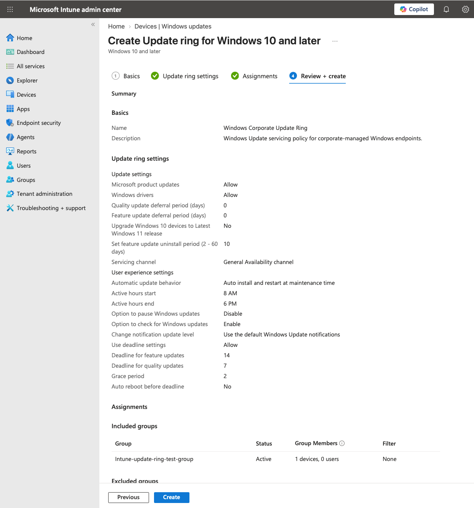
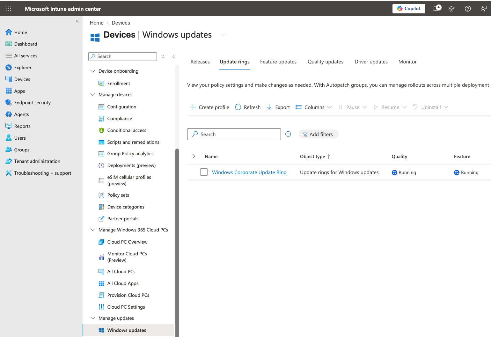
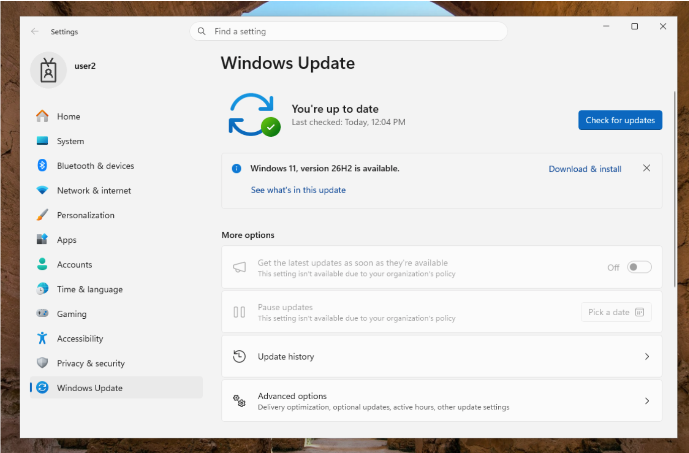
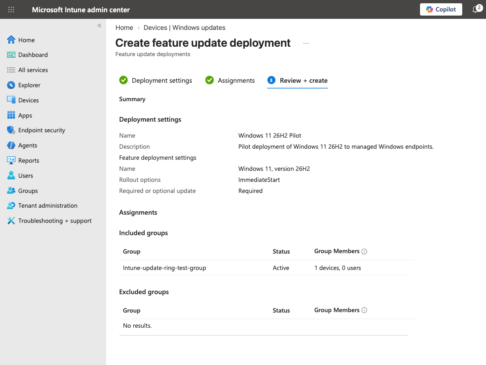
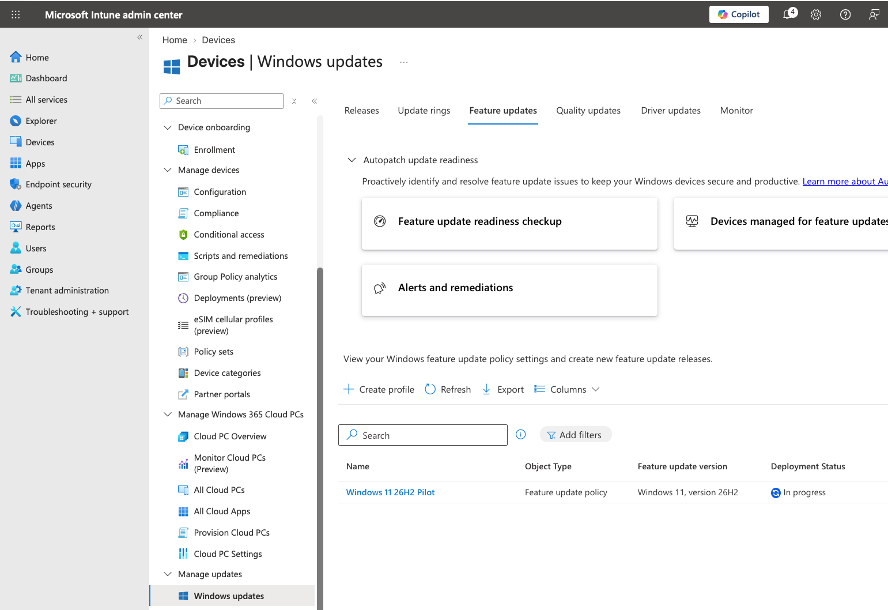

# Windows Update Management

**Status:** 🟢 Operational

This lab implements centralized Windows Update management through Microsoft Intune. An Update Ring defines servicing behavior for a managed Windows endpoint, while a separate Feature Update policy targets Windows 11, version 26H2.

A dedicated pilot device group was used to test the policies before broader deployment. The Update Ring was validated both through Intune reporting and directly on the endpoint, and the pilot endpoint was successfully upgraded to Windows 11 26H2.

> **Validation note:** Windows 11, version 26H2 was already being offered to the pilot endpoint through Windows Update before the Intune Feature Update policy was created. The lab therefore distinguishes between validating Intune policy enforcement, validating the resulting Windows release, and attributing the original 26H2 offer to Intune.

## Objectives

- Configure Windows Update servicing through Microsoft Intune
- Define update installation, restart, and deadline behavior
- Use a dedicated pilot group for controlled deployment
- Separate Update Ring configuration from feature-version targeting
- Target Windows 11 26H2 through a required Feature Update policy
- Validate Update Ring enforcement directly on the endpoint
- Monitor Feature Update deployment status through Intune
- Verify the resulting Windows version after installation

## Deployment Architecture

```text
Microsoft Intune
       │
       ├── Windows Corporate Update Ring
       │       │
       │       ├── Quality update behavior
       │       ├── Feature update behavior
       │       ├── Active hours
       │       ├── Update deadlines
       │       └── Restart behavior
       │
       └── Windows 11 26H2 Pilot
               │
               └── Required feature release
                       │
                       ▼
          Intune-update-ring-test-group
                       │
                       ▼
               WIN11-CLIENT-03
                       │
                       ▼
                Windows Update
                       │
                       ▼
              Windows 11 26H2
                 Build 26300
```

## Pilot Deployment Strategy

Rather than initially assigning the update policies to all corporate-managed endpoints, a dedicated security group was created for update testing.

| Setting | Configuration |
|---|---|
| Pilot Group | `Intune-update-ring-test-group` |
| Membership Type | Assigned |
| Device Members | 1 |
| Pilot Endpoint | `WIN11-CLIENT-03` |

This provided a controlled deployment path where update behavior could be validated on a pilot endpoint before expanding the policy to additional managed devices.

## Windows Update Ring

The `Windows Corporate Update Ring` controls how Windows Update operates on managed endpoints.

### Update Settings

| Setting | Configuration |
|---|---|
| Microsoft product updates | Allow |
| Windows drivers | Allow |
| Quality update deferral | 0 days |
| Feature update deferral | 0 days |
| Upgrade Windows 10 devices to latest Windows 11 release | No |
| Feature update uninstall period | 10 days |
| Servicing channel | General Availability channel |
| Pre-release builds | Not configured |

### User Experience

| Setting | Configuration |
|---|---|
| Automatic update behavior | Auto install and restart at maintenance time |
| Active hours | 8:00 AM – 6:00 PM |
| User option to pause updates | Disabled |
| User option to check for updates | Enabled |
| Update notifications | Default Windows Update notifications |
| Deadline settings | Enabled |
| Feature update deadline | 14 days |
| Quality update deadline | 7 days |
| Grace period | 2 days |
| Auto reboot before deadline | No |

The Update Ring controls servicing behavior but does not by itself define the specific Windows feature release targeted by the separate Feature Update policy.



## Pilot Assignment

The Update Ring was assigned only to the dedicated pilot device group.

```text
Windows Corporate Update Ring
             │
             ▼
Intune-update-ring-test-group
             │
             ▼
      WIN11-CLIENT-03
```

This separated initial update testing from the broader `Intune-corporate-devices` population.

After creation, Intune reported both the quality and feature portions of the Update Ring as **Running**.



## Endpoint Validation of Update Ring

The Update Ring was validated directly on `WIN11-CLIENT-03` rather than relying only on Intune deployment reporting.

After policy synchronization, Windows Update displayed organization-managed controls:

- **Get the latest updates as soon as they're available** was disabled by organizational policy.
- **Pause updates** was disabled by organizational policy.
- **Check for updates** remained available, matching the configured Update Ring behavior.

This provides endpoint-side evidence that the Intune Update Ring reached the pilot device and was controlling the Windows Update user experience.



## Windows 11 26H2 Feature Update

A separate Feature Update deployment was created to target Windows 11, version 26H2 on the pilot endpoint.

| Setting | Configuration |
|---|---|
| Policy | `Windows 11 26H2 Pilot` |
| Target Release | Windows 11, version 26H2 |
| Deployment Type | Required |
| Rollout | Make update available as soon as possible |
| Assignment | `Intune-update-ring-test-group` |
| Target Devices | 1 |

Using a separate Feature Update policy provides a distinction between two update-management responsibilities:

```text
Update Ring
    │
    └── Controls HOW updates are serviced

Feature Update Policy
    │
    └── Targets WHICH Windows feature release is managed
```



## Feature Update Validation Limitation

Windows 11, version 26H2 was already offered through Windows Update on `WIN11-CLIENT-03` before the `Windows 11 26H2 Pilot` Feature Update policy was created.

The endpoint displayed:

```text
Windows 11, version 26H2 is available.
Download & install
```

before the Feature Update policy was assigned.

Because the feature release was already available to the endpoint beforehand, its original appearance in Windows Update cannot be attributed to the Intune Feature Update policy.

The Feature Update policy was subsequently created, configured as Required, assigned to the pilot group, and reported by Intune as **In progress**.

This distinction is intentionally retained rather than treating correlation as evidence that Intune caused the original 26H2 offer.

## Deployment Monitoring

After the Feature Update policy was created, Intune reported the `Windows 11 26H2 Pilot` deployment as **In progress**.

This confirms that Intune was processing the Feature Update deployment for the targeted endpoint.

It does not, by itself, establish that Intune caused Windows Update to originally offer 26H2 because the endpoint had already been offered that release before the policy existed.



At the conclusion of the lab, the Feature Update dashboard had not yet advanced beyond the **In progress** reporting state. Further reporting validation was not pursued within the remaining trial-tenant evaluation window.

## Windows 11 26H2 Endpoint Verification

Windows 11, version 26H2 was successfully installed on `WIN11-CLIENT-03`.

After installation and restart, the resulting operating system state was independently verified using PowerShell:

```powershell
Get-ComputerInfo |
    Select-Object WindowsProductName, WindowsEditionId, WindowsVersion, OsBuildNumber
```

The endpoint reported:

```text
WindowsProductName  WindowsEditionId  WindowsVersion  OsBuildNumber
------------------  ----------------  --------------  -------------
Windows 10 Pro      Professional      2009            26300
```

Because some legacy Windows APIs continue to return older product/version labels, `winver` was also used to verify the installed Windows release.

`winver` confirmed:

```text
Windows 11
Version 26H2
OS Build 26300.9457
```


The endpoint successfully restarted and remained operational after the feature upgrade.

## Validation Summary

| Validation | Result |
|---|---|
| Update Ring created and assigned | ✅ Validated |
| Update Ring reported Running | ✅ Validated |
| Update Ring controls visible on endpoint | ✅ Validated |
| Organization-managed update controls matched configured policy | ✅ Validated |
| 26H2 Feature Update policy created | ✅ Validated |
| Feature Update configured as Required | ✅ Validated |
| Feature Update assigned to pilot group | ✅ Validated |
| Intune Feature Update deployment entered In progress | ✅ Validated |
| 26H2 availability observed on endpoint | ✅ Observed |
| Intune caused the original 26H2 offer | ⚪ Cannot be established |
| Windows 11 26H2 installed successfully | ✅ Validated |
| Post-update Windows version verified | ✅ Validated |
| Endpoint remained operational after restart | ✅ Validated |
| Final Intune Feature Update reporting | 🟡 Remained In progress at conclusion of testing |

The remaining Intune reporting state does not prevent validation of the Update Ring or the resulting endpoint state. The lab records it as an asynchronous reporting limitation rather than claiming a final Feature Update success state that was not observed.

## Key Takeaways

- Intune Update Rings and Feature Update policies serve different management purposes.
- Update Rings control servicing behavior, deadlines, restart behavior, and user experience.
- Feature Update policies target a specific Windows feature release independently of Update Ring configuration.
- Intune portal reporting should be supplemented with endpoint-side validation.
- Organization-managed Windows Update controls provided direct evidence that the Update Ring reached the pilot endpoint.
- Windows 11 26H2 was successfully installed and independently verified as version 26H2, OS build 26300.9457.
- A pre-existing Windows Update offer should not be attributed to a subsequently created Intune Feature Update policy.
- Windows Update management is asynchronous; policy processing, update availability, installation, restart, and Intune reporting can occur at different times.
- A dedicated pilot group limits deployment scope while update-management behavior is validated.
- Testing concluded within the trial-tenant evaluation window rather than extending the lab solely to wait for asynchronous dashboard reporting.

## Final State

The Windows Update management lab is considered **🟢 Operational**.

The Update Ring was configured, assigned, and functionally validated on the pilot endpoint. Windows 11 26H2 was successfully installed, the resulting version and build were independently verified, and the endpoint remained operational after restart.

The Feature Update policy was also configured and targeted through Intune, but final Intune reporting remained **In progress** when testing concluded. Because 26H2 had already been offered to the endpoint before the Feature Update policy was created, the lab intentionally does not claim that Intune initiated the original update offer.

This limitation is documented as part of the validation record rather than extending the trial environment solely to obtain a final dashboard state.