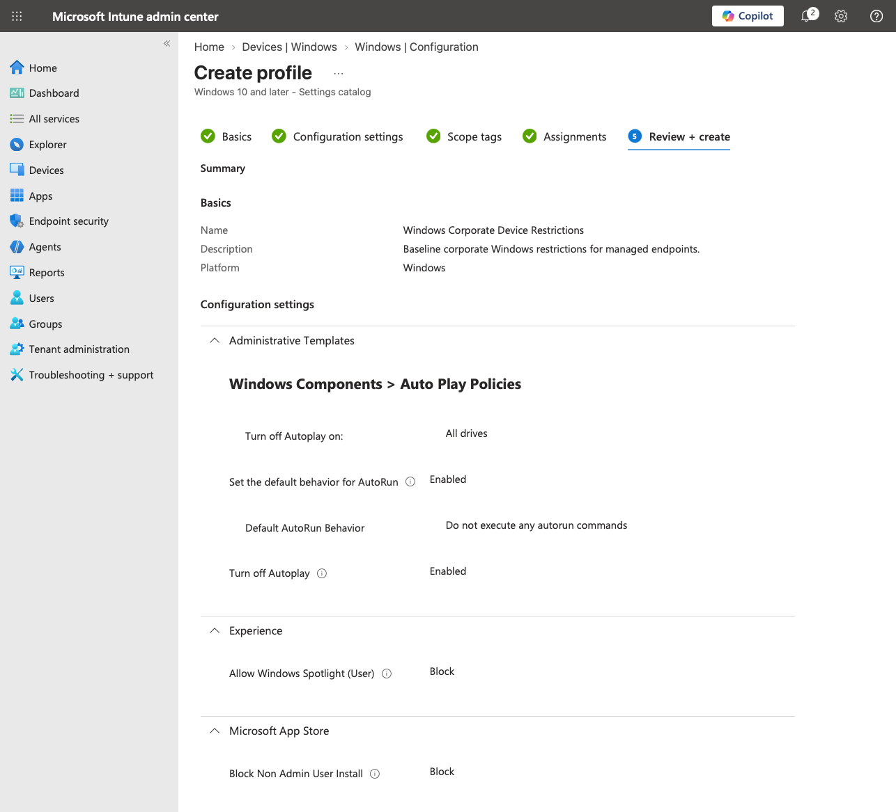
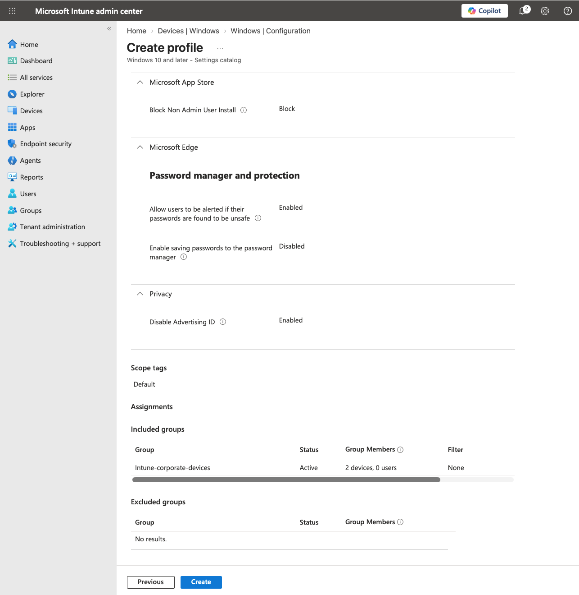

# Windows Configuration Profile

**Status: 🟡 Validation Pending**

This document covers centralized Windows configuration management through Microsoft Intune using the Settings Catalog.

The lab uses a **Windows Corporate Device Restrictions** profile to apply a small corporate endpoint baseline to Microsoft Entra joined and Intune-managed Windows devices.

The objective is to validate the complete configuration-management workflow:

```text
Define Corporate Endpoint Baseline
        ↓
Create Intune Settings Catalog Profile
        ↓
Configure Windows Policies
        ↓
Assign Corporate Device Group
        ↓
Managed Endpoint Checks In
        ↓
Policy Applied
        ↓
Validate Intune Reporting
        ↓
Validate Configuration on Endpoint
```

## 1. Configuration Profile

A Windows Settings Catalog profile was created with the following configuration:

| Setting | Configuration |
|---|---|
| Profile name | `Windows Corporate Device Restrictions` |
| Platform | Windows 10 and later |
| Profile type | Settings catalog |
| Assignment | `Intune-corporate-devices` |
| Scope tag | Default |

The profile is intentionally limited to a small set of understandable corporate workstation controls rather than attempting to reproduce a complete security baseline.

This keeps the configuration focused on validating Intune policy deployment, enforcement, reporting, and troubleshooting.



## 2. AutoPlay and AutoRun Hardening

Automatic execution from attached media was restricted through Windows AutoPlay policies.

| Setting | Configuration |
|---|---|
| Turn off AutoPlay | Enabled |
| Turn off AutoPlay on | All drives |
| Set the default behavior for AutoRun | Enabled |
| Default AutoRun behavior | Do not execute any AutoRun commands |

These controls reduce automatic behavior when removable media or other drives are connected to a managed endpoint.

The distinction between the two controls is important:

- **AutoPlay** controls automatic actions presented or initiated when media is connected.
- **AutoRun** controls execution of AutoRun commands.

Both were configured so the endpoint does not automatically execute content from attached media.

## 3. Windows User Experience

Windows Spotlight was blocked through the profile:

| Setting | Configuration |
|---|---|
| Allow Windows Spotlight (User) | Block |

This demonstrates centralized management of the Windows user experience on corporate-managed endpoints.

## 4. Microsoft Store Restrictions

Non-administrator application installation through Microsoft Store was restricted:

| Setting | Configuration |
|---|---|
| Block Non Admin User Install | Block |

The Microsoft Store itself was not completely disabled.

This preserves the Store servicing path while demonstrating centralized control over user-driven application installation.

## 5. Microsoft Edge Password Management

Microsoft Edge was configured with centrally managed password controls.

| Setting | Configuration |
|---|---|
| Enable saving passwords to the password manager | Disabled |
| Allow users to be alerted if their passwords are found to be unsafe | Enabled |

This prevents users from saving new credentials through the Edge password manager while retaining unsafe-password warnings.

The settings were configured through the enforced **Microsoft Edge** policy category rather than the user-overridable default-settings category.

## 6. Privacy Configuration

The Windows Advertising ID was disabled:

| Setting | Configuration |
|---|---|
| Disable Advertising ID | Enabled |

This demonstrates centralized enforcement of a Windows privacy setting through Intune.

## 7. Group Assignment

The configuration profile was assigned to:

```text
Intune-corporate-devices
```

At deployment time, the group contained two corporate Windows endpoints.

Using a dedicated corporate-device group keeps the policy scoped to the endpoints participating in the managed-device lab rather than assigning the profile tenant-wide.



## Configuration Architecture

```text
Microsoft Intune
        │
        │ Settings Catalog
        ▼
Windows Corporate Device Restrictions
        │
        ├── AutoPlay / AutoRun Hardening
        ├── Windows Spotlight Restriction
        ├── Microsoft Store Restriction
        ├── Edge Password Management
        └── Advertising ID Privacy Control
        │
        ▼
Intune-corporate-devices
        │
        ├── WIN11-CLIENT-02
        └── WIN11-CLIENT-03
        │
        ▼
Windows MDM Policy Processing
        │
        ▼
Configured Corporate Endpoint
```

## 8. Deployment Validation

**Status: 🟡 Pending**

The profile has been created and assigned to the corporate Windows device group.

The following validation still needs to be completed.

### Intune Reporting

- [ ] Synchronize `WIN11-CLIENT-02` with Intune
- [ ] Synchronize `WIN11-CLIENT-03` with Intune
- [ ] Confirm profile assignment reaches both endpoints
- [ ] Confirm configuration profile reports successful deployment
- [ ] Review per-setting status for errors or conflicts
- [ ] Capture successful deployment evidence

**Evidence placeholder:**

```markdown

```

### Endpoint Validation

At least several controls should be validated directly from a managed Windows endpoint rather than relying exclusively on Intune reporting.

- [ ] Confirm Edge password saving is disabled by policy
- [ ] Confirm Windows Spotlight is restricted
- [ ] Confirm AutoPlay/AutoRun behavior is restricted
- [ ] Confirm non-administrator Microsoft Store installation restriction
- [ ] Confirm Advertising ID policy is applied
- [ ] Capture endpoint-side evidence of an enforced setting

**Evidence placeholder:**

```markdown

```

## Validation

**Status: 🟡 In Progress**

### Configuration

- [x] Windows Settings Catalog profile created
- [x] Corporate endpoint restrictions configured
- [x] AutoPlay disabled for all drives
- [x] AutoRun commands disabled
- [x] Windows Spotlight blocked
- [x] Non-administrator Microsoft Store installation restricted
- [x] Edge password saving disabled
- [x] Edge unsafe-password alerts enabled
- [x] Windows Advertising ID disabled
- [x] Profile assigned to `Intune-corporate-devices`

### Deployment

- [ ] Profile successfully received by managed endpoints
- [ ] Intune reports successful configuration
- [ ] Per-setting deployment status reviewed
- [ ] Endpoint-side policy enforcement verified
- [ ] Deployment evidence captured

Once these tests are complete, the configuration profile can be considered fully validated:

```text
Define
   ↓
Configure
   ↓
Assign
   ↓
Sync
   ↓
Apply
   ↓
Report
   ↓
Verify
```

## Next Steps

After configuration-profile validation:

1. Integrate Intune compliance state with Microsoft Entra Conditional Access.
2. Require a compliant managed device for a controlled test user or resource.
3. Validate access behavior from compliant and noncompliant device states.