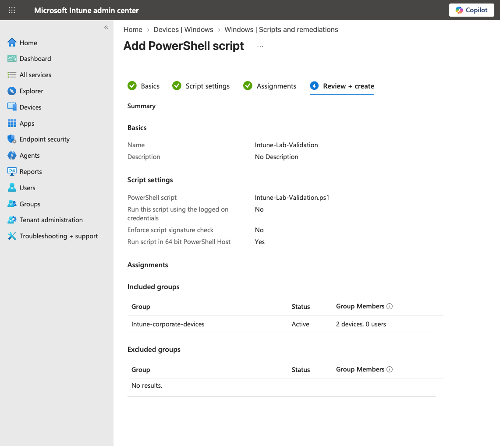
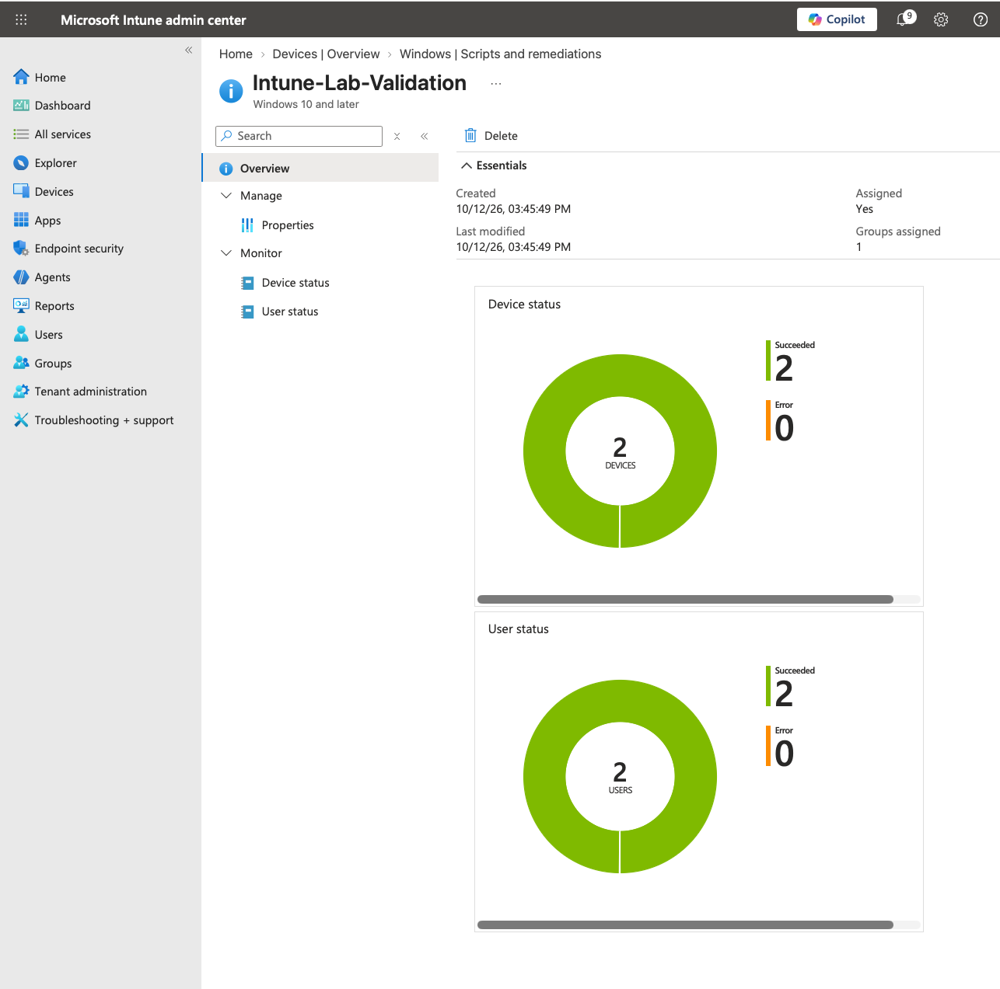
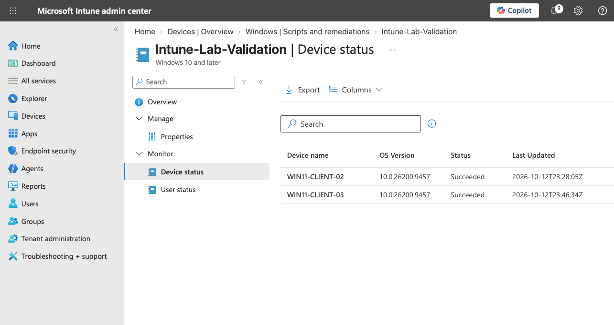
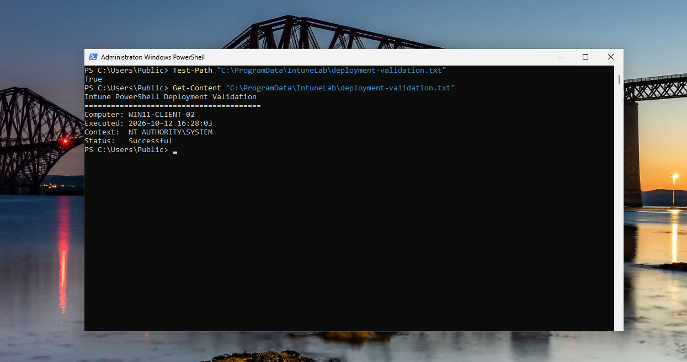

# PowerShell Script Deployment

**Status:** 🟢 Operational

This lab demonstrates centralized PowerShell script deployment to managed Windows endpoints through Microsoft Intune.

A validation script was deployed to corporate-managed devices using the Intune Management Extension. The script executed in the local SYSTEM security context and created a validation artifact on the endpoint. Deployment was verified through both Intune reporting and direct endpoint inspection.

## Objectives

- Deploy a PowerShell script through Microsoft Intune
- Target managed corporate Windows endpoints
- Execute the script using the SYSTEM security context
- Use the 64-bit PowerShell host
- Monitor script execution through Intune
- Validate the expected result directly on an endpoint
- Compare management-plane reporting with endpoint-side evidence

## Deployment Workflow

```text
PowerShell Script
       │
       ▼
Microsoft Intune
       │
       ▼
Intune-corporate-devices
       │
       ├── WIN11-CLIENT-02
       └── WIN11-CLIENT-03
       │
       ▼
Intune Management Extension
       │
       ▼
64-bit PowerShell
NT AUTHORITY\SYSTEM
       │
       ▼
Validation Artifact
       │
       ▼
C:\ProgramData\IntuneLab\
deployment-validation.txt
```

## Script Configuration

The `Intune-Lab-Validation` PowerShell script was uploaded to Intune and assigned to the corporate device group.

| Setting | Configuration |
|---|---|
| Script | `Intune-Lab-Validation.ps1` |
| Run using logged-on credentials | No |
| Execution context | SYSTEM |
| Enforce script signature check | No |
| PowerShell host | 64-bit |
| Assignment | `Intune-corporate-devices` |
| Target devices | 2 |

Running without the logged-on user's credentials causes the script to execute in the local SYSTEM context, which is appropriate for device-level administrative automation that should not depend on the privileges of the interactive user.



## PowerShell Script

The validation script creates a dedicated directory under `C:\ProgramData`, records execution information, and writes the results to a text file that can be independently inspected on the endpoint.

```powershell
$Folder = "C:\ProgramData\IntuneLab"
$File = "$Folder\deployment-validation.txt"

if (-not (Test-Path $Folder)) {
    New-Item -Path $Folder -ItemType Directory -Force | Out-Null
}

$Content = @"
Intune PowerShell Deployment Validation
========================================
Computer: $env:COMPUTERNAME
Executed: $(Get-Date -Format "yyyy-MM-dd HH:mm:ss")
Context:  $([System.Security.Principal.WindowsIdentity]::GetCurrent().Name)
Status:   Successful
"@

Set-Content -Path $File -Value $Content -Encoding UTF8
```

The script records four pieces of validation information:

| Field | Purpose |
|---|---|
| `Computer` | Identifies the endpoint that executed the script |
| `Executed` | Records the execution timestamp |
| `Context` | Identifies the Windows security context used for execution |
| `Status` | Records the expected successful completion state |

The script intentionally creates a simple, deterministic artifact rather than making a significant system change. This provides a low-risk method of validating remote PowerShell execution through Intune.

The resulting artifact is written to:

```text
C:\ProgramData\IntuneLab\deployment-validation.txt
```

## Deployment

The script was assigned to the `Intune-corporate-devices` group containing both managed Windows endpoints.

After the endpoints checked in and processed the assignment, Intune reported successful execution across both targeted devices.

The deployment dashboard reported:

| Result | Count |
|---|---:|
| Devices targeted | 2 |
| Devices succeeded | 2 |
| Errors | 0 |



## Device-Level Reporting

Device-level reporting was reviewed to confirm that both managed endpoints independently processed the script.

| Device | Status |
|---|---|
| `WIN11-CLIENT-02` | Succeeded |
| `WIN11-CLIENT-03` | Succeeded |



## Endpoint Validation

Intune reporting was supplemented with direct endpoint validation.

The script was designed to create the following artifact:

```text
C:\ProgramData\IntuneLab\deployment-validation.txt
```

The artifact was first verified with:

```powershell
Test-Path "C:\ProgramData\IntuneLab\deployment-validation.txt"
```

The endpoint returned:

```text
True
```

The contents were then inspected:

```powershell
Get-Content "C:\ProgramData\IntuneLab\deployment-validation.txt"
```

The resulting validation data confirmed:

- The expected validation artifact was created
- The script executed on the intended endpoint
- Execution occurred under `NT AUTHORITY\SYSTEM`
- The script recorded a successful execution state



## Validation

- [x] PowerShell script created
- [x] Script uploaded to Microsoft Intune
- [x] Script configured for 64-bit PowerShell
- [x] Script configured to run without logged-on user credentials
- [x] Script assigned to `Intune-corporate-devices`
- [x] Both managed endpoints received the assignment
- [x] Intune reported successful execution on both endpoints
- [x] No deployment errors reported
- [x] Validation artifact confirmed on endpoint
- [x] Artifact contents inspected
- [x] SYSTEM execution context verified

## Validation Model

The deployment was validated at two independent layers:

```text
Management Plane
Microsoft Intune
      │
      ├── WIN11-CLIENT-02 → Succeeded
      └── WIN11-CLIENT-03 → Succeeded
                    │
                    ▼
Endpoint
      │
      ├── Validation file exists
      ├── Expected output recorded
      └── NT AUTHORITY\SYSTEM confirmed
```

This provides stronger evidence than relying on portal reporting alone. Intune confirms that the management workflow completed, while endpoint inspection confirms that the expected state was actually produced on the Windows device.

## Key Takeaways

- Microsoft Intune can centrally execute PowerShell automation across managed Windows endpoints.
- Device-level administrative scripts can execute independently of the logged-on user's privileges by using the SYSTEM security context.
- The 64-bit PowerShell host can be explicitly selected for script execution.
- Intune script execution and reporting are asynchronous and may not appear immediately after assignment.
- Portal success should be supplemented with endpoint validation when the resulting system state is important.
- Creating a deterministic validation artifact provides a simple method for confirming that remote automation produced the intended result.

## Result

The PowerShell deployment successfully completed on both targeted Windows endpoints with no reported errors.

Direct inspection of `WIN11-CLIENT-02` independently confirmed that the validation artifact was created and that the script executed successfully under `NT AUTHORITY\SYSTEM`.

**PowerShell script deployment: 🟢 Validated**