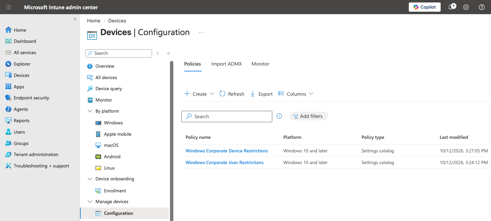
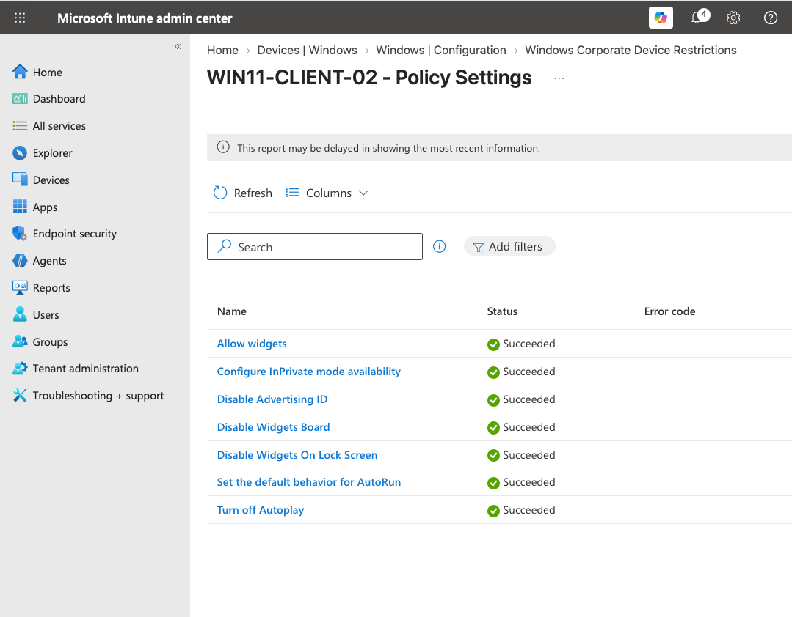
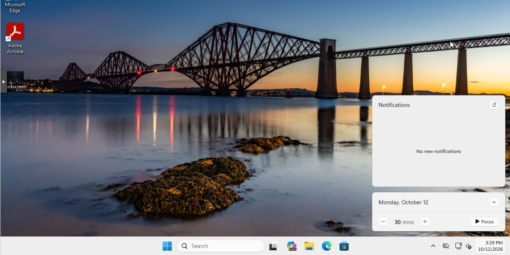
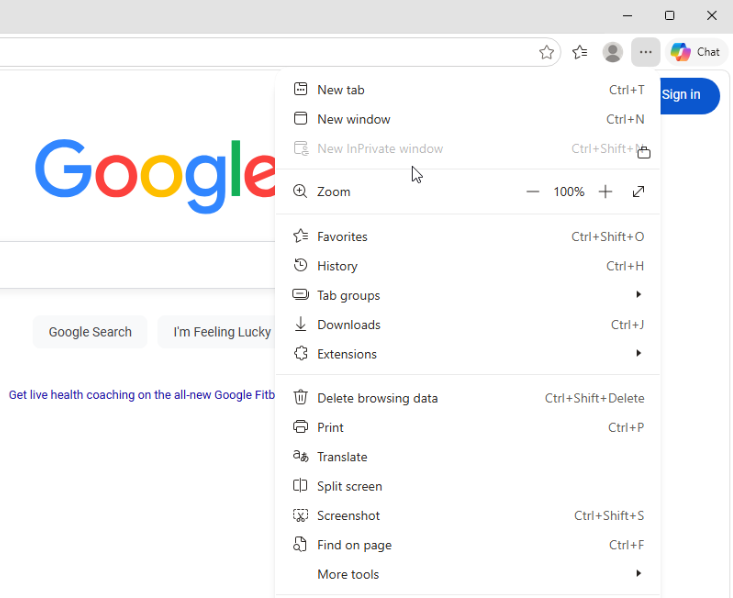
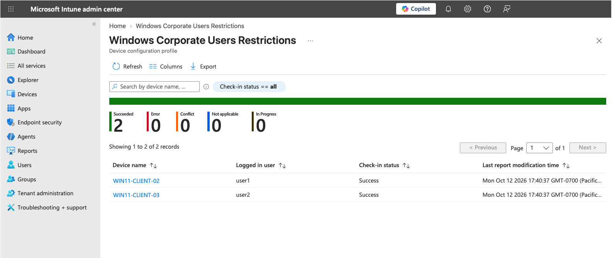

# Windows Configuration Profiles

**Status:** 🟢 Operational  
**Platform:** Windows 11  
**Management:** Microsoft Intune  
**Profile Type:** Settings Catalog

## Overview

Microsoft Intune configuration profiles were implemented to centrally manage device- and user-scoped Windows settings across the corporate endpoint lab.

Two profiles were deployed:

| Profile | Scope | Purpose |
|---|---|---|
| `Windows Corporate Device Restrictions` | Device | Enforce Windows and Microsoft Edge configuration standards |
| `Windows Corporate User Restrictions` | User | Enforce restrictions within managed user sessions |

## Device Configuration

The **Windows Corporate Device Restrictions** profile was deployed to managed corporate Windows endpoints using the Intune Settings Catalog.

The validated configuration included:

| Setting | Purpose |
|---|---|
| Allow widgets | Controls Windows widget availability |
| Configure InPrivate mode availability | Disables Microsoft Edge InPrivate browsing |
| Disable Advertising ID | Reduces advertising-based user tracking |
| Disable Widgets Board | Removes access to the Windows Widgets board |
| Disable Widgets On Lock Screen | Prevents widgets from appearing on the lock screen |
| Set the default behavior for AutoRun | Establishes controlled AutoRun behavior |
| Turn off Autoplay | Prevents automatic media execution |

Per-setting deployment results on `WIN11-CLIENT-02` confirmed that all seven configured settings were successfully processed.

## Endpoint Validation

Intune reporting was supplemented with functional endpoint testing to confirm that the configuration produced the intended Windows behavior.

### Widgets

The Windows taskbar was inspected after policy synchronization. The Widgets interface was no longer available, confirming enforcement of the configured widget restrictions.

### Microsoft Edge InPrivate Browsing

Microsoft Edge was opened and its menu inspected after policy application.

The **New InPrivate window** option was present but disabled, confirming enforcement of the configured InPrivate browsing restriction.

## User Configuration

A separate **Windows Corporate User Restrictions** profile was created to validate user-scoped policy management.

The profile enabled:

**Prohibit access to Control Panel and PC settings (User)**

The policy was assigned to the managed Intune user group rather than directly to devices.

Intune subsequently reported successful processing for both managed user/device sessions:

| Device | User | Result |
|---|---|---|
| `WIN11-CLIENT-02` | `user1` | Success |
| `WIN11-CLIENT-03` | `user2` | Success |

## User Policy Validation

Functional testing was performed from the managed Entra user session.

Attempting to access the restricted Windows interface produced the expected system restriction message:

> This operation has been cancelled due to restrictions in effect on this computer. Please contact your system administrator.

This provided endpoint-level confirmation that the user-scoped configuration was being enforced rather than relying solely on Intune reporting.

## Troubleshooting

User-scoped policy testing exposed an enrollment-context issue with the lab's manual **Enroll only in device management** workflow.

The original MDM enrollment authenticated to Intune using the organizational user but had been initiated from a local administrator Windows session. Endpoint investigation showed that the MDM enrollment was associated with the local administrator's Windows SID rather than the intended Entra user's SID.

Troubleshooting included:

- Intune per-user and per-device reporting
- `dsregcmd /status`
- Windows user SID comparison
- HKCU policy inspection
- MDM diagnostic event logs
- MDM enrollment registry inspection
- Controlled MDM re-enrollment

Re-enrolling from the intended Entra user's Windows session created an enrollment associated with the correct Entra SID. After synchronization, the user-scoped policy applied successfully and endpoint enforcement was confirmed.

Detailed investigation is documented in [`troubleshooting.md`](./troubleshooting.md).

## Validation Summary

| Validation | Result |
|---|---|
| Device configuration profile deployed | ✅ |
| 7 device settings successfully processed | ✅ |
| Widgets restriction functionally tested | ✅ |
| Edge InPrivate restriction functionally tested | ✅ |
| User configuration profile deployed | ✅ |
| Both managed user sessions reported Success | ✅ |
| Control Panel restriction functionally tested | ✅ |
| User-scoped enrollment issue root cause identified | ✅ |
| Corrected enrollment behavior validated | ✅ |

## Production Considerations

The lab used manual MDM enrollment because the Microsoft Entra ID Premium capabilities required for automatic MDM enrollment were unavailable under the lab licensing.

Manual enrollment was useful for testing but exposed additional dependency on the Windows user context used during enrollment.

A production implementation would evaluate **Microsoft Entra automatic MDM enrollment** and **Windows Autopilot** to establish a repeatable corporate provisioning workflow and avoid reliance on separate manual MDM enrollment.

## Key Takeaways

- Intune Settings Catalog profiles can manage both device- and user-scoped Windows configuration.
- Per-setting reporting is valuable for identifying unsupported or unsuccessful settings.
- Intune portal success should be supplemented with endpoint functional testing.
- Device-scoped and user-scoped policies depend on different Windows management contexts.
- The Windows identity associated with manual MDM enrollment can affect user-scoped policy processing.
- Cloud authentication, Windows security context, MDM enrollment, and Intune policy assignment should be validated independently when troubleshooting.
- Production enrollment architecture should minimize manual provisioning steps and establish a consistent corporate device lifecycle.