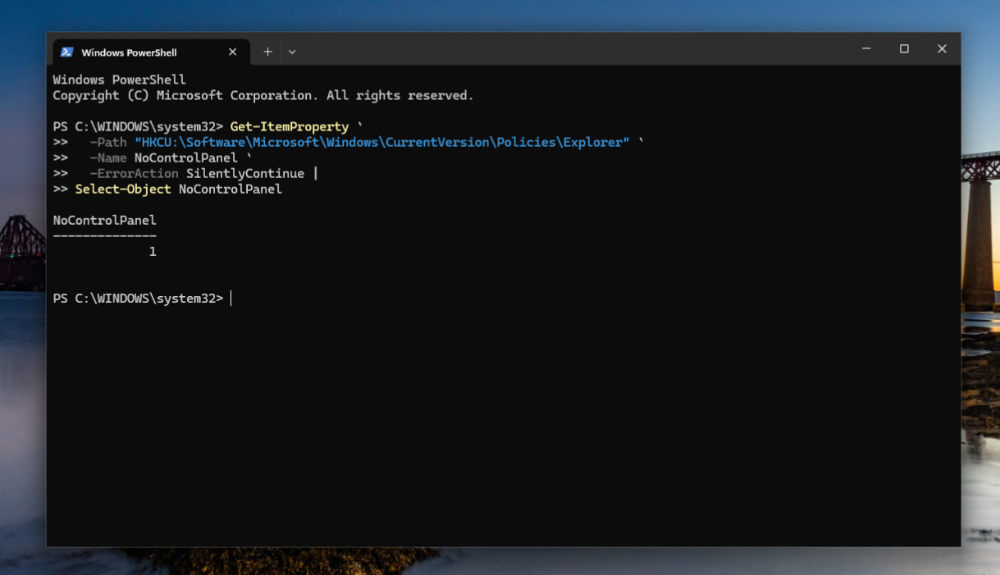

# Troubleshooting

Troubleshooting performed while deploying and validating Microsoft Intune management across the Windows lab.

The troubleshooting approach emphasized correlating Intune reporting with endpoint state rather than relying on management-plane status alone.

| Issue | Investigation | Root Cause | Resolution / Validation |
|---|---|---|---|
| **User-scoped policy applied to the wrong Windows account** | Intune eventually reported the Control Panel restriction as successful, but the Entra user could still access Settings. Compared `HKCU` state between accounts, queried MDM event logs, correlated Windows SIDs, and inspected `HKLM\SOFTWARE\Microsoft\Enrollments`. | Manual **Enroll only in device management** enrollment authenticated as `user1` but was initiated from a local administrator session. The enrollment UPN was `user1`, while its Windows SID belonged to the local administrator. | Removed the MDM enrollment and re-enrolled while signed into Windows as the actual Entra user. The new enrollment SID matched the Entra user's `S-1-12-1-...` SID. After synchronization, `NoControlPanel = 1` appeared in the intended user's `HKCU` and the restriction worked. |
| **Configuration settings reported Not applicable** | Reviewed Intune per-setting results and verified the endpoint Windows edition/build. | Some Settings Catalog options selected during testing were not applicable to the endpoint's Windows Pro configuration. | Removed or replaced unsuitable settings and validated the final device profile with all configured settings reporting **Succeeded**. |
| **Required Win32 application assigned while endpoint was offline** | 7-Zip was assigned as Required while one managed endpoint was powered off. | No fault existed; Intune application deployment is asynchronous and the assignment remained outstanding. | After the endpoint reconnected and checked in, Intune delivered the assignment and installed the application successfully. |
| **Application installed before Intune reporting updated** | 7-Zip was present and functional on the endpoint while the portal had not yet reached its final state. | Intune reporting lagged behind endpoint execution. | Allowed reporting to converge and validated both endpoint installation and eventual Intune **Installed** status. |
| **Win32 application state required independent detection** | Packaged 7-Zip with a silent installer and configured file-based detection for `7z.exe`. | Installer execution alone does not establish Intune's managed application state. | Detection verified the expected installation, and both endpoints ultimately reported **Installed**. Managed uninstall was also tested through Intune. |
| **Endpoint reported Noncompliant despite several passing controls** | Reviewed per-setting compliance results rather than relying only on overall device state. | BitLocker, storage encryption, and minimum OS version were responsible for the overall Noncompliant state. | Remediated the failed controls, synchronized the endpoint, and validated its return to **Compliant**. |
| **Minimum OS version unexpectedly failed compliance** | Compared the endpoint build with the value configured in the compliance policy. | The policy used `26200` instead of the expected version format `10.0.26200.0`. | Corrected the version baseline and allowed Intune to reevaluate compliance. |
| **Manual MDM enrollment failed with `0x80180014`** | Repeated enrollment while changing only the personally owned Windows restriction. | Manual MDM enrollment was classified as Personal and was therefore blocked when personally owned Windows enrollment was prohibited. | Temporarily allowing personally owned Windows devices allowed the same enrollment workflow to succeed, confirming the restriction as the cause. |
| **Manual enrollment failed from a standard Windows session** | Compared organizational authentication, Intune access, local group membership, and Windows security tokens. | Cloud permissions and local Windows privileges are separate. The interactive user lacked the local privileges required for the enrollment operation. | Temporarily added the Entra user to local Administrators, verified the elevated token with `whoami /groups`, completed enrollment from the correct user context, and validated the resulting enrollment SID. |
| **PowerShell deployment required endpoint confirmation** | Intune reported both devices as Succeeded, then the expected endpoint artifact was checked independently. | Portal success establishes management-plane execution but does not by itself demonstrate the intended endpoint result. | Verified `C:\ProgramData\IntuneLab\deployment-validation.txt` existed and recorded `NT AUTHORITY\SYSTEM` as the execution context. |
| **Feature update remained In progress after assignment** | Verified Update Ring configuration, pilot-group targeting, feature-update assignment, and deployment state separately. | Windows servicing through Intune is asynchronous; successful policy targeting does not mean the feature update has already completed. | Kept final endpoint OS-version verification pending until Windows 11 26H2 completes on the pilot endpoint. |

## Featured Investigation: User-Scoped Policy Context

The most significant troubleshooting case involved a user-scoped configuration profile that initially applied to the wrong Windows account.

The intended policy was:

**Prohibit access to Control Panel and PC settings (User)**

Intune eventually reported successful policy processing, but the intended Entra user could still access the restricted interface. Testing showed that the same restriction was instead being enforced against the local administrator account.

### Endpoint Investigation

The corresponding user policy value was checked from each Windows session:

```powershell
Get-ItemProperty `
  -Path "HKCU:\Software\Microsoft\Windows\CurrentVersion\Policies\Explorer" `
  -Name NoControlPanel `
  -ErrorAction SilentlyContinue |
Select-Object NoControlPanel
```

The value was initially absent from the intended Entra user's `HKCU`, while the local administrator had:

```text
NoControlPanel
--------------
1
```

MDM diagnostic event logs were then queried and showed that the `NoControlPanel` policy was being processed against the local administrator's Windows SID.

The intended Entra user's SID was obtained with:

```powershell
whoami /user
```

No corresponding `NoControlPanel` MDM events were initially found for that SID.

### Enrollment Correlation

The MDM enrollment metadata under:

```text
HKLM\SOFTWARE\Microsoft\Enrollments
```

revealed the underlying identity mismatch.

The original enrollment contained:

```text
UPN = user1@<tenant>
SID = local administrator SID
```

The organizational account had authenticated to Intune, but the enrollment itself had been initiated from the local administrator Windows session.

This explained why device-scoped Intune management worked while the user-scoped policy was processed against the wrong Windows profile.

### Controlled Re-Enrollment

The existing MDM connection was removed while preserving the Microsoft Entra device join.

The intended Entra user was temporarily granted the local privileges required to perform manual enrollment. The endpoint was then enrolled again using **Enroll only in device management** while signed into Windows as that Entra user.

Inspection of the new enrollment showed:

```text
UPN = user1@<tenant>
SID = Entra user1 SID
```

The enrollment was now associated with the intended Windows security context.

### Final Validation

After synchronization, the registry was checked again from the Entra user session:

```powershell
Get-ItemProperty `
  -Path "HKCU:\Software\Microsoft\Windows\CurrentVersion\Policies\Explorer" `
  -Name NoControlPanel `
  -ErrorAction SilentlyContinue |
Select-Object NoControlPanel
```

The result was:

```text
NoControlPanel
--------------
1
```



The restriction was also functionally tested on the endpoint and successfully prevented access to the restricted Windows interface.

### Root Cause

The original manual MDM enrollment authenticated to Intune using the intended organizational account but was initiated from a local administrator Windows session.

As a result, the enrollment UPN identified the organizational user while the enrollment SID identified the local administrator.

Re-enrolling from the actual Entra user session associated the MDM enrollment with the correct Entra SID and allowed the user-scoped policy to apply to the intended Windows profile.

### Production Consideration

The lab used manual MDM enrollment because the Microsoft Entra ID Premium capabilities required for automatic MDM enrollment were unavailable under the lab licensing.

The re-enrollment procedure was therefore a lab-specific workaround used to validate the enrollment-context issue.

A production deployment would evaluate **Microsoft Entra automatic MDM enrollment** and **Windows Autopilot** to establish a repeatable corporate provisioning workflow without relying on separate manual MDM enrollment.

## Troubleshooting Tools

| Tool | Used For |
|---|---|
| Intune deployment reports | Device, application, script, and policy status |
| Per-setting status | Isolating configuration and compliance failures |
| `dsregcmd /status` | Entra join, device authentication, PRT, and user state |
| `whoami` / `whoami /user` | Identifying the interactive Windows account and SID |
| `whoami /groups` | Validating local group membership and UAC token state |
| PowerShell registry queries | Validating applied user and device state |
| Windows MDM event logs | Tracing Policy CSP processing and associated user SID |
| `HKLM\SOFTWARE\Microsoft\Enrollments` | Correlating MDM enrollment UPNs with Windows SIDs |
| Endpoint functional testing | Confirming that reported policy state produced the intended behavior |

## Key Takeaways

- Intune portal status should be correlated with actual endpoint behavior when troubleshooting.
- Per-setting reporting is more useful than overall policy state when isolating individual failures.
- Microsoft Entra identity, Windows user identity, MDM enrollment context, and Intune authorization are separate layers.
- Manual MDM enrollment can introduce dependencies on the Windows security context used during enrollment.
- Application deployment and Intune reporting are asynchronous and may not update simultaneously.
- Win32 installation and application detection should be validated independently.
- Compliance failures should be remediated at the individual control level rather than automatically weakening the security baseline.
- Endpoint-side tools such as PowerShell, MDM event logs, registry inspection, and `dsregcmd` provide critical evidence when cloud reporting alone does not explain behavior.