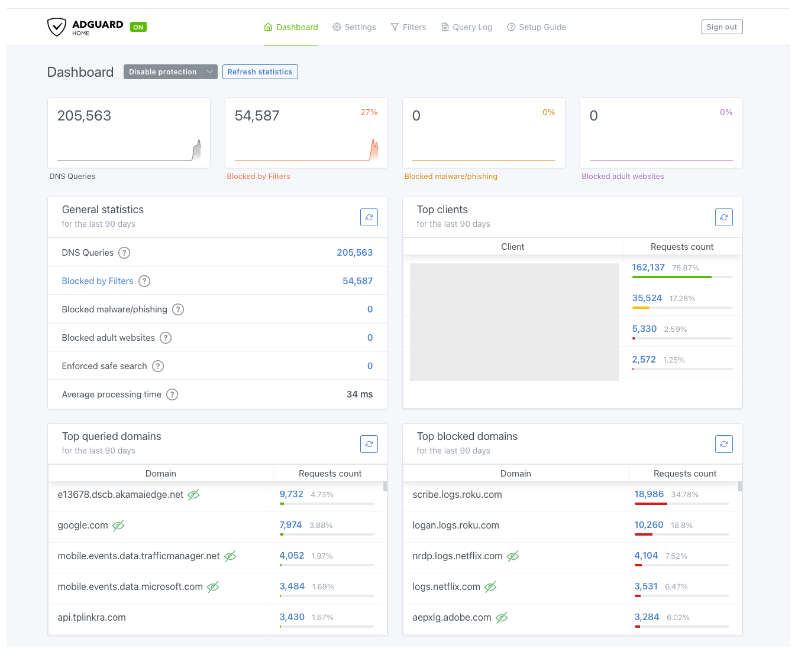

# AdGuard Home DNS Filtering



## Overview

Two AdGuard Home instances filter DNS for the whole network and send permitted queries to public resolvers over DNS-over-HTTPS (DoH). Active Directory DNS stays in front of them, so domain clients keep the internal resolution and service discovery they depend on.

Each instance is a dedicated Debian VM running AdGuard Home natively as a systemd service, and the two VMs run on different Proxmox hosts.

## Architecture

```text
                         Client Devices
                              │
                              │ DNS
                              ▼
                 ┌─────────────────────────┐
                 │   Active Directory DNS  │
                 │  dc-lab-01   dc-lab-02  │
                 └────────────┬────────────┘
                              │ Forwarders
                 ┌────────────┴────────────┐
                 ▼                         ▼
        ┌────────────────┐        ┌────────────────┐
        │ adguard-lab-01 │        │ adguard-lab-02 │
        │ (prox-lab-01)  │        │ (prox-lab-03)  │
        └───────┬────────┘        └───────┬────────┘
                │   Filtering, then DoH   │
                └────────────┬────────────┘
                             ▼
                  Cloudflare / Google
```

| Layer | Role |
|---|---|
| Active Directory DNS | Internal resolution and AD service discovery |
| AdGuard Home | Filtering and encrypted upstream resolution |

## Active Directory DNS Integration

Domain clients use `dc-lab-01` and `dc-lab-02` for DNS. The DCs are authoritative for `lab.example.com` and answer internal queries themselves. Anything they can't resolve goes to their forwarders, and both DCs list both AdGuard instances.

Windows DNS tries forwarders in list order and moves to the next one only when the first doesn't answer, so the forwarder order decides which AdGuard instance handles most of the traffic.

```text
Internal query:  Client → dc-lab-01/02 → AD-integrated zone
External query:  Client → dc-lab-01/02 → adguard-lab-01/02 → filtering → DoH → Cloudflare / Google
```

## Filtering and Upstream DNS

AdGuard checks each forwarded query against its blocklists. Blocked domains get a block response, and allowed queries go to the upstreams over DoH.

### Upstream Settings

Both instances use the same settings:

| Setting | Value |
|---|---|
| Upstream DNS servers | `https://cloudflare-dns.com/dns-query`, `https://dns.google/dns-query` |
| Upstream mode | Load-balancing: one upstream per query, weighted toward the server with the fewest failures and lowest average lookup time |
| Bootstrap DNS servers | `1.1.1.1`, `8.8.8.8` (used only to resolve the DoH hostnames) |
| Fallback DNS servers | None |
| Upstream timeout | 10 seconds |
| Private reverse DNS servers | `dc-lab-01`, `dc-lab-02` |

### Other DNS Settings

| Setting | Value |
|---|---|
| Listening address | The VM's own IP only: port 53 for DNS, port 80 for the web interface |
| Rate limit | Off (`0`). Every query arrives from the two DCs, which share one /24, so a per-subnet limit would cap the whole network at 20 queries per second per instance |
| DNSSEC | On |
| `ANY` queries | Refused |
| Cache | 4 MB, optimistic caching off |
| Safe browsing | On. Parental control and safe search are off |
| Query log and statistics | Kept for 30 days |

### Blocklists

| List | Purpose |
|---|---|
| AdGuard DNS filter | Ads and tracking |
| HaGeZi's Pro Blocklist | Ads, tracking, telemetry and other unwanted domains |
| Phishing URL Blocklist (PhishTank and OpenPhish) | Phishing |
| HaGeZi's Threat Intelligence Feeds | Malware, phishing and scam domains |
| Malicious URL Blocklist (URLhaus) | Malware distribution |

HaGeZi's Threat Intelligence Feeds is by far the largest list, at about 1.1 million rules of roughly 1.55 million in total. It accounts for most of AdGuard's memory use, roughly 1.3 to 1.7 GB on each 3 GB VM before HaGeZi's Pro Blocklist was added.

### Encryption Boundary

DoH only covers the hop from AdGuard to the public resolvers. Inside the lab, from client to DC and from DC to AdGuard, DNS uses standard unencrypted transport.

```text
Client ──DNS──► AD DNS ──DNS──► AdGuard ──DoH──► Public resolver
```

### Keeping the Instances in Sync

Settings, blocklists and rules are configured by hand on each instance. Any change made on one has to be repeated on the other.

## Redundancy and Failure Domains

A single AdGuard server would add a new single point of failure to external DNS, so there are two, on separate Proxmox hosts. This covers an AdGuard service failure, a VM failure, and a Proxmox host going down for maintenance or failing. With two DCs in front, both DNS layers are redundant.

## Failover Validation

Each instance was taken offline in turn:

| Test | Result |
|---|---|
| `adguard-lab-01` offline | External DNS continued through `adguard-lab-02` ✅ |
| `adguard-lab-02` offline | External DNS continued through `adguard-lab-01` ✅ |

### Upstream Outage

An unplanned test happened during the OPNsense validation in November 2026, when the WAN kept dropping. Both instances logged about 2,000 failed upstream lookups over two days, split almost evenly between Cloudflare and Google, and the errors stopped once the WAN was stable again.

Failures on both instances and both providers at the same time point to the WAN, not to AdGuard or a single provider. These commands separate the two cases:

```bash
# Failed upstream lookups per day
journalctl -u AdGuardHome --since "7 days ago" -o cat | grep 'exchange failed' \
  | grep -v 'arpa' | cut -c1-10 | uniq -c

# Failed upstream lookups per upstream
journalctl -u AdGuardHome --since "7 days ago" -o cat | grep 'exchange failed' \
  | grep -v 'arpa' | grep -o 'upstream=[^ ]*' | sort | uniq -c
```

## Internal Reverse DNS

Because the DCs forward queries, AdGuard sees the DC as the client. AdGuard sends PTR lookups for private addresses to the DCs, so its query log can show `dc-lab-01` instead of a bare address.

### Known Issue: Reverse Lookup Loop

This only works for subnets the DCs have a reverse zone for. For any other private subnet, a PTR lookup loops:

```text
AdGuard ──PTR──► AD DNS (no reverse zone) ──forwarder──► AdGuard ──PTR──► AD DNS ...
```

Each lookup times out after 2 seconds. Over one week each instance logged about 5,500 of these timeouts. The lab itself uses a single subnet, so none of these came from lab hosts. Most were Bonjour discovery lookups (`lb._dns-sd._udp.<subnet>.in-addr.arpa`) from Apple devices on networks the router hands out: WireGuard VPN clients (`10.0.100.0/24`) and the guest and IoT Wi-Fi networks. The rest were IPv6 link-local (`fe80::`) PTR lookups.

To count them by question:

```bash
journalctl -u AdGuardHome --since "7 days ago" -o cat | grep 'exchange failed' \
  | grep -o 'question="[^"]*' | sort | uniq -c | sort -rn
```

**Fix:** create AD-integrated reverse lookup zones on the DCs for every private subnet whose clients can reach AD DNS, including the VPN and guest networks, plus `8.e.f.ip6.arpa` for link-local IPv6. The DCs then answer these lookups themselves, either with a name or NXDOMAIN, and the loop stops. An empty zone is enough.

## Observability

AdGuard sees the forwarding DC, not the original client, so per-client statistics aren't available. Keeping AD DNS in front for domain clients was more important than endpoint-level attribution, and this is an accepted limitation.

Uptime Kuma checks each instance with a ping monitor and a DNS monitor. The DNS monitor resolves a name against the instance, which proves resolution works, not just that the VM is up.

## Security and Privacy

- AD DNS stays authoritative for the internal namespace.
- External queries are filtered before they reach public resolvers, and the upstream connection uses DoH.
- The AdGuard web interfaces are reachable only from inside the lab. They currently use plain HTTP, so logins cross the LAN unencrypted. This is an accepted risk until a reverse proxy with TLS is in place.
- Credentials are stored outside the repository, and this document uses placeholder names and addresses.

DoH protects the connection to the upstream resolvers. It doesn't make the answers trustworthy, and it doesn't encrypt DNS inside the lab.

## Design Decisions

| Decision | Why |
|---|---|
| AdGuard Home | Filtering and DoH upstreams in one tool, without replacing AD DNS |
| AD DNS in front of AdGuard | Domain clients depend on AD DNS for internal records and service discovery |
| Two instances | DNS is a core service, and one AdGuard server would be a single point of failure |
| Separate Proxmox hosts | Two instances on one host wouldn't survive host failure or maintenance |
| Native install, not Docker | Each instance has its own VM, so a container layer adds nothing |
| Accept DC-level attribution | Keeping AD DNS behavior mattered more than per-client statistics |

## Current Deployment State

| Component | State |
|---|---|
| `adguard-lab-01`, `adguard-lab-02` | 🟢 Deployed on separate Proxmox hosts |
| Both DCs forwarding to both instances | 🟢 Deployed |
| Filtering and DoH upstreams | 🟢 Deployed |
| Failover tests for each instance | ✅ Passed |
| Uptime Kuma ping and DNS monitors | 🟢 Deployed |
| Reverse zones for all private subnets | 🟡 In Progress |
| Per-client attribution | Accepted limitation |

## Future Enhancements

- Put the web interfaces behind a reverse proxy with TLS.
- Ship the AdGuard logs to Loki with Grafana Alloy and alert on spikes in failed lookups.
- Add an AdGuard Prometheus exporter for query rate, block rate and upstream response time in Grafana.
- Automate keeping the two instances' settings in sync.
- Evaluate encrypted DNS between clients and the DCs.

## Outcome

Network-wide filtering and encrypted upstream DNS are in place without changing how domain clients use Active Directory DNS. Either AdGuard instance can go offline and external resolution keeps working, which was confirmed by testing each one. The logs were also used to tell a WAN outage apart from an AdGuard fault, and to find a reverse lookup loop for private subnets without reverse zones.

## Related Documentation

- [AdGuard Home Native Installation](../../docs/reference/adguard/adguard-home-native-install.md)
- [Active Directory DNS](../active-directory-lab/active-directory-DNS.md)
- [Resource Allocation](../virtualization-lab/04-resource-allocation.md)
- [Availability Monitoring](../infrastructure-monitoring/availability-monitoring.md)
- [Network Infrastructure](./README.md)

## Technologies

- AdGuard Home
- Debian Linux
- Proxmox VE
- Windows Server DNS
- Active Directory Domain Services
- DNS-over-HTTPS
- Cloudflare DNS
- Google Public DNS
