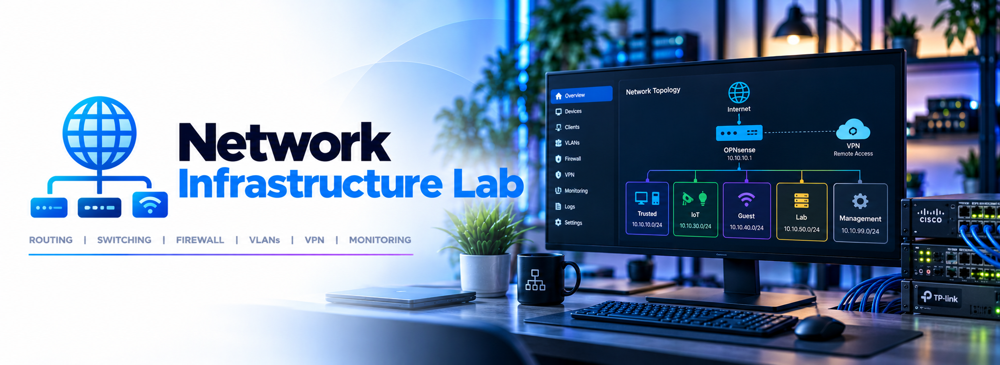

# 🌐 Network Infrastructure

**Status: 🟢 Operational**



## Overview

The core network services for the homelab: managed switching, Windows Server DHCP, Active Directory-integrated DNS, redundant AdGuard Home filtering, wireless and remote access.

An ASUS RT-AX5400 is the internet gateway, a Cisco managed switch connects the wired systems, Windows Server handles DHCP and internal DNS, and two AdGuard Home instances filter external DNS.

```text
                         Internet
                            │
                            ▼
                     ASUS RT-AX5400
                Routing / Firewall / NAT
                  WireGuard / Wireless
                            │
                            ▼
                  Cisco Managed Switch
                            │
          ┌─────────────────┼─────────────────┐
          ▼                 ▼                 ▼
      Proxmox VE        Synology NAS     Wired Systems
       Cluster
          │
          ├─────────────┬─────────────┐
          ▼             ▼             ▼
     AD / DNS / DHCP  AdGuard Home  Lab Services
```

The full design, service relationships and redundancy are in [Architecture](./architecture.md).

## Current Environment

| Component | Implementation | Status |
|---|---|:---:|
| Internet Gateway | ASUS RT-AX5400 | 🟢 |
| Managed Switching | Cisco Catalyst managed switch | 🟢 |
| Wired Network | Flat Layer 2 network on VLAN 1 | 🟢 |
| DHCP | Redundant Windows Server DHCP | 🟢 |
| Internal DNS | Active Directory-integrated DNS | 🟢 |
| DNS Filtering | Redundant AdGuard Home | 🟢 |
| Upstream DNS Security | DNS-over-HTTPS | 🟢 |
| Wireless | Trusted and isolated guest/IoT wireless | 🟢 |
| Remote Access | WireGuard VPN | 🟢 |
| Network Storage | Synology NAS | 🟢 |
| Infrastructure Monitoring | Uptime Kuma and monitoring stack | 🟢 |
| Dedicated Firewall | Mac mini failed validation; dedicated hardware pending | ⚪ |
| VLAN Segmentation | Management, server, trusted, IoT and guest zones | ⚪ Planned |

## Core Network Services

**DHCP.** Two Windows Server DHCP servers run as a failover pair and hand out addresses, the gateway, internal DNS servers and the domain. Failover was tested: leases kept working with either server down.

**DNS.** Active Directory DNS is authoritative for internal names. External queries go from clients to AD DNS, then to AdGuard Home, then out over DNS-over-HTTPS. The two AdGuard instances run on separate Proxmox hosts, and resolution was tested with each one down.

**Switching.** The Cisco switch connects the physical infrastructure on a flat VLAN 1 network. VLAN segmentation is planned with OPNsense. Real port assignments are kept privately; the public [port map](./06-port-map.md) uses representative devices.

**Wireless.** The ASUS provides Wi-Fi. Trusted devices join the internal network; guest and IoT devices use an isolated guest network with no access to internal resources.

**Remote access.** WireGuard on the ASUS provides encrypted remote access, so management services aren't exposed to the internet.

Security controls for these services are covered in the [Network Security](../network-security/README.md) project.

## Documentation

| Document | Focus |
|---|---|
| [Architecture](./architecture.md) | Logical design, service relationships, redundancy and future design |
| [IP Addressing Plan](./01-ip-addressing-plan.md) | Static and DHCP addressing strategy |
| [Cisco Switch Deployment](./02-cisco-switch-deployment.md) | Managed switch deployment and configuration |
| [DHCP Infrastructure](./03-dhcp-infrastructure.md) | Windows Server DHCP, failover, DNS integration and testing |
| [DNS Filtering with AdGuard Home](./04-dns-filtering-adguard-home.md) | DNS filtering, DoH, redundancy and failure testing |
| [Wireless Design](./05-wireless-design.md) | Trusted and guest/IoT wireless |
| [Port Map](./06-port-map.md) | Physical connections and current VLAN configuration |
| [Lessons Learned](./lessons-learned.md) | Implementation findings and troubleshooting |

## Planned Improvements

OPNsense and VLAN segmentation are next. The plans live in the Network Security project:

- [OPNsense Firewall Deployment](../network-security/TODO-opnsense-deployment-plan.md): dedicated firewall for the homelab, behind the ASUS
- [VLAN Implementation](../network-security/TODO-vlan-implementation-plan.md): management, server, trusted, IoT and guest zones over a trunk to the Cisco switch
- [WireGuard VPN Migration](../network-security/TODO-wireguard-vpn-deployment-plan.md): primary remote access moves to OPNsense

Windows Server stays the DHCP authority, with OPNsense relaying DHCP for each VLAN. None of this is part of the current deployed network.

## Related Projects

Proxmox virtualization, Active Directory, Microsoft Entra ID and Intune, Infrastructure Monitoring, Docker and self-hosted services, Backup and Disaster Recovery, and Network Security all run on this network.
