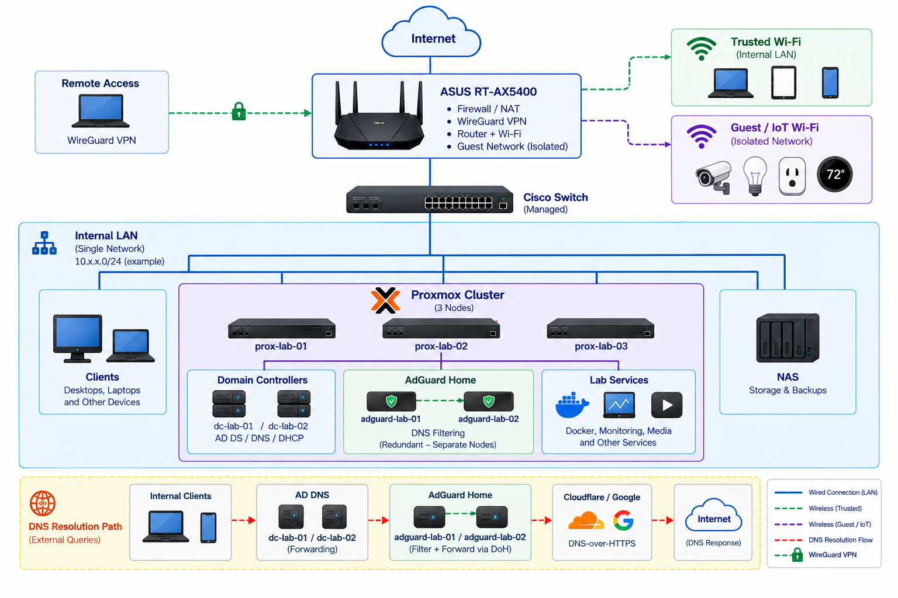

# Network Architecture

## Overview

How the homelab network is put together: routing, switching, wireless, addressing, DHCP, DNS and filtering, remote access, storage and virtualization connectivity. All trusted infrastructure and endpoints currently share one internal network; guest and IoT devices are isolated on the router's guest Wi-Fi.



*Current logical architecture showing routing, switching, virtualization, Active Directory services, redundant DNS filtering, storage, wireless connectivity and remote access.*

> [!NOTE]
> Real network addresses, allocation ranges, VLAN identifiers, credentials and device assignments are omitted or generalized in public documentation.

## Current Architecture

```text
                           Internet
                              │
                              ▼
                       ASUS RT-AX5400
                  Routing / Firewall / NAT
                     WireGuard / Wireless
                              │
                              ▼
                    Cisco Managed Switch
                              │
          ┌───────────────────┼───────────────────┐
          ▼                   ▼                   ▼
      Proxmox VE          Synology NAS      Wired Systems
       Cluster
          │
          ├───────────────┬───────────────┐
          ▼               ▼               ▼
     AD / DNS / DHCP   AdGuard Home    Lab Services
       Services         Instances
```

| Component | Role |
|---|---|
| ASUS RT-AX5400 | Internet gateway, routing, firewall, NAT, WireGuard VPN and wireless |
| Cisco Catalyst Managed Switch | Wired Ethernet connectivity and switch management |
| Proxmox VE Cluster | Hosts virtualized infrastructure and network services |
| Windows Server | Active Directory-integrated DNS and redundant DHCP |
| AdGuard Home | Redundant DNS filtering and encrypted upstream DNS |
| Synology NAS | Network storage and backups |
| Uptime Kuma | Network and service availability monitoring |

## Addressing

Infrastructure is statically addressed; client endpoints get their configuration from Windows Server DHCP, with reservations where needed. Ranges and assignments aren't published. See the [IP Addressing Plan](./01-ip-addressing-plan.md).

## DHCP

Two Windows Server DHCP servers, both authorized in Active Directory, run as a failover pair:

```text
                   Client Endpoints
                         │
                ┌────────┴────────┐
                ▼                 ▼
          DHCP Server 01    DHCP Server 02
                └────────┬────────┘
                  Failover Relationship
```

They hand out client addresses, the default gateway, internal DNS servers and the DNS domain. Controlled testing confirmed leases keep working with either server down. Details are in [DHCP Infrastructure](./03-dhcp-infrastructure.md).

## DNS

Internal and external DNS are handled separately. Active Directory-integrated DNS resolves internal names and domain services; external queries are forwarded to AdGuard Home for filtering and encrypted upstream resolution.

```text
Internal Clients
      │
      ▼
Active Directory DNS
  dc-lab-01 / dc-lab-02
      │  external forwarding
      ▼
    AdGuard Home
adguard-lab-01 / adguard-lab-02
      │  filtering, DNS-over-HTTPS
      ▼
Cloudflare / Google
      │
      ▼
   Internet DNS
```

- Both DNS servers forward to both AdGuard instances.
- The AdGuard instances run on separate Proxmox hosts, so losing one host doesn't stop external filtering. Testing confirmed resolution continues with either instance down.
- DNS-over-HTTPS protects the hop from AdGuard to the public resolvers; DNS inside the trusted network is standard DNS.

Details are in [DNS Filtering with AdGuard Home](./04-dns-filtering-adguard-home.md).

## Service Redundancy

| Service | Architecture | Failure Protection |
|---|---|---|
| DHCP | Two Windows Server DHCP servers | DHCP failover |
| Internal DNS | Two Active Directory DNS servers | Multiple DNS servers |
| DNS Filtering | Two AdGuard Home instances | Redundant forwarders |
| AdGuard Hosting | Separate Proxmox hosts | No single-host dependency |
| Upstream DNS | Multiple public resolvers | Resolver redundancy |

## Wireless and Segmentation

The ASUS provides Wi-Fi. Trusted devices join the internal network; guest and IoT devices use the guest network, which has internet access but no access to internal resources. Beyond that, the wired and trusted wireless environment is one flat network; infrastructure segmentation isn't implemented yet.

## Remote Access

WireGuard on the ASUS provides encrypted remote access to the home network, so internal management services aren't exposed to the internet.

```text
Remote Device ──WireGuard──► Internet ──► ASUS RT-AX5400 ──► Internal Network
```

## Monitoring

Uptime Kuma monitors network devices, core infrastructure, DNS and platform services. The full monitoring design is in the [Infrastructure Monitoring](../infrastructure-monitoring/README.md) project.

## Design Principles

- Predictable infrastructure addressing
- Wired connectivity through one managed switch
- Redundant DHCP and DNS, with AD DNS authoritative for internal names
- External filtering kept separate from internal DNS
- Redundant services spread across separate Proxmox hosts
- Guest and IoT devices isolated from trusted infrastructure
- No internet exposure of management services
- Enough documentation to troubleshoot and rebuild

## Planned Architecture

> [!IMPORTANT]
> OPNsense and VLAN segmentation are planned and not part of the deployed network.

OPNsense will be added behind the ASUS as the homelab firewall, with VLANs on a trunk to the Cisco switch separating systems by function and firewall policy controlling traffic between zones:

```text
                         Internet
                            │
                            ▼
                      ASUS RT-AX5400
                            │
                            ▼
                         OPNsense
                            │ 802.1Q
                            ▼
                    Cisco Managed Switch
                            │
       ┌──────────┬─────────┼─────────┬──────────┐
       ▼          ▼         ▼         ▼          ▼
  Management   Servers   Trusted     IoT       Guest
```

The plans are in the Network Security project: [OPNsense Firewall Deployment](../network-security/TODO-opnsense-deployment-plan.md) and [VLAN Implementation](../network-security/TODO-vlan-implementation-plan.md), which has the proposed VLAN IDs. Final subnets and firewall policies will be documented after implementation.
