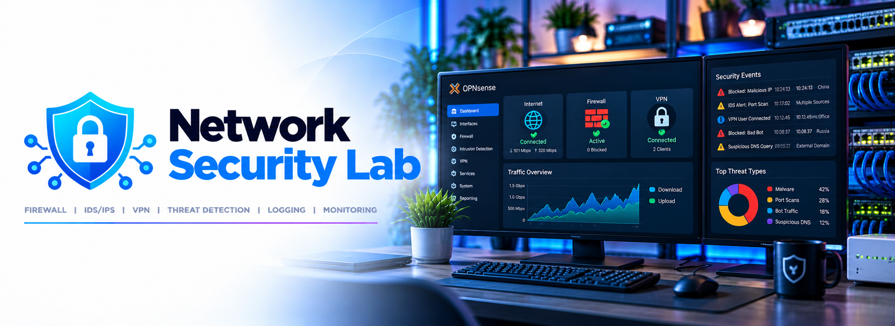

# 🔐 Network Security

**Status: 🟡 In Progress**

## Overview

The layered security controls protecting the homelab: perimeter firewalling, encrypted remote access, DNS filtering, wireless isolation and administrative-access hardening, with a dedicated OPNsense firewall and VLAN segmentation underway.

Today the ASUS RT-AX5400 is the security boundary, providing the stateful firewall, NAT, WireGuard VPN and wireless security. Wired systems share a flat VLAN 1 network on a Cisco switch, and guest and IoT Wi-Fi devices are isolated from internal systems.

The boundaries, trust model, known limitations and target design are in [Network Security Architecture](./architecture.md).

## Current Security Controls

| Security Area | Implementation | Status |
|---|---|:---:|
| Perimeter Firewall | ASUS stateful firewall | 🟢 |
| Network Address Translation | ASUS NAT | 🟢 |
| Remote Access | WireGuard VPN | 🟢 |
| DNS Filtering | Redundant AdGuard Home | 🟢 |
| Upstream DNS Encryption | DNS-over-HTTPS | 🟢 |
| Guest / IoT Isolation | Isolated wireless network | 🟢 |
| Managed Switching | Cisco Catalyst managed switch | 🟢 |
| SSH Hardening | Key-based access where implemented | 🟡 |
| Wired Segmentation | Flat VLAN 1 network | 🟡 |
| Dedicated Firewall | Mac mini failed validation; dedicated hardware pending | ⚪ |
| VLAN Security Zones | Management, server, trusted, IoT and guest | ⚪ Planned |
| IDS / IPS | Future implementation | ⚪ Planned |
| Centralized Network-Security Logging | Integration planned | ⚪ Planned |

## Design Goals

- Keep internal services off the internet; administer remotely through the VPN
- Filter external DNS and encrypt it upstream
- Isolate guest and IoT devices
- Harden administrative access
- Document known gaps openly, and call a control operational only after it's tested
- Move toward explicit trust zones with least-privilege traffic between them

## Documentation

| Document | Focus |
|---|---|
| [Architecture](./architecture.md) | Security boundaries, trust model, current limitations and target architecture |
| [Perimeter Firewall](./01-perimeter-security.md) | Internet-facing firewall and exposure controls |
| [WireGuard VPN](./02-wireguard-vpn.md) | Encrypted remote access |
| [Wireless Security](./03-wireless-security.md) | Trusted and guest/IoT wireless controls |
| [SSH Hardening](./04-ssh-hardening.md) | Administrative-access hardening |
| [OPNsense on Mac mini — Hardware Validation](./opnsense-mac-mini-validation.md) | Failed firewall hardware test and the decision to use dedicated hardware |
| [Lessons Learned](./lessons-learned.md) | Implementation and troubleshooting findings |

## Planned Deployments

The `TODO-` prefix marks plans to revisit before implementation.

| Plan | Scope | Key Dependencies |
|---|---|---|
| [OPNsense Deployment](./TODO-opnsense-deployment-plan.md) | Dedicated firewall for the homelab behind the ASUS, with validated policies and a reversible cutover | Dedicated hardware passing the acceptance criteria; Windows Server DHCP and its failover preserved |
| [VLAN Implementation](./TODO-vlan-implementation-plan.md) | Management, server, trusted, IoT and guest zones with controlled inter-VLAN access | OPNsense policies, Cisco switch configuration, VLAN-aware wireless where needed |
| [WireGuard VPN Migration](./TODO-wireguard-vpn-deployment-plan.md) | Move primary remote access to OPNsense; keep the ASUS VPN as break-glass | Working OPNsense gateway, verified remote access, rollback path |

> [!NOTE]
> Windows Server remains the DHCP authority, including failover; OPNsense will relay DHCP for routed VLANs. The VPN work is a migration of the existing service, not a new deployment.

IDS/IPS deployment and alert analysis are tracked in the [Security Operations Lab](../security-operations/TODO-ids-ips-deployment-plan.md). Network Security owns the OPNsense and segmentation dependencies; Security Operations owns detection.

## Related Projects

Network Infrastructure, Proxmox virtualization, Active Directory, Microsoft Entra ID and Intune, Infrastructure Monitoring, Docker and self-hosted services, and Backup and Disaster Recovery.
