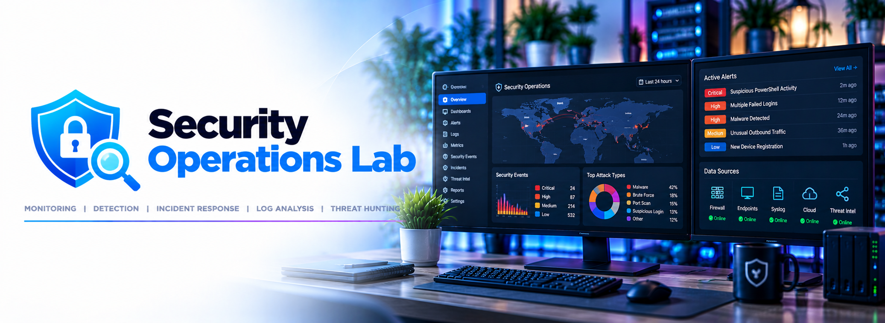

# 🛡️ Security Operations Lab

**Status: ⚪ Planned**



The *detect and respond* side of homelab security: network intrusion detection, centralized logging, SIEM deployment, detection engineering, investigation, and incident response.

> [!NOTE]
> Preventive controls such as firewalls, segmentation, access controls, and system hardening are documented in the [Network Security Lab](../network-security/). This project focuses on **visibility, detection, and response**.

## Objectives

- Deploy network intrusion detection, then graduate to inline prevention once rules are tuned
- Centralize security-relevant logs across the homelab
- Collect Windows events and Linux security logs
- Deploy and operate a SIEM
- Build and tune detections for realistic security events
- Generate controlled test activity and document detection → triage → response
- Explore Microsoft Sentinel as a cloud-native SIEM

## Planned Deployments

| Plan | Scope | Blocked by |
|---|---|---|
| [IDS/IPS Deployment](./ids-ips-deployment-plan.md) | Suricata on OPNsense: detection first, inline prevention after tuning | [OPNsense](../network-security/opnsense-deployment-plan.md), [VLANs](../network-security/vlan-implementation-plan.md) |

## Technologies

| Technology | Planned Role |
|---|---|
| **Suricata** | Network IDS/IPS on OPNsense; alerts shipped to the monitoring stack |
| **Wazuh** | SIEM/XDR, log analysis, alerting, and dashboards |
| **Sysmon / Windows Event Logs** | Windows endpoint and Active Directory telemetry |
| **auditd / syslog** | Linux security and system telemetry |
| **Loki / Grafana** | Existing log pipeline; first home for Suricata and firewall events |
| **Microsoft Sentinel** | Cloud-native SIEM and KQL-based detection |
| **Atomic Red Team** | Controlled security testing and detection validation |

## Key Tasks

- [ ] Deploy Suricata in detection-only mode and ship alerts to Loki/Grafana
- [ ] Tune IDS rules, then enable inline prevention for validated rules
- [ ] Deploy Wazuh on a dedicated VM
- [ ] Collect logs from Linux hosts and the [AD lab](../active-directory-lab/)
- [ ] Deploy Sysmon on Windows endpoints with a tuned configuration
- [ ] Build an authentication monitoring dashboard
- [ ] Simulate failed-logon activity and tune detection rules
- [ ] Simulate a port scan and document detection and triage
- [ ] Write a complete incident report from detection through response
- [ ] Ingest Entra ID sign-in activity into Microsoft Sentinel
- [ ] Write KQL detection queries
- [ ] Document alert tuning and false-positive decisions

## Detection Workflow

```text
Endpoints / Servers / Identity        Network (Suricata)
            │                               │
            ▼                               ▼
       Log Collection  ◄────────────────────┘
            │
            ▼
   Loki / Wazuh / Sentinel
            │
            ▼
         Detection
            │
            ▼
          Triage
            │
            ▼
         Response
            │
            ▼
       Documentation
```

## Folder Structure

```text
security-operations/
├── ids-ips-deployment-plan.md   # Suricata IDS → IPS plan
├── detections/                  # Detection rules and KQL queries
├── incident-reports/            # Documented triage exercises
├── configs/                     # Sanitized logging and agent configurations
├── docs/                        # Build notes and lessons learned
└── screenshots/                 # Visual documentation
```

## Future Integration

As the lab develops, Security Operations can ingest telemetry from other projects, including:

- Active Directory and Windows endpoints
- Linux servers
- OPNsense firewall and Suricata alerts
- SSH authentication
- Microsoft Entra ID
- Azure resources
- Container workloads

> [!NOTE]
> **Systems generate telemetry → logs are centralized → detections identify suspicious activity → alerts are investigated → response actions are documented.**