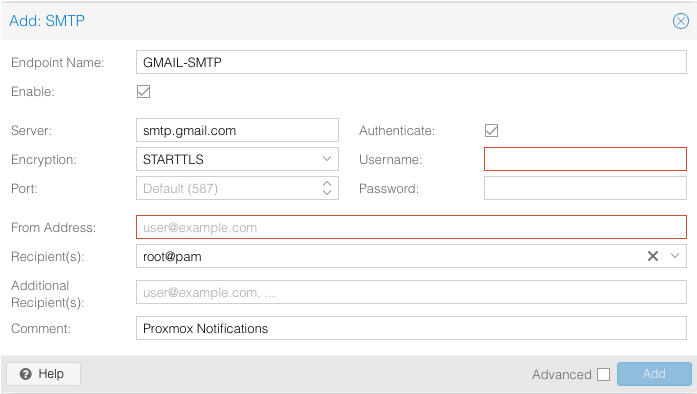
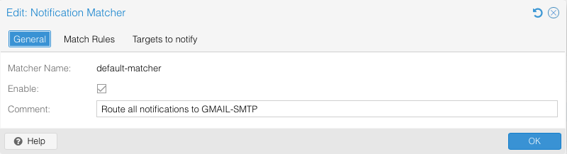
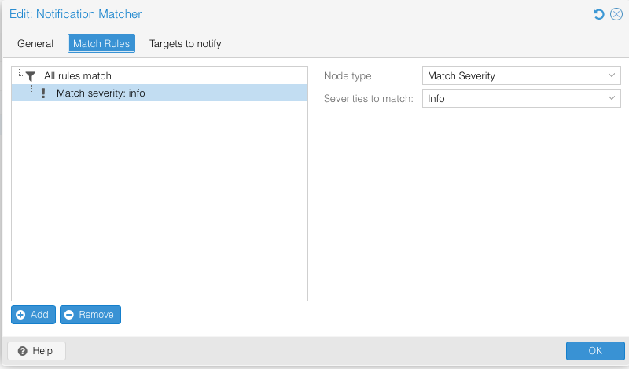
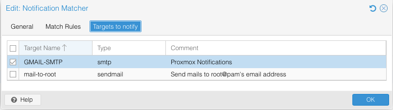
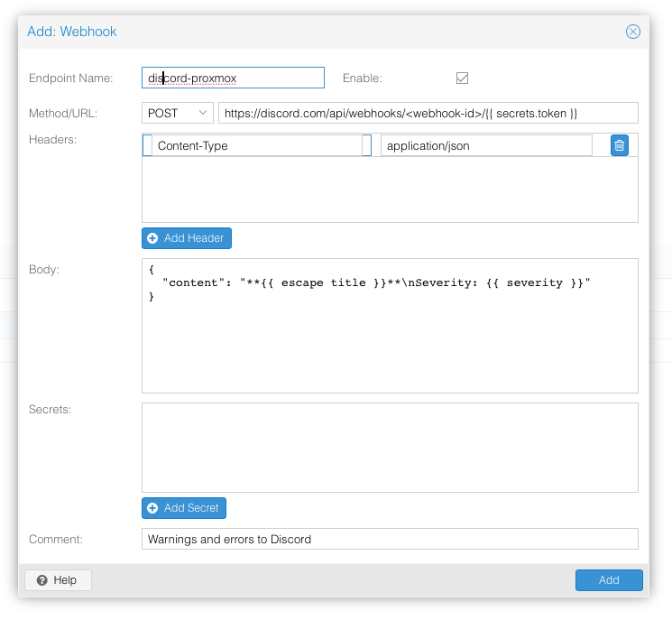
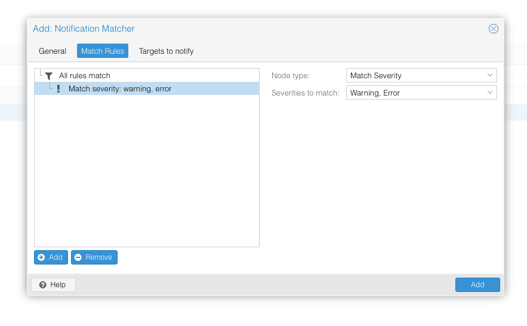

# 🔔 Proxmox Notifications

This configuration provides Datacenter-level notifications through two targets: email through Gmail SMTP for every event, and a Discord webhook for warnings and errors. I created a dedicated Google account for infrastructure notifications instead of using my personal account.

## Architecture

```text
Proxmox VE
   │
   ├──► default-matcher (info and above) ──► GMAIL-SMTP ──► Administrator email
   │
   └──► discord-warnings (warning, error) ──► discord-proxmox ──► Discord alerts channel
```

Email gets every event with full detail. Discord gets a short message for warnings and errors only, so it stays quiet enough to notice.

## SMTP Target

The SMTP target was configured to use Gmail's SMTP service with authentication and encrypted transport over `STARTTLS` on port `587`.



*Gmail SMTP target configured in Proxmox.*

## Authentication

I enabled 2FA on the dedicated notification account, but Proxmox's SMTP integration uses standard SMTP authentication and could not complete Google's interactive 2FA flow. To work around this, I generated a Google App Password specifically for Proxmox.

Google recommends modern authentication methods over App Passwords when supported, so I limited this approach to a dedicated Google account used only for infrastructure notifications. The App Password can also be revoked independently without exposing or changing the account's primary password.

SMTP traffic was configured to use `STARTTLS` over port `587` so authentication and notification traffic are encrypted in transit.

## Matcher

I kept the default Proxmox matcher and pointed it at the Gmail SMTP target.

- Matcher: `default-matcher`
- Target: `GMAIL-SMTP`
- Severity: `info`
- Rule behavior: All rules match



*Default notification matcher with severity and target rules applied.*

I started with `info` alerts deliberately to capture routine events for the first few weeks and establish a baseline for what normal looks like. The threshold can be raised once the normal notification volume is clear.



*Matcher severity configured at `info` to include informational events and higher-severity notifications.*

The matcher was then configured to send matching events to the `GMAIL-SMTP` notification target.



*Default matcher routing notifications to the Gmail SMTP target.*

## Discord Webhook

A second target sends warnings and errors to the same Discord alerts channel as Uptime Kuma and NUT, through a webhook named for Proxmox so each message shows its source.

| Setting | Value |
|---|---|
| Endpoint name | `discord-proxmox` |
| Method | `POST` |
| URL | `https://discord.com/api/webhooks/<webhook-id>/{{ secrets.token }}` |
| Header | `Content-Type: application/json` |
| Secret | `token`: the token part of the Discord webhook URL |

The Discord webhook URL has two parts, `https://discord.com/api/webhooks/<webhook-id>/<token>`. The ID goes in the URL field, and the token goes in a Proxmox secret, so it isn't shown in the target's configuration.

Body:

```json
{
  "content": "**{{ escape title }}**\nSeverity: {{ severity }}"
}
```

The body sends only the title and severity. Discord limits a message to 2,000 characters, and backup reports can be longer, so the full detail stays in email. `escape` makes the title safe to place inside a JSON string.



*Discord webhook target, with the token stored as a secret.*

A separate matcher routes only warnings and errors to Discord, leaving `default-matcher` unchanged:

- Matcher: `discord-warnings`
- Rule: match severity `warning`, `error`
- Target: `discord-proxmox`



*Matcher sending warning and error notifications to Discord.*

Notification targets and matchers are set at the Datacenter level, so one target and one matcher cover all three nodes. The cluster doesn't use storage replication or HA, so replication and fencing events don't apply; the main events for Discord are failed backups.

## Validation

- Test notification delivered successfully to the administrator inbox.
- SMTP connection configured with `STARTTLS` over port `587`.
- App Password authenticated successfully with 2FA active on the dedicated account.
- `default-matcher` confirmed routing notifications to `GMAIL-SMTP`.
- Credentials excluded from the repository; email addresses replaced with placeholders and sanitized from screenshots.
- Test notification from `discord-proxmox` delivered to the Discord alerts channel.
- Discord webhook ID and token kept out of the repository and screenshots; the token is stored as a Proxmox secret.

## Scaling Considerations

Gmail SMTP is appropriate for a homelab of this size. In a larger or production environment, I would use a dedicated SMTP relay or managed notification service so alerting does not depend on a single Google account and manually managed App Password.
