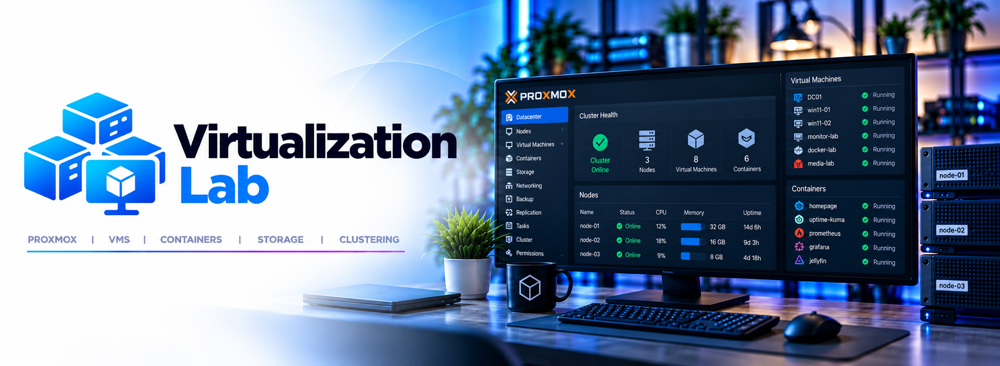
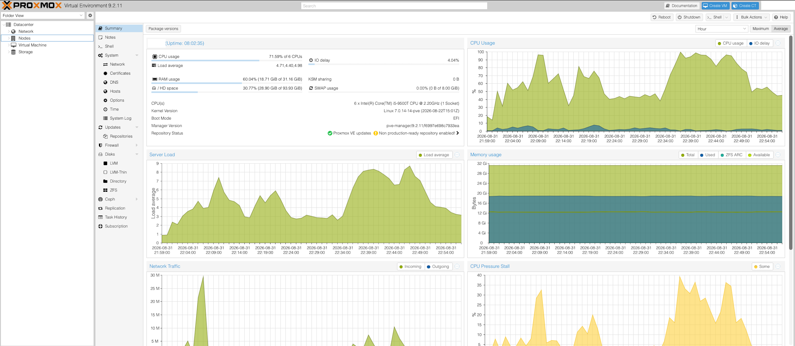

# 🧊 Virtualization Lab

**Status: 🟢 Operational**




## Overview

Bare-metal virtualization environment built with **Proxmox VE** and repurposed hardware.

This lab provides the virtualization foundation for the broader infrastructure
homelab.


_Proxmox VE management interface from the lab environment._


## Objectives

- Deploy and administer Proxmox VE on bare-metal hardware
- Design host storage for system and virtual workloads
- Build and operate a multi-node Proxmox cluster
- Configure Linux bridge and VLAN-aware virtual networking
- Build reusable Linux and Windows VM templates
- Manage the VM lifecycle including cloning, snapshots, backups, and migration
- Validate cluster quorum, migration, and failure-recovery workflows


## Technologies

- Proxmox VE
- KVM/QEMU
- Corosync
- Cloud-init
- LVM-thin
- Linux bridges
- VLAN tagging


## Architecture

```text
                  Proxmox VE Cluster
                         │
              ┌──────────┼──────────┐
              │          │          │
        prox-lab-01  prox-lab-02  prox-lab-03
              │          │          │
              └──────────┼──────────┘
                         │
               Virtual Infrastructure
                         │
              ┌──────────┼──────────┐
              │          │          │
           Windows     Linux      Docker
             VMs        VMs      Workloads
```

The environment consists of three active Proxmox nodes operating as a single
cluster. Each node participates as a voting member, providing a three-node
quorum configuration with a majority of two votes required.

Containerized workloads are deployed through **Docker running within Linux
virtual machines**, rather than directly through Proxmox LXC containers.

Detailed cluster architecture, networking, storage behavior, and quorum are
documented in the cluster documentation:

➡️ [Proxmox Cluster](./06-proxmox-cluster.md)


## Implementation

- [x] Deploy initial Proxmox VE bare-metal host
- [x] Complete post-install repository and system configuration
- [x] Validate CPU virtualization support, memory, storage, and system health
- [x] Configure static Proxmox management networking
- [x] Establish host and VM storage design
- [x] Configure node-local NVMe LVM-thin VM storage
- [x] Deploy second Proxmox VE host
- [x] Initialize Proxmox cluster
- [x] Join second node to cluster
- [x] Validate Corosync communication
- [x] Standardize node-local VM storage naming
- [x] Deploy third Proxmox VE host
- [x] Join third node to cluster
- [x] Configure third-node storage
- [x] Validate three-node quorum
- [x] Create Debian VM template
- [x] Create Windows Server 2025 template
- [x] Create Windows 11 template
- [ ] Add cloud-init to the Debian template
- [ ] Configure VLAN-aware virtual networking
- [ ] Test snapshots and cloning
- [ ] Configure VM backup and restore
- [ ] Test VM migration
- [ ] Test node failure and recovery


## Storage Design

The cluster uses node-local storage with NVMe-backed LVM-thin storage for VM
and container disks.

`prox-lab-01` and `prox-lab-02` use separate system and VM storage:

```text
Proxmox Node
│
├── SATA SSD
│   ├── Proxmox VE
│   └── General Storage
│
└── NVMe SSD
    └── LVM-Thin
        ├── VM Disks
        └── Container Disks
```

`prox-lab-03` uses a modified design because it contains two smaller drives:

```text
prox-lab-03
│
├── NVMe SSD
│   ├── Proxmox VE
│   └── LVM-Thin
│       ├── VM Disks
│       └── Container Disks
│
└── SATA HDD
    └── General Storage
```

General storage is used for backups, ISO images, container templates, and
snippets.

VM storage remains node-local rather than shared between cluster members.
Proxmox storage definitions are managed at the cluster level while the
underlying storage devices remain local to their respective hosts.

Detailed storage architecture is documented separately:

➡️ [Proxmox Storage](./02-storage-configuration.md)


## Resource Allocation

Workloads are distributed across the cluster according to available CPU,
memory, storage capacity, and service dependencies.

The three-node environment provides a combined:

- **16 physical CPU cores**
- **26 hardware threads**
- **64 GB of memory**
- **Approximately 2.3 TB of NVMe VM storage**

CPU and memory remain local to each virtualization host rather than operating
as a single shared resource pool.

Detailed host capacity and workload allocation are documented separately:

➡️ [Proxmox Resource Allocation](./04-resource-allocation.md)


## Networking

Proxmox uses Linux bridges to connect virtual machines and host management
services to the physical network:

```text
Physical NIC
     │
     ▼
   vmbr0
     │
     ├── Proxmox Management
     └── Virtual Machines
```

Cluster nodes use static management addressing to provide stable endpoints
for management and Corosync communication.

Corosync currently operates over the primary management network through
**Link 0**.

VLAN-aware networking and additional network segmentation will be introduced
as the broader homelab network architecture develops.

Firewall and routing services are hosted independently of the Proxmox cluster
so virtualization host maintenance and experimentation do not intentionally
depend on the availability of a virtualized gateway.


## Quorum

All three Proxmox hosts participate as voting cluster members.

```text
prox-lab-01 ─┐
             │
prox-lab-02 ─┼── 3 voting nodes
             │
prox-lab-03 ─┘

Expected Votes = 3
Quorum         = 2
Status         = Quorate
```

The three-node architecture allows the cluster to maintain quorum while one
node is unavailable and provides the foundation for future node failure and
recovery testing.


## Documentation

Lab docs, in build order:

1. [Baseline Build Summary](./01-proxmox-baseline-build.md)
2. [Proxmox Storage](./02-storage-configuration.md)
3. [Proxmox VM Deployment Baseline](./03-vm-deployment.md)
4. [Proxmox Resource Allocation](./04-resource-allocation.md)
5. [Proxmox Notifications](./05-proxmox-notifications.md)
6. [Proxmox Cluster](./06-proxmox-cluster.md)
7. [Proxmox Node Upgrades & Maintenance](./07-proxmox-node-upgrades.md)
8. [Proxmox Node Replacement](./08-proxmox-node-replacement.md)

Reference:

- [Proxmox Host Baseline Build](../../docs/reference/proxmox/proxmox-baseline-build.md)
- [Debian VM Template](../../docs/reference/proxmox/proxmox-debian-vm-template.md)
- [Windows VM Templates](../../docs/reference/proxmox/proxmox-windows-vm-template.md)

Also:

- [Troubleshooting](./troubleshooting.md)
- [Lessons Learned](./lessons-learned.md)


## Downstream Projects

This virtualization environment provides infrastructure for:

- [Active Directory Lab](../active-directory-lab/)
- [Containerization Lab](../containerization-lab/)
- [Infrastructure Monitoring](../infrastructure-monitoring/)
- [Security Operations Lab](../security-operations/)
- [Infrastructure Automation](../infrastructure-automation/)


## Next Steps

1. Add cloud-init to the Debian template
2. Test VM migration between cluster nodes
3. Test snapshots and cloning
4. Configure and validate VM backup and restore
5. Introduce VLAN-aware virtual networking
6. Test node failure and recovery
7. Evaluate shared storage and additional cluster networking
