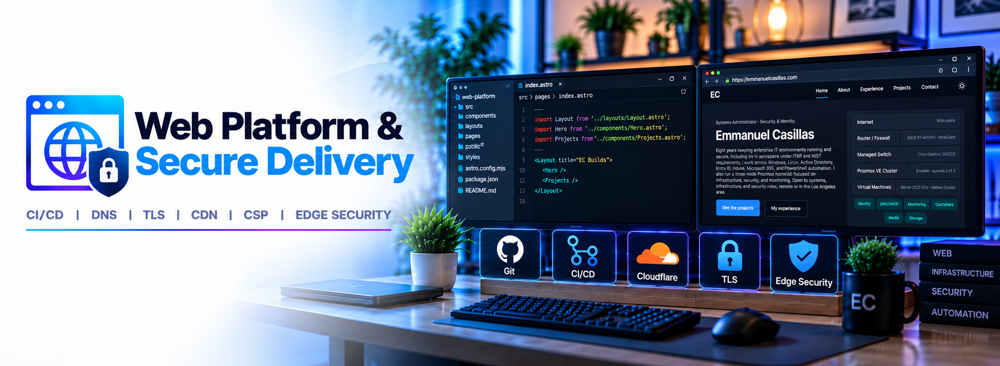
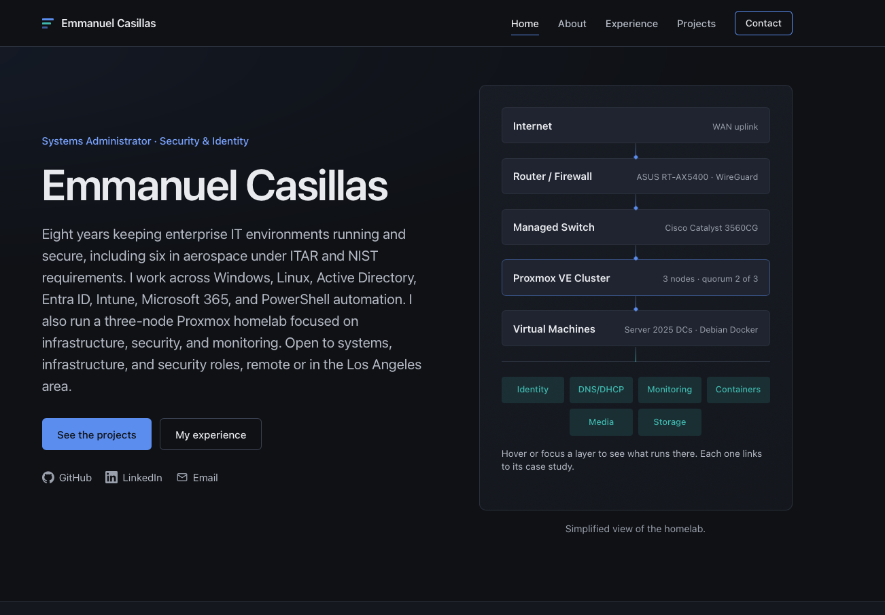

# Web Platform & Secure Delivery

**Status: 🟢 Operational**  



**Live Site: [emmanuelcasillas.com](https://emmanuelcasillas.com)**

Git-driven CI/CD deployment of a personal portfolio website to **Cloudflare Workers (Static Assets)**, with a focus on cloud infrastructure, secure delivery, and production validation.

The application source repository is private. This project documents the infrastructure, deployment workflow, and security configuration using sanitized examples.

### Website Home Page



## How this was built

The website was developed with AI assistance, while I focused on platform architecture, cloud deployment, configuration, security hardening, troubleshooting, and production validation.

| AI-assisted | Owned by me |
| --- | --- |
| Astro components, CSS, config files, audit scripts | Architecture and vendor decisions |
| First drafts of documentation | Review of every change; mobile and desktop testing |
| Headless-browser test runs (axe, CSP) | GitHub and Cloudflare administration, DNS, TLS, zone security settings, deployment, production validation |

## CI/CD pipeline

Deployment is continuous and triggered by Git, not run by hand. Cloudflare Workers Builds is connected to the repository, so a push to `main` builds and deploys automatically. The CI stage is currently the build itself; automated tests in the pipeline are the next step (see Known limits).

```text
Local working copy
  └─ git push → GitHub (main)
       └─ Cloudflare Workers Builds (git-connected)
            ├─ npm install
            ├─ astro build      → static output in dist/ + _headers
            └─ wrangler deploy  → Worker with Static Assets
                 └─ emmanuelcasillas.com (custom domain, Cloudflare DNS + TLS)
```

- **The build is the deployment gate.** If the Astro build fails, nothing is deployed and the previous version keeps serving.
- **Assets only.** The Worker has no script; it serves the static build. Security headers come from `_headers`; requests for paths that don't exist get the custom 404 page.
- **Zone settings live in Cloudflare, not the repo.** That covers DNS, TLS, Bot Fight Mode, Page Shield, Web Analytics and the injected-script features below.
- **Production is checked after every meaningful deploy:** headers, TLS and the CSP console.

## Security controls

| Control | Implementation |
| --- | --- |
| TLS | Cloudflare-managed certificates; HSTS with `includeSubDomains` and `preload` |
| Content-Security-Policy | `script-src 'self'`, one SHA-256 hash for an intentional inline script, and the Cloudflare Web Analytics origin; no `'unsafe-inline'` for scripts |
| Security headers | `nosniff`, `X-Frame-Options: DENY`, `frame-ancestors 'none'`, strict referrer policy, restrictive `Permissions-Policy`, COOP |
| Third-party requests | None from the application; fonts self-hosted. Cloudflare Web Analytics (cookieless) is the only allowed external origin |
| Edge protection | Bot Fight Mode, Page Shield script monitoring and Precursor enabled on the zone |
| Injected-script features | Email Address Obfuscation and Rocket Loader disabled because they rewrite the page and conflict with the CSP |

**Result:** securityheaders.com **A+**.

## Sanitized configuration

`wrangler.jsonc`, the Worker definition (assets only, no script):

```jsonc
{
  "name": "<site-name>",
  "compatibility_date": "2026-10-01",
  "assets": {
    "directory": "./dist",
    "not_found_handling": "404-page",
    "html_handling": "auto-trailing-slash"
  }
}
```

`_headers` (excerpt):

```text
/*
  Strict-Transport-Security: max-age=31536000; includeSubDomains; preload
  X-Content-Type-Options: nosniff
  X-Frame-Options: DENY
  Referrer-Policy: strict-origin-when-cross-origin
  Content-Security-Policy: default-src 'self'; script-src 'self' 'sha256-<hash>' https://static.cloudflareinsights.com; style-src 'self' 'unsafe-inline'; img-src 'self' data:; font-src 'self'; connect-src 'self' https://cloudflareinsights.com; frame-ancestors 'none'; form-action 'self'; base-uri 'self'; object-src 'none'

/_astro/*
  Cache-Control: public, max-age=31536000, immutable
```

## Challenges

**The CDN changed the page.** In production, the CSP blocked scripts that weren't in the local build. Comparing the served HTML with the build output, and checking with `curl`, traced them to Cloudflare features that inject scripts at the edge. I handled each one individually: disabled the features that rewrite the page, allowed the one origin that was needed (Web Analytics), and did not loosen the CSP for the rest.

**Stale DNS blocked the custom domain.** Workers rejected the custom domain because leftover A/CNAME records and forwarding rules from an earlier redirect still occupied the apex. Removing them fixed the conflict. A cached `301` briefly hid the result, so the cutover was confirmed in a private browser session.

**The build machine isn't my machine.** Dependencies installed on macOS didn't include the Linux bundler binding needed when building in a Linux environment. Reinstalling there fixed the build but also stripped the macOS entries from `package-lock.json`, which I reverted before committing so the lockfile stayed valid for both macOS and Cloudflare's Linux builds. Lockfile changes are now checked before every push.

## Validation

- **Delivery:** push to `main` → Workers Build → live on the custom domain; served output compared against the local build
- **Headers and CSP:** zero violations locally across all pages; re-verified in production; securityheaders.com A+
- **Accessibility:** automated axe-core scan (WCAG 2.1 AA) across 17 pages at desktop and phone widths; findings remediated and re-scanned to **0**
- **Post-deploy checks:** structured data, share preview and sitemap submission confirmed

## Known limits and next steps

- **One accepted CSP residual.** For some sessions, Cloudflare injects a dynamic inline challenge script. It can't be hash-allowed, so the CSP blocks it, producing one console error with no effect on the site. Adding `'unsafe-inline'` or a nonce to silence it was rejected.
- **`style-src` permits inline styles;** scripts are strict.
- **No automated test gate.** The axe and CSP checks run on demand. Next: run them in the build so a regression fails the deploy.
- **No preview environment.** Next: per-branch preview deployments before merging to `main`.
- **Rollback not rehearsed.** Workers keeps deployment versions, but I haven't practiced a rollback. Next: a deliberate rollback drill, documented.
- **Clean up `workers.dev`.** Disable the default `workers.dev` route now that the custom domain is settled.

## Related

- [Enterprise homelab](../../README.md): the lab this project is part of
- [emmanuelcasillas.com/projects/web-platform-secure-delivery](https://emmanuelcasillas.com/projects/web-platform-secure-delivery/): the full case study
