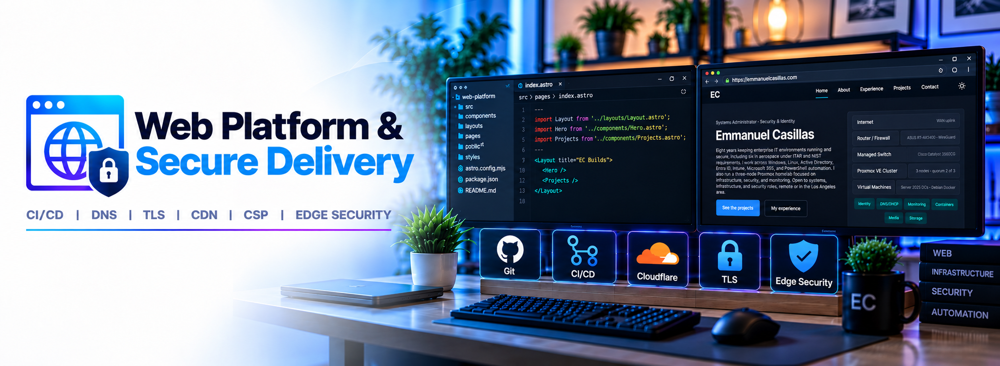

# Web Platform & Secure Delivery

**Status: 🟢 Operational**  



## Overview

Two production websites, both deployed from Git to **Cloudflare Workers (Static Assets)** with no server to run: a personal portfolio, and the documentation site for this homelab. Each push to `main` builds and deploys automatically, and both sites ship strict security headers and a Content-Security-Policy.

## Sites

| Site | What it is | Source | Status |
|---|---|---|---|
| [emmanuelcasillas.com](./portfolio-site.md) | Personal portfolio and project case studies | Private repo, documented with sanitized examples | 🟢 Operational |
| [ec-builds.com](./ec-builds-docs-site.md) | This homelab's documentation, generated from the repo's Markdown | Public, in this repo's `site/` folder | 🟢 Operational |

## Shared Platform

```text
git push → GitHub (main)
  └─ Cloudflare Workers Builds
       ├─ build (Astro)     → static output in dist/ + _headers
       └─ wrangler deploy   → Worker with Static Assets, custom domain on Cloudflare DNS + TLS
```

| Area | Both sites |
|---|---|
| Hosting | Cloudflare Workers with static assets only, no Worker script |
| Deployment | Git-connected Workers Builds; a failed build deploys nothing |
| Security | HSTS, `nosniff`, `X-Frame-Options: DENY`, a restrictive CSP, self-hosted fonts |
| Framework | Astro (the docs site adds Starlight) |

The details, decisions and validation for each site are in its own doc.

## Related

- [Enterprise homelab](../../README.md): the lab this project is part of
- [Infrastructure Automation](../infrastructure-automation/): the docs site pipeline is listed there as existing automation
