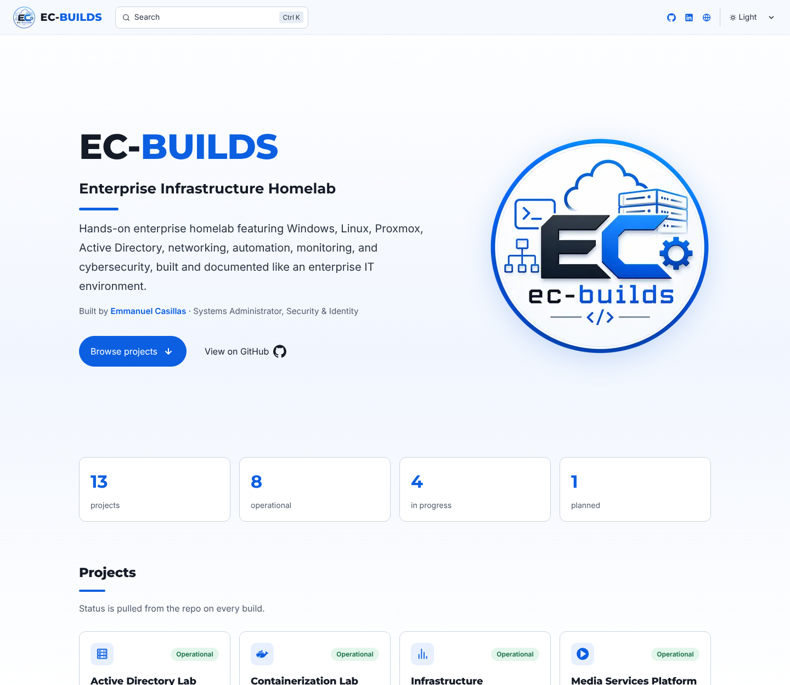
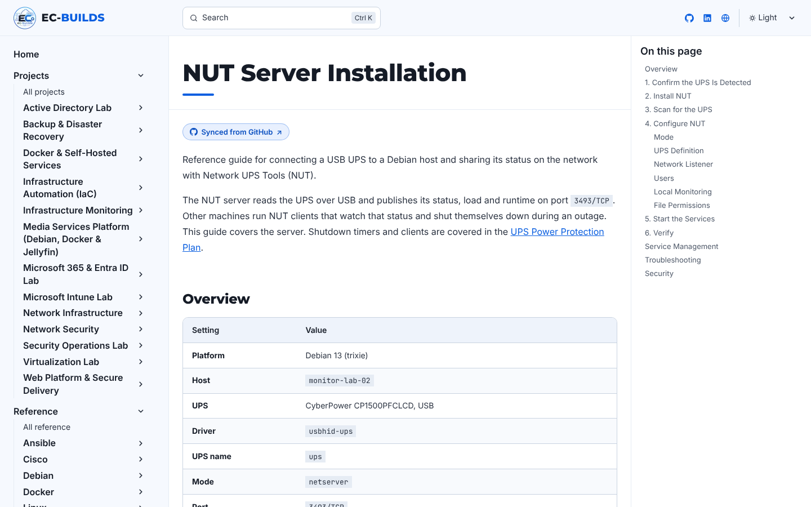
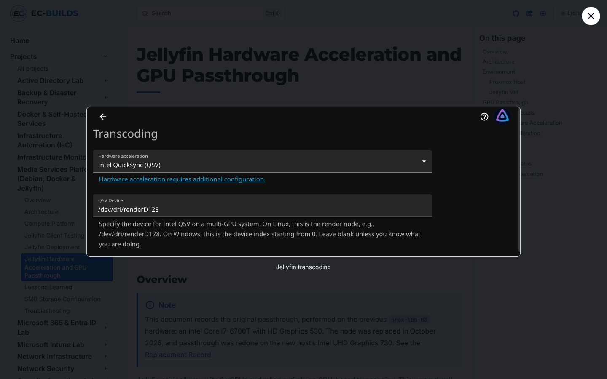

# EC-Builds Docs Site

**Status: 🟢 Operational**

## Overview

**Live Site: [ec-builds.com](https://ec-builds.com)**

The documentation site for this homelab, built with **Astro** and **Starlight** and deployed to **Cloudflare Workers (Static Assets)**. Every page is generated from the Markdown in this repository at build time, so the repo is the single source of truth: update a doc, push, and the site rebuilds with the change.

Unlike the portfolio, the site's source is public, in the repo's [`site/`](../../site/) folder.



*Home page. The project cards and the status counts come from the project table in `projects/README.md`.*

## How this was built

The site was developed with AI assistance, while I focused on the platform, the content model, review and production validation.

| AI-assisted | Owned by me |
| --- | --- |
| Astro and Starlight components, CSS, the sync script, client-side features | Architecture, the docs-as-code approach, what gets published and how |
| First drafts of documentation | Review of every change; desktop and mobile testing |
| Headless-browser checks during development | GitHub and Cloudflare administration, DNS, TLS, deployment, production validation |

## Pipeline

```text
git push → GitHub (main)
  └─ Cloudflare Workers Builds (root directory: site/)
       ├─ npm run build
       │    ├─ sync-repo.mjs   → reads ../projects and ../docs/reference, writes site pages and images
       │    └─ astro build     → static output in dist/ + _headers
       └─ wrangler deploy      → Worker with Static Assets
            └─ ec-builds.com (custom domain, Cloudflare DNS + TLS)
```

- **The build is the deployment gate.** If the sync or the Astro build fails, nothing is deployed and the previous version keeps serving.
- **Assets only.** `wrangler.jsonc` serves `dist/` with no Worker script, and turns off the `workers.dev` address and per-version preview URLs so the site is reachable only at its custom domain.

## Docs as Code

`site/scripts/sync-repo.mjs` runs before every build and turns repo Markdown into Starlight pages. For each doc it:

1. Takes the page title from the first heading and adds the frontmatter Starlight needs.
2. Rewrites links between docs to site URLs, and links to configs, scripts and other repo files to GitHub.
3. Copies the images each page uses, and converts PNG and JPG files over 200 KB to WebP (at most 2000px wide). The large project banners drop from about 1.7 MB to about 100 KB with no visible change, and the originals in the repo aren't touched.
4. Converts GitHub alerts (`> [!NOTE]` and others) into Starlight callouts.
5. Wraps tables so wide ones scroll on small screens, and turns status emoji (🟢 🟡 ⚪) into colored pills.
6. Adds a "Synced from GitHub" link to the source file at the top of each page.

Docs named `TODO-*.md` are published with a **Planned** badge and banner, and anything in an `archive/` folder is skipped. Writes are incremental: only changed pages and images are rewritten, and only outputs whose source is gone are removed.

### Generated Sections

| Section | Generated from |
|---|---|
| Home page project cards and counts | The project table in `projects/README.md` |
| Projects sidebar | One group per project folder, labelled with its README title |
| Reference section | `docs/reference/`, one sidebar group per category, with subfolders flattened into their category |



*A reference doc on the site. Projects and Reference each get a sidebar section, built from the repo's folders.*

## Reading Features

- **Search** across every project and reference page, built into Starlight.
- **Click to zoom** on screenshots and diagrams, on screens 700px and wider. It uses a native `<dialog>`: Esc, the close button, or a click on the image or backdrop closes it, and keyboard users get focus back on the image.
- **Back to top** button on long pages, light and dark themes, and a custom 404 page that shows the address the visitor tried and links back to the projects.



*Click to zoom: the enlarged image with its caption.*

## Security Controls

Headers are set in `site/public/_headers`.

| Control | Implementation |
| --- | --- |
| TLS | Cloudflare-managed certificates; HSTS with `includeSubDomains` |
| Content-Security-Policy | Scripts, styles, images, fonts and connections from the site itself only; `frame-ancestors 'none'`, `object-src 'none'` |
| Security headers | `nosniff`, `X-Frame-Options: DENY`, strict referrer policy, restrictive `Permissions-Policy`, COOP and CORP |
| Third-party requests | None; fonts are self-hosted |

`_headers` (excerpt):

```text
/*
  X-Content-Type-Options: nosniff
  X-Frame-Options: DENY
  Referrer-Policy: strict-origin-when-cross-origin
  Strict-Transport-Security: max-age=31536000; includeSubDomains
  Content-Security-Policy: default-src 'self'; script-src 'self' 'unsafe-inline' 'wasm-unsafe-eval'; style-src 'self' 'unsafe-inline'; img-src 'self' data:; font-src 'self' data:; connect-src 'self'; object-src 'none'; base-uri 'self'; form-action 'self'; frame-ancestors 'none'; upgrade-insecure-requests

/_astro/*
  Cache-Control: public, max-age=31536000, immutable
```

## Design Decisions

- **Sync instead of copying the docs.** Copying would mean two versions to keep in step. Syncing at build time means a doc pushed to GitHub is live after the next build, with its links and images fixed on the way.
- **`'unsafe-inline'` for scripts.** Starlight adds small inline scripts to every page (theme toggle, search) and code blocks use inline styles. Hashing each script would be stricter, but the hashes change whenever Starlight updates and a stale one silently breaks the page. Everything else is locked to the site itself, and the site has no logins, forms or user data. `'wasm-unsafe-eval'` is allowed for the built-in search.
- **Incremental writes.** Deleting and rewriting every page and image on each run made anti-ransomware software flag the bulk file changes. Only changed files are written now.
- **One shared placeholder scheme.** Project and reference docs use the same placeholder hostnames and addresses, so a link from a project page to a reference doc shows the same names on both.

## Validation

- **Delivery:** push to `main` → Workers Build → live on the custom domain.
- **Links:** the sync writes `sync-report.json`, listing every link it couldn't resolve. The repo's GitHub Actions link check (Lychee) also validates internal links and images on every push.
- **Clean build:** a full build from a fresh clone of the repo, with all project and reference pages and no unresolved links.

## Known Limits and Next Steps

- **Unresolved links don't fail the build.** They're reported in `sync-report.json` but still deploy. Next: fail the build when the report isn't empty.
- **No automated visual or accessibility tests.** Next: an axe scan and a few screenshot checks in the build, as planned for the portfolio.
- **HSTS isn't preloaded** yet, unlike the portfolio.

## Related

- [Web Platform & Secure Delivery](./README.md): the lab this site is part of
- [emmanuelcasillas.com Portfolio Site](./portfolio-site.md): the lab's other site
- [Infrastructure Automation](../infrastructure-automation/): the site pipeline as part of the lab's existing automation
